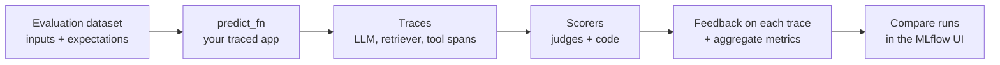

# MLflow Scorers, Judges, SME Feedback, and Agent Monitoring

## Overview

The 2026 exam guide rewrote most of the Evaluation and Monitoring domain around **MLflow 3 GenAI evaluation**: *"Evaluate agent performance using MLflow scoring and tracing"*, *"Identify evaluation judges that require ground truth"*, *"Use Databricks custom Scorers for evaluating agents and LLMs"*, *"Incorporate SME feedback to improve agent performance"*, and the Agent Monitoring half of *"Use inference tables and Agent Monitoring to track a live LLM endpoint."* In MLflow 3 a **scorer** receives a **trace**, assesses it, and attaches **feedback** — and the same scorer runs in `mlflow.genai.evaluate()` during development and in production monitoring after release.

> [!abstract]
>
> - **`mlflow.genai.evaluate(data, predict_fn, scorers)`** — runs your app on an evaluation dataset, traces every call, and scores each trace
> - **Built-in judges** — `Correctness`, `RetrievalSufficiency`, `ToolCallCorrectness` **need ground truth**; `RelevanceToQuery`, `RetrievalRelevance`, `RetrievalGroundedness`, `Safety`, `Guidelines`, `ToolCallEfficiency` do not
> - **Custom scorers** — `@scorer`-decorated Python functions for deterministic checks, and `make_judge()` for custom LLM judges
> - **SME feedback** — experts label traces in the Review App, feedback is logged with `mlflow.log_feedback()`, and judges are **aligned** to expert judgment with `judge.align()`
> - **Agent Monitoring** — `scorer.register()` then `.start(sampling_config=...)` scores a sample of live traces continuously

> [!tip] What the Exam Tests
>
> - Which judges need **expectations** (ground truth) and therefore cannot run on unlabeled production traffic
> - When to write a **code-based scorer** vs a **custom LLM judge** vs a built-in judge
> - How to make SME feedback reliable (rubrics, calibration) and feed it back into evaluation (the official sample question)
> - The register → start pattern and sampling for production monitoring

---

> [!note] Platform update (Oct 2026)
> The MLflow 2 APIs in [Evaluating LLM Applications](./01-evaluation-llm-apps.md) — `mlflow.evaluate()` with `mlflow.metrics.genai` and `model_type="databricks-agent"` — are the earlier generation. Current Databricks documentation uses MLflow 3: `mlflow.genai.evaluate()`, scorers from `mlflow.genai.scorers`, `make_judge()`, and production monitoring (Beta) ([Scorers and LLM judges](https://docs.databricks.com/aws/en/mlflow3/genai/eval-monitor/concepts/scorers)). The legacy Review App feedback model and request/assessment logs are deprecated in favour of `mlflow.log_feedback()` ([Deploy an agent, Model Serving](https://docs.databricks.com/aws/en/agents/custom-agents/model-serving/deploy-agent)).

## How MLflow 3 evaluation works



1. **Dataset** — rows with `inputs` and, optionally, `expectations` (`expected_response`, `expected_facts`, guidelines)
2. **`predict_fn`** — your application; MLflow calls it per row and captures a **trace** (spans for each LLM, retriever, and tool step)
3. **Scorers** — each reads what it needs from the trace and returns **feedback** (pass/fail, number, category) with a rationale
4. **Results** — per-trace feedback and aggregate metrics in an MLflow run; compare versions side by side

```python
import mlflow
from mlflow.genai.scorers import Correctness, RelevanceToQuery, RetrievalGroundedness, Safety, Guidelines

eval_dataset = [
    {
        "inputs": {"question": "Can I return an opened item?"},
        "expectations": {"expected_facts": ["Opened items can be returned within 15 days."]},
    },
    # ...
]

results = mlflow.genai.evaluate(
    data=eval_dataset,
    predict_fn=support_agent,  # traced application function
    scorers=[
        Correctness(),            # needs expectations
        RelevanceToQuery(),
        RetrievalGroundedness(),
        Safety(),
        Guidelines(name="cites_policy", guidelines="The answer must cite the policy section."),
    ],
)
```

**Tracing is what makes this agent-aware:** because scorers receive the whole trace, they can judge retrieval (retriever spans), tool use (tool spans), and the final answer separately — and you can open any failing trace to see which step went wrong.

## Which judges need ground truth?

| Built-in judge | Evaluates | Needs ground truth? |
| :--- | :--- | :---: |
| `RelevanceToQuery` | Is the response relevant to the request? | No |
| `RetrievalRelevance` | Is the retrieved context relevant to the request? | No |
| `RetrievalGroundedness` | Is the response grounded in the retrieved context (no hallucination)? | No |
| `Safety` | Is the content free of harmful or toxic material? | No |
| `Guidelines` | Does the response meet natural-language rules you supply? | No |
| `ExpectationsGuidelines` | Does the response meet **per-example** rules stored in expectations? | No (needs guidelines in expectations) |
| `ToolCallEfficiency` | Are tool calls efficient, without redundancy? | No |
| `Correctness` | Is the response correct versus the expected answer / facts? | **Yes** |
| `RetrievalSufficiency` | Does the context contain everything needed for the expected facts? | **Yes** |
| `ToolCallCorrectness` | Are the tool calls and arguments correct for the request? | **Yes** |

Multi-turn judges (`ConversationCompleteness`, `UserFrustration`, `KnowledgeRetention`, `ConversationalGuidelines`, `ConversationalRoleAdherence`, `ConversationalSafety`, `ConversationalToolCallEfficiency`) score a whole **session** and do not need ground truth. Source: [Built-in LLM judges](https://docs.databricks.com/aws/en/mlflow3/genai/eval-monitor/concepts/judges/).

> [!important]
> Judges that need ground truth can only run where you have **labels** — a curated evaluation dataset. On live production traffic, rely on judges that do not need ground truth, plus code-based scorers.

Each judge uses a Databricks-hosted LLM by default; change it with `model=`, for example `Correctness(model="databricks:/databricks-gpt-5-mini")`.

## Custom scorers

Choose the lightest option that fits ([Scorers and LLM judges](https://docs.databricks.com/aws/en/mlflow3/genai/eval-monitor/concepts/scorers)):

| Approach | Use for | Example |
| :--- | :--- | :--- |
| **Built-in judge** | Common quality dimensions | `Safety()`, `Correctness()` |
| **`Guidelines` judge** | Pass/fail natural-language rules | "Must not promise refunds" |
| **Custom LLM judge** (`make_judge`) | Domain-specific criteria, graded scales, categorical outputs | Product-description quality: excellent / good / fair / poor |
| **Code-based scorer** (`@scorer`) | Deterministic checks — exact match, JSON validity, length, latency, citation present | `contains_citation` |

### Code-based scorer

A `@scorer` function may declare any of the keyword arguments `inputs`, `outputs`, `expectations`, and `trace`, and may return a `bool`, `int`, `float`, `str`, a `Feedback`, or a list of `Feedback` ([MLflow custom scorers](https://mlflow.org/docs/latest/genai/eval-monitor/scorers/custom/)).

```python
from mlflow.genai.scorers import scorer
from mlflow.entities import Feedback

@scorer
def contains_citation(outputs: str) -> str:
    return "yes" if "[source]" in outputs else "no"

@scorer
def within_length(outputs: str) -> Feedback:
    words = len(outputs.split())
    return Feedback(value=words <= 120, rationale=f"{words} words")
```

### Custom LLM judge

```python
from mlflow.genai.judges import make_judge

product_quality = make_judge(
    name="product_quality",
    instructions=(
        "Evaluate if the product description in {{ outputs }} "
        "is accurate and helpful for the query in {{ inputs }}. "
        "Rate as: excellent, good, fair, or poor"
    ),
    model="databricks:/databricks-gpt-oss-120b",
)
```

For production monitoring, use built-in judges or `@scorer` functions; **class-based `Scorer` subclasses are not supported** there, and `@scorer` functions must be defined and registered from a Databricks notebook ([Code-based scorers](https://docs.databricks.com/aws/en/mlflow3/genai/eval-monitor/custom-scorers)).

## Incorporating SME feedback

Subject-matter experts define what "good" means. MLflow records their judgment **on the trace** ([Collect feedback and build datasets](https://docs.databricks.com/aws/en/mlflow3/genai/human-feedback/)):

| Feedback form | Means | Used for |
| :--- | :--- | :--- |
| **Feedback** | An assessment of the app's actual output (was it good?) | Measuring quality, aligning judges |
| **Expectation** | The correct, ground-truth output | Turning a trace into an evaluation test case |

How SMEs contribute:

- **Review App** — experts chat with the agent or label existing traces; Databricks now recommends **review queues** (Beta) that route traces one at a time
- **Trace UI** — *Assess → Add expectation*, then *Add to dataset* turns a real interaction into a regression test
- **Programmatic** — `mlflow.log_feedback(trace_id=..., name=..., value=..., rationale=..., source=AssessmentSource(source_type=AssessmentSourceType.HUMAN, ...))`
- **Agent Bricks** — Knowledge Assistant and Supervisor accept SME **guidelines** directly

### Make SME feedback reliable

The official sample question describes four experts whose ratings disagree. The fix is process, not averaging:

1. **Define clear rubrics** for each dimension (what is *factually accurate*, *complete*, *useful*)
2. **Calibrate SMEs** on shared examples until they agree
3. Use the **aligned judgments** in `mlflow.genai.evaluate()` — as expectations and as alignment data for judges

Averaging noisy ratings, discarding disputed cases, or trusting an un-calibrated LLM judge as the source of truth do not fix the root cause.

### Align a judge with expert feedback

Judge alignment teaches a built-in or custom judge to agree with your experts ([Align judges with human feedback](https://docs.databricks.com/aws/en/mlflow3/genai/eval-monitor/align-judges)):

1. Run the judge on traces to get baseline assessments
2. Experts log feedback **under the same name** as the judge (for example `relevance_to_query` or `product_quality`)
3. Call `aligned_judge = judge.align(traces)` — the default optimizer is MemAlign; about 10 traces work, 50–100 work better

Databricks reports 30–50 % better agreement with human assessments after alignment. Session-level (multi-turn) judges cannot be aligned. Requires MLflow 3.14.0 or above.

## Agent Monitoring: scoring live traffic

Production monitoring (Beta) runs scorers on traces from a deployed agent, on a sample of traffic, and attaches the results as feedback ([Set up production monitoring](https://docs.databricks.com/aws/en/mlflow3/genai/eval-monitor/production-monitoring)).

```python
from mlflow.genai.scorers import Safety, RelevanceToQuery, ScorerSamplingConfig

safety = Safety().register(name="safety")
safety = safety.start(sampling_config=ScorerSamplingConfig(sample_rate=1.0))  # 100 % for critical checks

relevance = RelevanceToQuery().register(name="relevance")
relevance = relevance.start(sampling_config=ScorerSamplingConfig(sample_rate=0.2))
```

| Setting | Guidance |
| :--- | :--- |
| `sample_rate` | `1.0` for safety and security checks; lower for expensive judges |
| `filter_string` | Score only matching traces (same syntax as `mlflow.search_traces()`) |
| Limit | At most **20 scorers** per experiment for continuous monitoring |
| Prerequisites | Traces logged to an MLflow experiment; tested scorers; a serverless budget policy; a SQL warehouse ID when traces are stored in Unity Catalog |

Agent Monitoring watches **quality**. Pair it with **inference tables** (request/response payloads) and **usage tables** (tokens, latency, cost) for the operational view — see [Online Monitoring](./02-online-monitoring.md) and [AI Gateway: Usage Tracking and Cost Control](./04-ai-gateway-usage-and-cost-control.md).

## Choosing an LLM from quantitative evaluation metrics

Exam guide bullet: *"Select an LLM choice (size and architecture) based on a set of quantitative evaluation metrics."* Evaluate each candidate on the **same dataset and scorers**, discard any that fail safety, keep those above the quality threshold, then choose the cheapest and fastest. The size and architecture trade-offs are in [Model Selection and Response Quality](../01-application-development/06-model-selection-and-response-quality.md).

## Use Cases

- **Release gate** — CI runs `mlflow.genai.evaluate()` with `Correctness` and `RetrievalGroundedness`; a version ships only if both beat production
- **Brand-voice check** — a `Guidelines` judge enforces "never mention competitor names"; a `@scorer` checks answer length
- **Expert-aligned quality** — pharmacists label 80 traces; the aligned `product_quality` judge then scores thousands of production traces
- **Live safety watch** — `Safety` monitors 100 % of traffic; `RelevanceToQuery` monitors 20 %

## Common Issues & Errors

### Correctness Scores Missing in Production

**Scenario:** A monitoring job registered `Correctness`, but no useful scores appear.
**Fix:** `Correctness` needs expectations (ground truth), which live traffic does not have. Use `RelevanceToQuery`, `RetrievalGroundedness`, `Safety`, `Guidelines`, or code-based scorers in production.

### Judge Alignment Has No Effect

**Scenario:** `align()` does not change judge behaviour.
**Fix:** The human feedback was logged under a different name. The feedback name must exactly match the judge's `name`.

### Class-Based Scorer Fails to Register for Monitoring

**Scenario:** A `Scorer` subclass works in `evaluate()` but cannot be used for monitoring.
**Fix:** Rewrite it as a `@scorer`-decorated function defined in a Databricks notebook.

## Exam Tips

> [!tip] Exam Tips
>
> - **Ground truth needed:** `Correctness`, `RetrievalSufficiency`, `ToolCallCorrectness`. Everything else in the built-in list scores without labels.
> - **Deterministic rule → `@scorer`**; **subjective domain criterion → `make_judge()` or `Guidelines`**.
> - **SME disagreement → rubrics + calibration**, then use the aligned judgments in `mlflow.genai.evaluate()`.
> - **Agent Monitoring** = `register()` + `start(sampling_config=ScorerSamplingConfig(sample_rate=...))`, max 20 scorers per experiment.
> - The same scorers run in evaluation and monitoring, so results stay comparable.

## Key Takeaways

- MLflow 3 evaluation runs your traced app over a dataset and attaches scorer feedback to every trace
- Know which built-in judges need ground truth; only those without it run on unlabeled production traffic
- Custom scorers come in two forms: code-based `@scorer` functions and custom LLM judges via `make_judge()`
- SME feedback lives on traces, builds evaluation datasets, and aligns judges; rubrics and calibration make it reliable
- Agent Monitoring samples live traces and scores them continuously with the same scorers

## Related Topics

- [Evaluating LLM Applications](./01-evaluation-llm-apps.md)
- [Online Monitoring](./02-online-monitoring.md)
- [AI Gateway: Usage Tracking and Cost Control](./04-ai-gateway-usage-and-cost-control.md)
- [Agentic Systems with MLflow, Agent Framework, and Genie](../01-application-development/05-agentic-systems-mlflow-and-genie.md)

## Official Documentation

- [Scorers and LLM judges](https://docs.databricks.com/aws/en/mlflow3/genai/eval-monitor/concepts/scorers)
- [Built-in LLM judges](https://docs.databricks.com/aws/en/mlflow3/genai/eval-monitor/concepts/judges/)
- [Code-based scorers](https://docs.databricks.com/aws/en/mlflow3/genai/eval-monitor/custom-scorers)
- [Align judges with human feedback](https://docs.databricks.com/aws/en/mlflow3/genai/eval-monitor/align-judges)
- [Collect feedback and build datasets](https://docs.databricks.com/aws/en/mlflow3/genai/human-feedback/)
- [Set up production monitoring](https://docs.databricks.com/aws/en/mlflow3/genai/eval-monitor/production-monitoring)

---

**[← Previous: Online Monitoring](./02-online-monitoring.md) | [↑ Back to Evaluation and Monitoring](./README.md) | [Next: AI Gateway: Usage Tracking and Cost Control](./04-ai-gateway-usage-and-cost-control.md) →**
