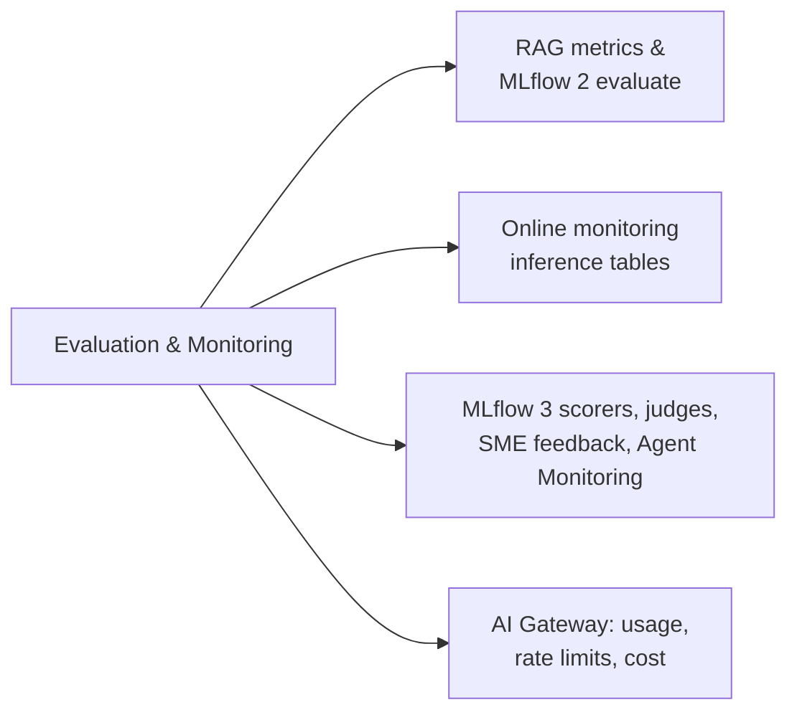

# Evaluation and Monitoring (12 % of Exam)

Section 6 of the exam guide: measuring whether a GenAI application works — before release (MLflow evaluation with judges and scorers, SME feedback) and after release (inference tables, usage tables, Agent Monitoring, rate limits, and cost controls through AI Gateway).

## Topics Overview

## Section Contents

| File | Topic | Priority |
| :--- | :--- | :--- |
| [01-evaluation-llm-apps.md](./01-evaluation-llm-apps.md) | RAG metrics (faithfulness, relevance, context precision/recall), MLflow 2 `mlflow.evaluate()`, RAGAS, Review App | High |
| [02-online-monitoring.md](./02-online-monitoring.md) | What to monitor; queries on inference tables and system tables; alerting via DBSQL + Lakeflow Jobs | High |
| [03-mlflow-scorers-judges-and-feedback.md](./03-mlflow-scorers-judges-and-feedback.md) | `mlflow.genai.evaluate()`, judges that need ground truth, custom scorers, SME feedback and judge alignment, Agent Monitoring *(2026 guide)* | High |
| [04-ai-gateway-usage-and-cost-control.md](./04-ai-gateway-usage-and-cost-control.md) | AI Gateway inference tables, usage tables, rate limits, cost levers, traffic splitting *(moved here from Assembling; 2026 guide)* | High |

## Exam Guide Coverage

| Exam guide bullet (Section 6) | Where it is covered |
| :--- | :--- |
| Select an LLM choice (size and architecture) based on a set of quantitative evaluation metrics | [03](./03-mlflow-scorers-judges-and-feedback.md#choosing-an-llm-from-quantitative-evaluation-metrics), [Model Selection](../01-application-development/06-model-selection-and-response-quality.md#size-and-architecture-trade-offs) |
| Select key metrics to monitor for a specific LLM deployment scenario | [02](./02-online-monitoring.md) |
| Evaluate agent performance using MLflow scoring and tracing | [03](./03-mlflow-scorers-judges-and-feedback.md#how-mlflow-3-evaluation-works) |
| Use inference logging to assess deployed RAG application performance | [02](./02-online-monitoring.md), [04](./04-ai-gateway-usage-and-cost-control.md#inference-tables-tracking-what-a-live-endpoint-does) |
| Use Databricks features to control LLM costs | [04](./04-ai-gateway-usage-and-cost-control.md#controlling-llm-costs) |
| Use inference tables and Agent Monitoring to track a live LLM endpoint | [03](./03-mlflow-scorers-judges-and-feedback.md#agent-monitoring-scoring-live-traffic), [04](./04-ai-gateway-usage-and-cost-control.md) |
| Identify evaluation judges that require ground truth | [03](./03-mlflow-scorers-judges-and-feedback.md#which-judges-need-ground-truth) |
| Use AI Gateway (Inference Tables, Usage Tables, and rate limiting) to track an LLM or agent deployed via Agent Framework | [04](./04-ai-gateway-usage-and-cost-control.md) |
| Use Databricks custom Scorers for evaluating agents and LLMs | [03](./03-mlflow-scorers-judges-and-feedback.md#custom-scorers) |
| Incorporate SME feedback to improve agent performance | [03](./03-mlflow-scorers-judges-and-feedback.md#incorporating-sme-feedback) |

## Key Concepts

| Concept | Why it matters |
| :--- | :--- |
| **`mlflow.genai.evaluate()`** | MLflow 3: runs your traced app on a dataset and scores every trace |
| **Ground-truth judges** | `Correctness`, `RetrievalSufficiency`, `ToolCallCorrectness` need expectations; others do not |
| **Custom scorers** | `@scorer` for deterministic checks; `make_judge()` for custom LLM judges |
| **SME feedback** | Rubrics + calibration, logged on traces, used to align judges |
| **Agent Monitoring** | Scorers registered on the experiment score a sample of live traces |
| **Inference tables** | Request/response payloads of every call in a UC Delta table |
| **Usage tables + rate limits** | Tokens and requesters per call; QPM/TPM caps to control cost |

## Related Resources

- [MLflow Basics (shared)](../../../shared/fundamentals/mlflow-basics.md)
- [MLflow GenAI evaluation and monitoring (Databricks)](https://docs.databricks.com/aws/en/mlflow3/genai/eval-monitor/)
- [Inference tables for serving endpoints](https://docs.databricks.com/aws/en/ai-gateway/inference-tables-serving-endpoints)
- [Governance — the audit trail](../06-governance/01-governance-overview.md#the-audit-trail) — same tables, governance lens (audit, PII exposure checks)

---

**[← Previous: Data Preparation](../04-data-preparation/README.md) | [↑ Back to GenAI Engineer Associate](../README.md) | [Next: Governance](../06-governance/README.md) →**
