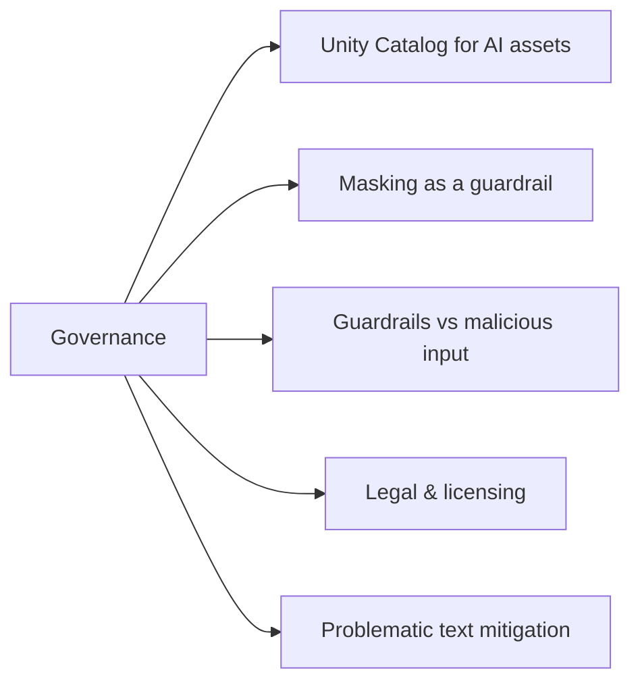

# Governance (8 % of Exam)

> [!important]
> Section 5 of the exam guide. Governance covers masking techniques used as guardrails, guardrails against malicious user inputs, legal and licensing requirements for data sources, and mitigating problematic text in source data — all built on Unity Catalog governance of AI assets. AI Gateway *monitoring* (inference tables, usage tables, rate limits) is tested under [Evaluation and Monitoring](../05-evaluation-and-monitoring/README.md).

## Topics Overview

## Section Contents

| File | Topic | Priority |
| :--- | :--- | :--- |
| [01-governance-overview.md](./01-governance-overview.md) | UC for AI assets, masking (ingestion, column masks, gateway `MASK`), guardrails against jailbreaks and prompt injection, licensing, problematic text, audit trail | High |

## Exam Guide Coverage

| Exam guide bullet (Section 5) | Where it is covered |
| :--- | :--- |
| Use masking techniques as guard rails to meet a performance objective | [01](./01-governance-overview.md#layer-2--masking-techniques-as-guardrails) |
| Select guardrail techniques to protect against malicious user inputs to a Gen AI application | [01](./01-governance-overview.md#layer-3--guardrails-against-malicious-user-inputs) |
| Use legal/licensing requirements for data sources to avoid legal risk | [01](./01-governance-overview.md#layer-4--legal-and-licensing-requirements-for-data-sources) |
| Recommend an alternative for problematic text mitigation in a data source feeding a GenAI application | [01](./01-governance-overview.md#layer-5--mitigating-problematic-text-in-source-data) |

## Key Concepts

| Concept | Why it matters |
| :--- | :--- |
| **UC for AI assets** | Tables, volumes, indexes, models, functions, prompts, and MCP services share one `GRANT` / `REVOKE` model |
| **Mask before embedding** | PII in an index can be retrieved into any prompt; masking at ingestion also costs nothing at query time |
| **Mask vs block** | Masking keeps requests answerable; blocking enforces zero tolerance |
| **Layered guardrails** | Safety filters, injection-resistant prompts, least-privilege tools, rate limits, human approval |
| **Licensing and terms** | Check data and model licences, terms of service, and privacy basis before ingestion |
| **Fix problematic text at the source** | Exclude, replace, or redact upstream; output filters are the backstop |

## Related Resources

- [Unity Catalog Basics (shared)](../../../shared/fundamentals/unity-catalog-basics.md)
- [Unity Catalog cheat sheet (shared)](../../../shared/cheat-sheets/unity-catalog-quick-ref.md)
- [AI governance with Unity Gateway](https://docs.databricks.com/aws/en/ai-gateway/)
- [Governance for model serving endpoints (legacy AI Gateway)](https://docs.databricks.com/aws/en/ai-gateway/overview-serving-endpoints)

---

**[← Previous: Evaluation and Monitoring](../05-evaluation-and-monitoring/README.md) | [↑ Back to GenAI Engineer Associate](../README.md)**
