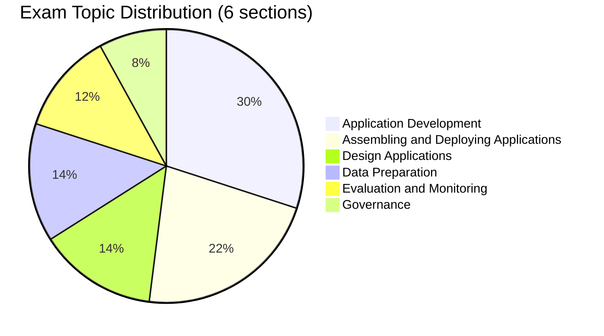

# Databricks Generative AI Engineer Associate

> [!important]
> **What changed in the current exam guide (exam published March 18, 2026; PDF re-issued as "August 2026")**
>
> - **Six weighted sections**: Design Applications 14 %, Data Preparation 14 %, Application Development 30 %, Assembling and Deploying Applications 22 %, Governance 8 %, Evaluation and Monitoring 12 %. The August 2026 PDF prints these weights inside the guide; the skill bullets are identical to the March 2026 PDF
> - **Question format**: 45 scored *multiple-choice and multiple-selection* questions, plus up to 10 unscored items — expect "select TWO" questions
> - **New skills**: **Agent Bricks** (Knowledge Assistant, Multiagent Supervisor, Information Extraction), **MCP servers** (managed, external, custom), **multi-agent systems with Genie**, MLflow + **Agent Framework** for agentic systems, **judges that require ground truth**, **custom Scorers**, **SME feedback**, **Agent Monitoring**, prompt version control, persistent memory, and agent user interfaces (Apps, Slack, Teams)
> - **AI Gateway moved**: "AI Gateway (Inference Tables, Usage Tables, and rate limiting)" is tested under **Evaluation and Monitoring**, not Governance
> - Pass / fail — **the exam guide does not publish a numeric passing score**
>
> Source of truth: [exam guide PDF (August 2026 edition)](https://www.databricks.com/sites/default/files/2026-10/databricks-certified-gen-ai-associate-exam-guide-august-2026.pdf) and the [certification page](https://www.databricks.com/learn/certification/genai-engineer-associate). The folder structure in this guide matches the six sections 1 : 1 (folders are ordered by study flow, not by section number).

> [!note] Platform update (Oct 2026)
> This certification is affected more than any other by late-2026 product changes. The exam still tests the March 2026 product surface, so the topic files teach that surface and flag what has moved on:
>
> - **Knowledge Assistant** and **Supervisor Agent** became *legacy* on 2026-10-12; the **Supervisor API** reached end of life on 2026-09-30 → [Agent Bricks](./03-design-applications/03-agent-bricks.md)
> - Agents on **Model Serving** and the **MLflow AgentServer** are *legacy* since 2026-10-05; new agents use the **Agent Bricks CLI** (Beta) and **Agent Runtime** on Databricks Apps → [Compound AI Apps](./02-assembling-and-deploying-apps/03-compound-ai-apps.md)
> - `ChatAgent` / `ChatModel` are legacy authoring interfaces → **`ResponsesAgent`** → [Agentic Systems](./01-application-development/05-agentic-systems-mlflow-and-genie.md)
> - **Genie Spaces** are now **Genie Agents** (2026-07-08); **Vector Search** is now **AI Search** (2026-06-01); AI Gateway's successor is **Unity Gateway**
> - MCP: built-in services are called through Unity Gateway at `https://<host>/ai-gateway/mcp-services/<name>`; the bare `/api/2.0/mcp/genie` endpoint retires 2026-10-31 → [MCP Servers](./02-assembling-and-deploying-apps/04-mcp-servers.md)

## Exam Overview

| Detail              | Information                                           |
| ------------------- | ----------------------------------------------------- |
| **Certification**   | Databricks Certified Generative AI Engineer Associate |
| **Exam guide**      | Exam published / guide updated March 18, 2026 — [PDF, August 2026 edition](https://www.databricks.com/sites/default/files/2026-10/databricks-certified-gen-ai-associate-exam-guide-august-2026.pdf) |
| **Scored questions**| 45 multiple-choice and multiple-selection             |
| **Unscored items**  | Up to 10 (not identified; extra time already included) |
| **Duration**        | 90 minutes                                            |
| **Result**          | Pass / fail (no numeric threshold in the exam guide)  |
| **Languages**       | English, Japanese, Portuguese (BR), Korean            |
| **Code in stems**   | Python (SQL for non-ML data manipulation)             |
| **Test aids**       | None allowed                                          |
| **Experience**      | 6+ months hands-on with the exam outline on Databricks (recommended) |
| **Recertification** | Every 2 years — see [Renewal Guide](../../shared/appendix/renewal-guide.md) |
| **Cost**            | $200 USD plus applicable taxes                        |
| **Delivery**        | Online proctored (exam guide); the certification page lists online or test center |

## Exam Domain Weights (official)

| Exam guide section | Weight |
| :--- | :---: |
| Section 1: Design Applications | 14 % |
| Section 2: Data Preparation | 14 % |
| Section 3: Application Development | 30 % |
| Section 4: Assembling and Deploying Applications | 22 % |
| Section 5: Governance | 8 % |
| Section 6: Evaluation and Monitoring | 12 % |

## Study Topics

Each folder's `README.md` has an **Exam Guide Coverage** table that maps every bullet of its section to the file that teaches it.

| Folder | Exam guide section | Weight | Focus |
| :--- | :---: | :---: | :--- |
| [01 — Application Development](./01-application-development/README.md) | 3 | 30 % | Prompt engineering, chains/agents, retrieval augmentation, vector search runtime, `ResponsesAgent` + MLflow Tracing, multi-agent with Genie, model selection |
| [02 — Assembling and Deploying Applications](./02-assembling-and-deploying-apps/README.md) | 4 | 22 % | Foundation Model APIs, MLflow logging + UC registry, compound apps, MCP servers, access control, `ai_query()`, memory, CI/CD, Prompt Registry, UIs |
| [03 — Design Applications](./03-design-applications/README.md) | 1 | 14 % | RAG design patterns, I/O specs, model tasks, chain components, tool ordering, Agent Bricks |
| [04 — Data Preparation](./04-data-preparation/README.md) | 2 | 14 % | Source selection, extraction packages, filtering, chunking, embeddings, Vector Search indexes, retrieval metrics, re-ranking |
| [05 — Evaluation and Monitoring](./05-evaluation-and-monitoring/README.md) | 6 | 12 % | MLflow 3 judges and custom scorers, SME feedback, Agent Monitoring, inference tables, AI Gateway usage tables and rate limits, cost control |
| [06 — Governance](./06-governance/README.md) | 5 | 8 % | UC for AI assets, masking as guardrails, guardrails against malicious input, licensing, problematic text mitigation |

### Practice & Resources

| Resource                                                        | Description                              |
| --------------------------------------------------------------- | ---------------------------------------- |
| [Practice Questions](./resources/practice-questions/README.md)  | Topic-specific practice questions, including *(2026 guide)* sets |
| [Mock Exam 1](./resources/mock-exam/README.md)                  | Full-length practice exam                |
| [Mock Exam 2](./resources/mock-exam-2/README.md)                | Alternative practice exam                |
| [Exam Tips](./resources/exam-tips.md)                           | Exam strategies and tips                 |
| [Final Review](./resources/final-review.md)                     | Exam-morning cram scan                   |
| [Official Links](./resources/official-links.md)                 | Documentation and resources              |

## Interview Preparation

After completing this certification, explore:

- [Interview Prep Resource](../../shared/interview-prep/README.md) - Gen AI system design, RAG architecture, and LLM applications

## Key Technologies

- **Mosaic AI Model Serving + Foundation Model APIs** — hosted LLMs and embedding models, pay-per-token or provisioned throughput
- **Mosaic AI Vector Search** (now **Databricks AI Search**) — managed vector and hybrid search over Delta tables
- **Agent Framework + MLflow 3** — `ResponsesAgent`, MLflow Tracing, `mlflow.genai.evaluate()`, scorers, production monitoring
- **Agent Bricks** — Knowledge Assistant, Multi-Agent Supervisor, Information Extraction (plus the new Agent Bricks CLI)
- **Genie Agents** (formerly Genie Spaces) — governed natural-language access to structured data
- **MCP** — managed, external, and custom servers for agent tools
- **AI Gateway / Unity Gateway** — inference tables, usage tables, rate limits, guardrails
- **Unity Catalog** — governance for tables, indexes, models, functions, prompts, and MCP services
- **LangChain / LangGraph** — LLM application and agent frameworks

## Prerequisites

Review these shared fundamentals:

- [Databricks Workspace](../../shared/fundamentals/databricks-workspace.md)
- [Unity Catalog Basics](../../shared/fundamentals/unity-catalog-basics.md)
- [RAG / Vector Search Basics](../../shared/fundamentals/rag-vector-search-basics.md)
- [MLflow Basics](../../shared/fundamentals/mlflow-basics.md)

Hands-on practice: the exam guide suggests tasks small enough for [Databricks Free Edition](https://docs.databricks.com/aws/en/getting-started/free-edition). Community Edition has been retired. Free Edition does not support Knowledge Assistant and allows one AI Search endpoint ([limitations](https://docs.databricks.com/aws/en/getting-started/free-edition-limitations)).

## Study Progress Tracker

- [ ] Translate business goals into I/O specs; pick model tasks, chain components, and tool order
- [ ] Know when to use Agent Bricks: Knowledge Assistant, Multi-Agent Supervisor, Information Extraction
- [ ] Prepare data: source selection, extraction packages, filtering, chunking, Delta + Vector Search indexes, retrieval metrics, re-ranking
- [ ] Build chains and agents; author with `ResponsesAgent`; trace with MLflow; connect Genie in multi-agent systems
- [ ] Select LLMs and embedding models from attributes, model cards, and experiment metrics
- [ ] Deploy: register in UC, serve, control access (passthrough / OBO / secrets), `ai_query()` batch inference
- [ ] Integrate managed, external, and custom MCP servers
- [ ] Operate: persistent memory, CI/CD, Prompt Registry aliases, Apps / Slack / Teams interfaces
- [ ] Evaluate with MLflow 3 judges and custom scorers; know which judges need ground truth; use SME feedback
- [ ] Monitor with inference tables, usage tables, rate limits, and Agent Monitoring; control LLM costs
- [ ] Govern: masking as guardrails, defences against malicious input, licensing, problematic text

## Official Resources

- [Databricks Certification Page](https://www.databricks.com/learn/certification/genai-engineer-associate)
- [Exam guide PDF (August 2026 edition)](https://www.databricks.com/sites/default/files/2026-10/databricks-certified-gen-ai-associate-exam-guide-august-2026.pdf)
- [Develop agents on Databricks (Agent Bricks)](https://docs.databricks.com/aws/en/agents/)
- [Databricks AI Search (formerly Vector Search)](https://docs.databricks.com/aws/en/ai-search/ai-search)
- [Model Serving Documentation](https://docs.databricks.com/aws/en/machine-learning/model-serving/)
- [MLflow GenAI evaluation and monitoring](https://docs.databricks.com/aws/en/mlflow3/genai/eval-monitor/)
- [AI governance with Unity Gateway](https://docs.databricks.com/aws/en/ai-gateway/)
