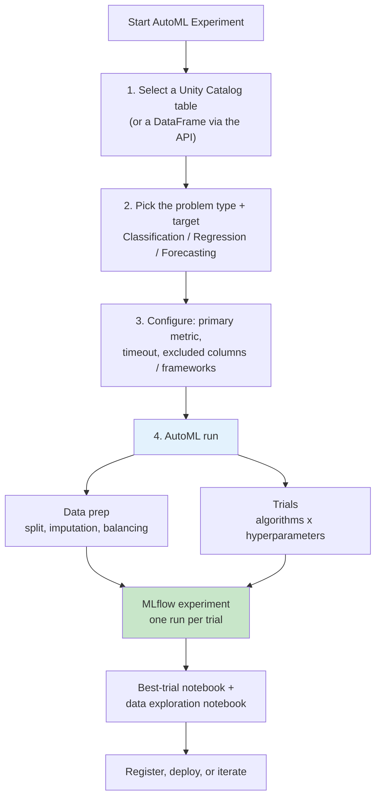

# Databricks AutoML

## Overview

Databricks AutoML takes a dataset and a target column, then prepares the data, trains and tunes a set of candidate models, and logs every trial to MLflow. Its output is a **glass-box** baseline: real, editable notebooks that you can read, reproduce, and modify — not a black-box endpoint.

> [!abstract]
>
> - Supports **classification**, **regression**, and **forecasting**, from a low-code UI or the Python API (`databricks.automl`)
> - Each trial is an MLflow run; the **best-trial notebook** and a **data exploration notebook** are imported into the workspace
> - Classification / regression try decision trees, random forests, linear/logistic regression, XGBoost, and LightGBM; forecasting uses Prophet and Auto-ARIMA
> - Handles train/validation/test splitting, imputation, and class-imbalance balancing for you

> [!tip] What the Exam Tests
>
> - *How AutoML facilitates model / feature selection* — many algorithms + hyperparameters compared on one primary metric; SHAP feature importance in generated notebooks
> - *The advantages AutoML brings to model development* — fast, reproducible baseline; editable code; everything tracked in MLflow
> - What AutoML produces and where it lives (MLflow experiment, trial runs, notebooks)

---

## AutoML Workflow



## What AutoML Automates

### **Data preparation**

| Step | Default behaviour (classification / regression) |
| :--- | :--- |
| **Split** | Random 60 % train / 20 % validation / 20 % test (stratified for classification) |
| **Missing values** | Imputation method chosen per column based on type and content; overridable per column |
| **Imbalanced classes** | Balances **only the training split** — downsamples the majority class and applies class weights; validation/test keep the original distribution |
| **Large datasets** | Estimates memory and samples the dataset if needed (each trial trains on a single worker node) |
| **Semantic types** | Best-effort detection (e.g. numeric strings, dates); override with column annotations |
| **Columns** | All columns included by default; exclude with `exclude_cols` (not the target or time column) |

Source: [Data preparation for classification](https://docs.databricks.com/aws/en/machine-learning/automl/classification-data-prep).

### **Algorithms tried**

| Problem type | Algorithms |
| :--- | :--- |
| **Classification** | Decision trees, random forests, logistic regression, XGBoost, LightGBM (scikit-learn / XGBoost / LightGBM implementations) |
| **Regression** | Decision trees, random forests, linear regression with SGD, XGBoost, LightGBM |
| **Forecasting** | Prophet, Auto-ARIMA (serverless forecasting also lists DeepAR) |

Source: [What is AutoML?](https://docs.databricks.com/aws/en/machine-learning/automl/).

### **Default primary metrics**

| API | Default `primary_metric` |
| :--- | :--- |
| `automl.classify` | `f1` |
| `automl.regress` | `r2` |
| `automl.forecast` | `smape` |

Source: [AutoML Python API reference](https://docs.databricks.com/aws/en/machine-learning/automl/automl-api-reference).

## How AutoML Facilitates Model and Feature Selection

- **Model selection** — every algorithm/hyperparameter combination is a trial scored on the *same* primary metric and validation split, so the leaderboard (the MLflow experiment, sorted by metric) shows directly which model family wins
- **Feature selection** — the trial notebooks include a **Feature importance** section that computes **Shapley (SHAP) values**; it is off by default because it is memory-intensive — set `shap_enabled = True` and re-run the notebook
- **Feature reuse** — `feature_store_lookups` lets AutoML join Unity Catalog feature tables into the training data, so the baseline uses governed features

Source: [How Databricks AutoML works](https://docs.databricks.com/aws/en/machine-learning/automl/how-automl-works).

## Advantages AutoML Brings to Model Development

| Advantage | Why it matters |
| :--- | :--- |
| **Fast baseline** | Minutes to a tuned benchmark instead of days of manual sweeps |
| **Glass-box code** | Generated notebooks are ordinary Python you can edit, rerun, and productionise |
| **Reproducible + tracked** | Every trial is an MLflow run with params, metrics, and a logged model |
| **Sensible defaults** | Splitting, imputation, balancing, and sampling handled consistently |
| **Low-code access** | Domain experts can produce a baseline from the UI; data scientists refine it |

## Using AutoML via the UI

1. **Create experiment** — from **Experiments** in the sidebar, start a new AutoML experiment and choose the problem type
2. **Configure** — compute (ML runtime), problem type, input table, prediction target; optionally evaluation metric, excluded frameworks/columns, imputation per column, timeout
3. **Start** — AutoML runs the trials and shows them in the MLflow experiment
4. **Review** — sort runs by the primary metric, open the **best-trial notebook** or the **data exploration notebook**, register the best model

## Programmatic AutoML

```python
from databricks import automl

df = spark.read.table("ml_dev.churn.customer_features")

summary = automl.classify(
    dataset=df,
    target_col="churned",
    primary_metric="f1",          # default for classify
    timeout_minutes=30,           # default 120, minimum 5
    exclude_cols=["customer_id"],
)

best = summary.best_trial
print(best.metrics)               # validation/test metrics of the best trial
print(best.mlflow_run_id)         # MLflow run that holds the model
print(best.notebook_url)          # generated notebook for the best trial

model = best.load_model()         # load the trial's logged MLflow model
```

```python
# Regression and forecasting follow the same pattern
reg_summary = automl.regress(dataset=housing_df, target_col="price", timeout_minutes=60)

fc_summary = automl.forecast(
    dataset=sales_df,
    target_col="units",
    time_col="date",              # required for forecasting
    horizon=30,
    frequency="D",
)
```

### **AutoMLSummary and TrialInfo**

| Object | Useful attributes |
| :--- | :--- |
| `AutoMLSummary` | `experiment`, `trials`, `best_trial` |
| `TrialInfo` | `mlflow_run_id`, `metrics`, `params`, `model_path`, `notebook_path` / `notebook_url` (best trial only for classification/regression), `load_model()` |

## AutoML Output & Artifacts

```text
MLflow experiment (default dir /Users/<you>/databricks_automl/)
├── Run: trial 1 (e.g. LightGBM)  → params, metrics, model, trial notebook as artifact
├── Run: trial 2 (e.g. XGBoost)
├── ...
├── Best-trial notebook           → imported into the workspace
└── Data exploration notebook     → imported into the workspace
```

Registering the best model is a separate, explicit step:

```python
import mlflow

mlflow.set_registry_uri("databricks-uc")
mlflow.register_model(
    f"runs:/{summary.best_trial.mlflow_run_id}/model",
    "ml_dev.churn.churn_classifier",
)
```

> [!note] Platform update (Oct 2026)
> The AutoML docs now state: "In Databricks Runtime 18.0 ML or above, AutoML is not included as a built-in library," and AutoML depends on the `databricks-automl-runtime` package. The exam guide (Mar 1, 2025 exam version) still tests AutoML — learn the concepts above; when practising, use an ML runtime where AutoML is available ([What is AutoML?](https://docs.databricks.com/aws/en/machine-learning/automl/)).

## Best Practices for AutoML

- Start from a clean Unity Catalog table; drop leakage columns (IDs, post-outcome fields) with `exclude_cols`
- Pick the **primary metric that matches the business goal** (e.g. `f1` or `log_loss` for imbalanced classes, not accuracy)
- Treat the output as a **baseline** — validate the best model on held-out data and review the generated notebook before production
- Enable SHAP in the best-trial notebook to check that the most important features make domain sense
- Use `feature_store_lookups` instead of ad-hoc joins so training and serving share feature definitions

## Comparison: AutoML vs Manual ML

| Aspect | AutoML | Manual |
| :--- | :--- | :--- |
| **Time to baseline** | Minutes–hours | Days–weeks |
| **Algorithm + hyperparameter search** | Automated, logged to MLflow | Hand-written sweeps |
| **Code visibility** | Generated, editable notebooks | Your own code |
| **Customisation** | Limited to API/UI options, then edit notebooks | Full control |
| **Best for** | Baselines, benchmarking, citizen data science | Complex, domain-specific pipelines |

## Use Cases

- **Rapid Baseline Model Generation**: Running AutoML on a new churn table to establish an F1 benchmark before investing in custom feature engineering.
- **Feature Triage**: Using SHAP values in the best-trial notebook to decide which engineered features are worth keeping.

## Common Issues & Errors

### AutoML Not Available on the Cluster

**Scenario:** `from databricks import automl` fails or the AutoML UI is unavailable.
**Fix:** Use an ML runtime cluster with a supported access mode (Dedicated supports AutoML + Unity Catalog; Standard does not support AutoML). On Databricks Runtime 18.0 ML and above, AutoML is no longer built in.

### AutoML Run Produces Poor Results

**Scenario:** The best model's metric is low compared with expectations.
**Fix:** Check data quality and leakage, choose a metric suited to the class balance, increase `timeout_minutes` so more trials run, or add better features via `feature_store_lookups`.

## Exam Tips

- ✅ Three problem types only: classification, regression, forecasting (no clustering)
- ✅ Every trial = an MLflow run; best-trial + data exploration notebooks are imported into the workspace
- ✅ SHAP feature importance is in the generated notebook but **off by default**
- ✅ AutoML balances only the **training** split; validation/test keep the real distribution
- ✅ AutoML does **not** auto-register or auto-deploy the model
- ✅ Forecasting needs a `time_col`

## Key Takeaways

- AutoML is a glass-box accelerator: it produces editable code, not a sealed model
- It automates splitting, imputation, balancing, algorithm choice, and hyperparameter search
- Model selection happens by comparing trials on one primary metric in MLflow
- Feature selection is supported through SHAP importance in the generated notebooks
- Registration and deployment remain explicit, governed steps

## Related Topics

- [Compute Clusters for ML](./02-compute-clusters-ml.md)
- [MLflow Tracking](./05-mlflow-tracking.md)
- [Model Registry in Unity Catalog](./07-model-registry.md)
- [Hyperparameter Tuning](../03-model-development/02-hyperparameter-tuning.md)

## Official Documentation

- [What is AutoML?](https://docs.databricks.com/aws/en/machine-learning/automl/)
- [How Databricks AutoML works](https://docs.databricks.com/aws/en/machine-learning/automl/how-automl-works)
- [Data preparation for classification](https://docs.databricks.com/aws/en/machine-learning/automl/classification-data-prep)
- [AutoML Python API reference](https://docs.databricks.com/aws/en/machine-learning/automl/automl-api-reference)

---

**[← Previous: Compute Clusters for ML](./02-compute-clusters-ml.md) | [↑ Back to Section](./README.md) | [Next: Feature Store in Unity Catalog →](./04-feature-store.md)**
