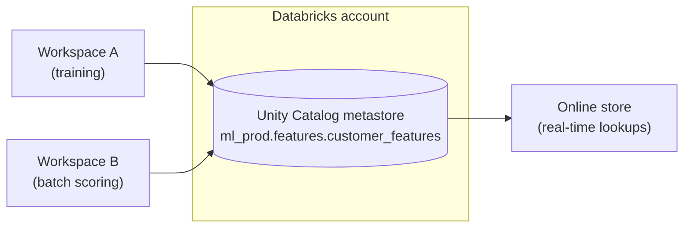

# Feature Store in Unity Catalog

## Overview

In a Unity Catalog-enabled workspace, the Databricks Feature Store *is* **Feature Engineering in Unity Catalog**: any Delta table with a primary key can be a feature table, governed by Unity Catalog and used through the `FeatureEngineeringClient`. The exam guide places every feature-table skill in Section 1 (Databricks Machine Learning, 38 %).

> [!abstract]
>
> - A **feature table** is a Unity Catalog Delta table with a **primary key** (plus an optional time-series key for point-in-time joins)
> - Create with `FeatureEngineeringClient.create_table(...)` or SQL `CREATE TABLE ... CONSTRAINT ... PRIMARY KEY`; write with `write_table(..., mode="merge")`
> - Train with `FeatureLookup` + `create_training_set` + `fe.log_model`; score with `fe.score_batch`
> - **Offline** feature tables serve training and batch scoring; an **online store** serves low-latency lookups to real-time endpoints

> [!tip] What the Exam Tests
>
> - The benefits of account-level (Unity Catalog) feature tables over legacy workspace-level ones
> - The *correct creation path* in UC — `FeatureEngineeringClient.create_table`, not `FeatureStoreClient` or an invented SQL clause
> - Writing, training, and scoring with feature tables, and the difference between online and offline feature tables

---

## Unity Catalog vs Workspace Feature Store

Unity Catalog's metastore is attached at the **account** level, so feature tables registered there are shared by every workspace attached to that metastore. The legacy **Workspace Feature Store** kept feature tables inside a single workspace.

| Aspect | Feature tables in Unity Catalog (account level) | Workspace Feature Store (legacy) |
| :--- | :--- | :--- |
| **Scope** | Any workspace attached to the metastore — cross-workspace feature sharing and discovery | One workspace |
| **Governance** | Unity Catalog privileges (`SELECT`, `MODIFY`, ownership) on `catalog.schema.table` | Workspace ACLs |
| **Lineage** | Lineage between feature tables, models, and functions in Unity Catalog | Limited |
| **Naming** | Three-level `catalog.schema.table` | `database.table` |
| **Python client** | `databricks.feature_engineering.FeatureEngineeringClient` | `databricks.feature_store.FeatureStoreClient` |
| **Status** | Current | Docs label it "Workspace Feature Store (deprecated)" |

Source: [Feature management](https://docs.databricks.com/aws/en/machine-learning/feature-store/) — registering features and models in Unity Catalog gives "built-in governance, lineage, point-in-time joins, and cross-workspace feature sharing and discovery."



## Creating a Feature Table

### **Python: `FeatureEngineeringClient.create_table`**

```python
from databricks.feature_engineering import FeatureEngineeringClient
from pyspark.sql import functions as F

fe = FeatureEngineeringClient()

customer_features_df = (spark.read.table("ml_dev.raw.transactions")
    .groupBy("customer_id")
    .agg(
        F.count("*").alias("txn_count_90d"),
        F.sum("amount").alias("spend_90d"),
        F.avg("amount").alias("avg_txn_amount"),
    ))

# Passing df= creates the table AND writes the data
fe.create_table(
    name="ml_dev.features.customer_features",
    primary_keys=["customer_id"],          # required
    df=customer_features_df,
    description="Customer spend aggregates (90-day window)",
)
```

- `primary_keys` is required; you must pass **either** `df` (create + populate) **or** `schema` (create empty)
- The Python client is pre-installed on Databricks Runtime 13.3 LTS ML and above

### **SQL: any Delta table with a primary key**

```sql
CREATE TABLE ml_dev.features.customer_features (
  customer_id INT NOT NULL,
  txn_count_90d BIGINT,
  spend_90d DOUBLE,
  CONSTRAINT customer_features_pk PRIMARY KEY (customer_id)
);

-- An existing table: make the key NOT NULL, then add the constraint
ALTER TABLE ml_dev.features.store_features ALTER COLUMN store_id SET NOT NULL;
ALTER TABLE ml_dev.features.store_features
  ADD CONSTRAINT store_features_pk PRIMARY KEY (store_id);
```

> [!warning] Common Mistake
> There is **no** `AS FEATURE STORE` or `SET AS FEATURE STORE` SQL clause, and `FeatureStoreClient.register_table` is not the Unity Catalog creation path. In UC, a feature table is simply a Delta table with a primary key constraint, created in SQL or with `FeatureEngineeringClient.create_table`.

Source: [Work with feature tables in Unity Catalog](https://docs.databricks.com/aws/en/machine-learning/feature-store/uc/feature-tables-uc).

## Writing Data to a Feature Table

```python
# Upsert new / changed rows by primary key
fe.write_table(
    name="ml_dev.features.customer_features",
    df=updated_features_df,
    mode="merge",        # the only supported mode
)
```

| Behaviour | Detail |
| :--- | :--- |
| `mode="merge"` | Upserts rows by primary key; rows whose key is **not** in the DataFrame stay unchanged |
| Overwrite | Not a `write_table` mode in `FeatureEngineeringClient` — delete rows (`DELETE FROM`) or drop/recreate the table first |
| Streaming | `write_table` accepts a streaming DataFrame (with `checkpoint_location` / `trigger`) |
| Plain Delta writes | Because it is a Delta table, `MERGE INTO` or a Lakeflow pipeline can also maintain it |

Sources: [Work with feature tables in Unity Catalog](https://docs.databricks.com/aws/en/machine-learning/feature-store/uc/feature-tables-uc), [Feature Engineering Python API](https://api-docs.databricks.com/python/feature-engineering/latest/feature_engineering.client.html).

## Training a Model with Feature Table Features

```python
import mlflow
from databricks.feature_engineering import FeatureEngineeringClient, FeatureLookup
from sklearn.ensemble import RandomForestClassifier

fe = FeatureEngineeringClient()
mlflow.set_registry_uri("databricks-uc")

# Label table: keys + label (+ optional event timestamp)
labels_df = spark.read.table("ml_dev.churn.labels")   # customer_id, churned

feature_lookups = [
    FeatureLookup(
        table_name="ml_dev.features.customer_features",
        lookup_key="customer_id",                     # column in labels_df that matches the PK
        feature_names=["txn_count_90d", "spend_90d", "avg_txn_amount"],
    ),
]

training_set = fe.create_training_set(
    df=labels_df,
    feature_lookups=feature_lookups,
    label="churned",
    exclude_columns=["customer_id"],
)
train_pdf = training_set.load_df().toPandas()

X, y = train_pdf.drop("churned", axis=1), train_pdf["churned"]
model = RandomForestClassifier(n_estimators=200).fit(X, y)

# Log WITH feature metadata so scoring can look features up automatically
fe.log_model(
    model=model,
    artifact_path="model",
    flavor=mlflow.sklearn,
    training_set=training_set,
    registered_model_name="ml_dev.churn.churn_classifier",
)
```

### **Point-in-time lookups**

When a feature table has a time-series key, pass `timestamp_lookup_key` in the `FeatureLookup`. Each label row then gets the feature values **as of its event timestamp**, which prevents leakage of future information. A timestamp column must not be used as a plain `lookup_key`. See [Point-in-time feature joins](https://docs.databricks.com/aws/en/machine-learning/feature-store/time-series).

```python
FeatureLookup(
    table_name="ml_dev.features.customer_daily_features",
    lookup_key="customer_id",
    timestamp_lookup_key="event_ts",   # column in the label DataFrame
)
```

Source: [Use features to train models](https://docs.databricks.com/aws/en/machine-learning/feature-store/train-models-with-feature-store).

## Scoring a Model with Feature Table Features

```python
# The scoring DataFrame only needs the lookup keys (+ any non-feature-table inputs)
batch_df = spark.read.table("ml_dev.churn.customers_to_score")   # customer_id

predictions = fe.score_batch(
    model_uri="models:/ml_dev.churn.churn_classifier@champion",
    df=batch_df,
)
(predictions.select("customer_id", "prediction")
    .write.mode("overwrite")
    .saveAsTable("ml_dev.churn.daily_predictions"))
```

- `score_batch` reads the feature metadata packaged by `fe.log_model`, **joins the features automatically**, and applies the model — the same feature definitions as training, so no training-serving skew
- Plain MLflow `pyfunc` batch inference does not support time-series feature tables; use `score_batch` for those

## Online vs Offline Feature Tables

| | Offline feature table | Online store |
| :--- | :--- | :--- |
| **What it is** | The Unity Catalog Delta table you created | A low-latency copy published from the offline table |
| **Used for** | Training sets, batch scoring (`create_training_set`, `score_batch`) | Real-time model serving endpoints and online applications |
| **Access pattern** | Large scans and joins | Key-based lookups in milliseconds |
| **Freshness** | Whenever the table is written | Published `SNAPSHOT`, `TRIGGERED` (default), or `CONTINUOUS` |
| **Backed by** | Delta Lake | Databricks Lakebase (Online Feature Stores) |

```python
fe.create_online_store(name="churn-online-store", capacity="CU_2")
online_store = fe.get_online_store(name="churn-online-store")

fe.publish_table(
    online_store=online_store,
    source_table_name="ml_dev.features.customer_features",
    online_table_name="ml_dev.features.customer_features_online",
    # publish_mode defaults to "TRIGGERED"; "CONTINUOUS" and "SNAPSHOT" also exist
)
```

A model logged with `fe.log_model` and deployed to Model Serving can then **look up features automatically** from the online store using only the primary key in the request.

> [!note] Platform update (Oct 2026)
>
> - **Online stores:** the docs describe Online Feature Stores "powered by Databricks Lakebase"; stores created with `fe.create_online_store` after March 23, 2026 use Lakebase Autoscaling. The older product appears as **Databricks online tables (legacy)** with a migration guide ([Online Feature Stores](https://docs.databricks.com/aws/en/machine-learning/feature-store/online-feature-store), [Migrate from legacy online tables](https://docs.databricks.com/aws/en/machine-learning/feature-store/migrate-from-online-tables)). Free Edition lists online tables as unsupported ([Free Edition limitations](https://docs.databricks.com/aws/en/getting-started/free-edition-limitations)).
> - **Feature Views:** "Feature Views are now generally available for batch, streaming, and request-time data" ([October 2026 release notes](https://docs.databricks.com/aws/en/release-notes/product/2026/october), entry dated October 12, 2026), and the feature-management overview says "For new use cases, Databricks recommends Feature Views" ([Feature management](https://docs.databricks.com/aws/en/machine-learning/feature-store/)). The exam guide still tests **feature tables** — learn the APIs on this page.

## Feature Store Best Practices

- Keep feature tables in a dedicated schema per environment (`ml_dev.features`, `ml_prod.features`)
- Always log models with `fe.log_model` when they use feature tables — it is what makes `score_batch` and online lookups work
- Use point-in-time lookups for any time-dependent feature
- Add descriptions and tags (`fe.set_feature_table_tag(name=..., key=..., value=...)`) so features are discoverable in Catalog Explorer
- Refresh features with a scheduled Lakeflow Job or a pipeline rather than ad-hoc notebook runs

## Comparison: Feature Store vs Manual Feature Management

| Aspect | Feature tables in UC | Manual (copy features into every training table) |
| :--- | :--- | :--- |
| **Consistency** | Same definitions for training, batch, and online | Risk of training-serving skew |
| **Reuse** | Discoverable across workspaces | Copies per project |
| **Lineage** | Tracked in Unity Catalog | Manual |
| **Inference** | `score_batch` / automatic online lookup | Re-implement joins at scoring time |

## Use Cases

- **Eliminating Training-Serving Skew**: A churn model logged with `fe.log_model` is scored nightly with `fe.score_batch`, which joins the exact same feature definitions used in training.
- **Cross-Workspace Feature Reuse**: A fraud team in one workspace reuses the `customer_features` table that the marketing team maintains in another workspace on the same metastore.

## Common Issues & Errors

### Feature Lookup Returns NULL Values

**Scenario:** Some rows have null features after `create_training_set` or `score_batch`.
**Fix:** The lookup key values have no matching primary key in the feature table, or the key types differ. Check key types and coverage; use `default_values` in `FeatureLookup` if a default is acceptable.

### Error Using a DATE/TIMESTAMP Primary Key

**Scenario:** `create_training_set()` fails on a feature table whose primary key includes a `DATE` or `TIMESTAMP` column.
**Fix:** Declare that column as the table's time-series key (and use `timestamp_lookup_key`), or change it to `STRING` for exact-match lookups.

## Exam Tips

- ✅ UC creation path: `FeatureEngineeringClient().create_table(name="cat.schema.table", primary_keys=[...], df=...)`
- ✅ Any Delta table with a `PRIMARY KEY` constraint is a feature table — there is no `AS FEATURE STORE` clause
- ✅ `write_table` uses `mode="merge"` (upsert by key)
- ✅ Train: `FeatureLookup` → `create_training_set` → `fe.log_model`; score: `fe.score_batch(model_uri, df)`
- ✅ Offline = Delta table for training/batch; online = low-latency store for real-time serving
- ✅ UC (account-level) benefits: cross-workspace sharing/discovery, centralised governance, lineage

## Key Takeaways

- Feature Engineering in Unity Catalog replaces the deprecated Workspace Feature Store
- A feature table is a governed Delta table keyed by a primary key
- `fe.log_model` packages feature metadata so batch and real-time inference retrieve features automatically
- Point-in-time lookups prevent future data leaking into training rows
- Online stores serve features to real-time endpoints; offline tables serve training and batch scoring

## Related Topics

- [Feature Engineering Techniques](../02-data-processing/02-feature-engineering-techniques.md)
- [MLflow Tracking](./05-mlflow-tracking.md)
- [Model Registry in Unity Catalog](./07-model-registry.md)
- [Model Deployment & Serving](../04-model-deployment/01-model-deployment-serving.md)
- [Feature Engineering Basics (shared)](../../../shared/fundamentals/feature-engineering-basics.md)

## Official Documentation

- [Feature management on Databricks](https://docs.databricks.com/aws/en/machine-learning/feature-store/)
- [Work with feature tables in Unity Catalog](https://docs.databricks.com/aws/en/machine-learning/feature-store/uc/feature-tables-uc)
- [Use features to train models](https://docs.databricks.com/aws/en/machine-learning/feature-store/train-models-with-feature-store)
- [Online Feature Stores](https://docs.databricks.com/aws/en/machine-learning/feature-store/online-feature-store)
- [Feature Engineering Python API](https://api-docs.databricks.com/python/feature-engineering/latest/feature_engineering.client.html)

---

**[← Previous: Databricks AutoML](./03-databricks-automl.md) | [↑ Back to Section](./README.md) | [Next: MLflow Tracking →](./05-mlflow-tracking.md)**
