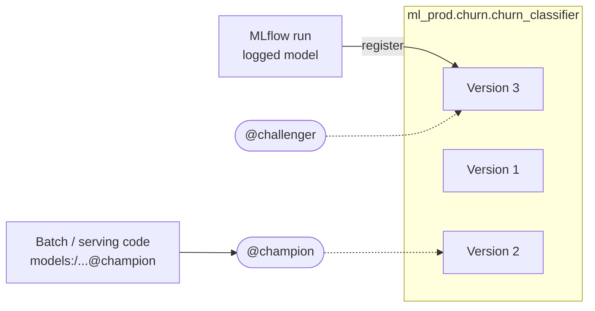
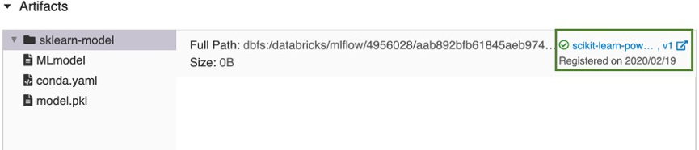

# Model Registry in Unity Catalog

## Overview

**Models in Unity Catalog** is the MLflow Model Registry hosted in Unity Catalog. Registered models live at `catalog.schema.model`, every registration creates a numbered **model version**, and **aliases** such as `champion` / `challenger` mark which version a workload should use. The exam guide puts all registry skills in Section 1 (Databricks Machine Learning).

> [!abstract]
>
> - Point MLflow at the UC registry with `mlflow.set_registry_uri("databricks-uc")` (the default in MLflow 3) and use three-level names
> - Register with `mlflow.register_model(...)`, `registered_model_name=` at log time, or the Client API (`MlflowClient().create_registered_model` / `create_model_version`)
> - Promote with **aliases** (`set_registered_model_alias`) — UC does **not** support stages
> - Tags (`set_*_tag` / `delete_*_tag`) are descriptive metadata; they do not change which version is served

> [!tip] What the Exam Tests
>
> - *Register a model using the MLflow Client API in the Unity Catalog registry*
> - *Benefits of the UC registry over the workspace registry* — centralised access control, auditing, lineage, cross-workspace discovery
> - *Set or remove a tag for a model* and *promote a challenger to champion using aliases*

---

## Unity Catalog Registry vs Workspace Model Registry

| Aspect | Models in Unity Catalog | Workspace Model Registry (legacy) |
| :--- | :--- | :--- |
| **Scope** | Account-level metastore — **discoverable and usable across workspaces** | One workspace |
| **Access control** | Unity Catalog privileges (`EXECUTE`, `CREATE MODEL`, ownership) | Workspace registry ACLs |
| **Auditing & lineage** | UC audit logs; lineage from model to the tables/feature tables it was trained on | Limited |
| **Naming** | `catalog.schema.model` — environment can be encoded in the catalog (`dev` / `staging` / `prod`) | Flat model name |
| **Promotion** | **Aliases** (`@champion`, `@challenger`) | Stages (`None` → `Staging` → `Production` → `Archived`) |
| **Signature** | **Required** for new versions | Optional |

Docs: Unity Catalog "extends the benefits of Unity Catalog to ML models, including centralized access control, auditing, lineage, and model discovery across workspaces" and "Stages are not supported for models in Unity Catalog" ([Manage model lifecycle in Unity Catalog](https://docs.databricks.com/aws/en/machine-learning/manage-model-lifecycle/)).



## Registering a Model

### **Fluent API**

```python
import mlflow

mlflow.set_registry_uri("databricks-uc")   # default in MLflow 3; harmless to set explicitly

# Option 1 — register while logging (input_example lets MLflow infer the required signature)
with mlflow.start_run() as run:
    mlflow.sklearn.log_model(
        model,
        artifact_path="model",
        input_example=X_train.head(5),
        registered_model_name="ml_dev.churn.churn_classifier",
    )

# Option 2 — register an already-logged model later
mv = mlflow.register_model(f"runs:/{run.info.run_id}/model", "ml_dev.churn.churn_classifier")
print(mv.version)
```



*A run's Artifacts panel: the logged `sklearn-model` and the registered model version it produced (older workspace-registry UI; in UC the version belongs to `catalog.schema.model`).*

### **MLflow Client API**

```python
from mlflow import MlflowClient

mlflow.set_registry_uri("databricks-uc")
client = MlflowClient()

name = "ml_dev.churn.churn_classifier"

# Create the registered model once (raises if it already exists)
client.create_registered_model(name, description="Churn classifier (gradient boosting)")

# Each create_model_version call adds a new numbered version
mv = client.create_model_version(
    name=name,
    source=f"runs:/{run_id}/model",
    run_id=run_id,
)
print(mv.version, mv.status)
```

Privileges: registering needs `USE CATALOG` + `USE SCHEMA` and `CREATE MODEL` on the schema; loading a model needs `EXECUTE` on the registered model.

> [!warning] Common Mistake
> New model versions in Unity Catalog **must have a signature**. Pass an `input_example` (or an explicit `signature`) to `log_model`, or use autologging, otherwise registration in UC fails.

## Model Versions and URIs

| URI | Resolves to |
| :--- | :--- |
| `models:/ml_prod.churn.churn_classifier/3` | Version 3 (immutable) |
| `models:/ml_prod.churn.churn_classifier@champion` | Whatever version the `champion` alias points to right now |
| `runs:/<run_id>/model` | The model logged in a specific run (not a registry reference) |

```python
import mlflow

champion = mlflow.pyfunc.load_model("models:/ml_prod.churn.churn_classifier@champion")
v3 = mlflow.pyfunc.load_model("models:/ml_prod.churn.churn_classifier/3")
```

## Promoting a Challenger to Champion with Aliases

```python
from mlflow import MlflowClient

client = MlflowClient()
name = "ml_prod.churn.churn_classifier"

# 1. New version passes offline validation -> mark it as the challenger
client.set_registered_model_alias(name, "challenger", 4)

# 2. Compare challenger vs current champion (offline metrics, A/B traffic split, etc.)
champ = client.get_model_version_by_alias(name, "champion")
chall = client.get_model_version_by_alias(name, "challenger")

# 3. Challenger wins -> move the champion alias (aliases are unique per model,
#    so assigning "champion" to v4 removes it from the old version)
client.set_registered_model_alias(name, "champion", chall.version)
client.delete_registered_model_alias(name, "challenger")
```

Inference code that loads `models:/<name>@champion` picks up the new version **without any code change** — deployment is decoupled from inference.

> [!warning] Common Mistake
> `transition_model_version_stage(...)` belongs to the legacy workspace registry; deleting the old version is destructive and unnecessary; setting a tag like `champion=true` is only metadata. The recommended promotion in UC is **moving an alias**.

## Tags and Descriptions

```python
client = MlflowClient()
name = "ml_prod.churn.churn_classifier"

# Registered-model-level tag
client.set_registered_model_tag(name, "task", "classification")
client.delete_registered_model_tag(name, "task")

# Model-version-level tag
client.set_model_version_tag(name, "4", "validation_status", "approved")
client.delete_model_version_tag(name, "4", "validation_status")

# Descriptions
client.update_registered_model(name=name, description="Predicts 30-day churn")
client.update_model_version(name=name, version=4, description="LightGBM, F1 0.81 on holdout")
```

| Operation | Model level | Version level |
| :--- | :--- | :--- |
| Set tag | `set_registered_model_tag(name, key, value)` | `set_model_version_tag(name, version, key, value)` |
| Remove tag | `delete_registered_model_tag(name, key)` | `delete_model_version_tag(name, version, key)` |
| Alias | — | `set_registered_model_alias(name, alias, version)` / `delete_registered_model_alias(name, alias)` |

Tags can also be set or removed in Catalog Explorer on the model or version page.

## Promoting Across Environments

With one catalog per environment, a validated version can be **copied** from the staging catalog into the production catalog and then given the production alias:

```python
client = MlflowClient()
src_uri = "models:/staging.ml_team.fraud_detection/1"

copied = client.copy_model_version(src_uri, "prod.ml_team.fraud_detection")
client.set_registered_model_alias("prod.ml_team.fraud_detection", "champion", copied.version)
```

This is the *deploy models* pattern; the *deploy code* pattern instead retrains in each environment — see [MLOps Strategy](./08-mlops-strategy.md).

## Legacy: Workspace Model Registry Stages

You may still see stage-based questions in older material. Recognise them, but answer UC questions with aliases.

| Legacy concept | UC equivalent |
| :--- | :--- |
| Stages `None`, `Staging`, `Production`, `Archived` | Aliases you name yourself (`challenger`, `champion`) + environment catalogs |
| `transition_model_version_stage(name, version, stage)` | `set_registered_model_alias(name, alias, version)` |
| `models:/name/Production` | `models:/catalog.schema.name@champion` |
| `get_latest_versions(name, stages=[...])` | `get_model_version_by_alias(name, alias)` |

> [!note] Platform update (Oct 2026)
> The docs title this registry **"Workspace Model Registry (legacy)"**: since April 2024 it is disabled for workspaces in new accounts whose default catalog is in Unity Catalog, and since May 2024 it imposes quota limits. It "continues to be supported in MLflow 3", but for UC-enabled workspaces the docs say to use Models in Unity Catalog instead ([Workspace Model Registry](https://docs.databricks.com/aws/en/machine-learning/manage-model-lifecycle/workspace-model-registry)).

## Use Cases

- **Champion/Challenger Rollout**: A retrained model is registered as version 7, tagged `validation_status=approved`, given the `challenger` alias, compared against the champion, then promoted by moving the `champion` alias — the nightly scoring job reads `@champion` and needs no change.
- **Cross-Workspace Model Reuse**: A model registered in `ml_prod` from the training workspace is loaded by a serving workspace attached to the same metastore, governed by `EXECUTE` grants.

## Common Issues & Errors

### Model Registration Fails in Unity Catalog

**Scenario:** `mlflow.register_model()` fails with a permissions or `RESOURCE_DOES_NOT_EXIST` error.
**Fix:** Make sure the registry URI is `databricks-uc`, the catalog and schema exist, the name is three-level, and you have `USE CATALOG`, `USE SCHEMA`, and `CREATE MODEL`.

### Registration Fails Because the Model Has No Signature

**Scenario:** Logging worked but registering in UC is rejected.
**Fix:** Re-log the model with an `input_example` or `signature` (or use autologging), then register the new run's model.

## Exam Tips

- ✅ Client API registration: `create_registered_model(name)` then `create_model_version(name, source, run_id)`
- ✅ UC registry benefits: centralised access control, auditing, lineage, discovery **across workspaces**
- ✅ Promotion = `set_registered_model_alias(name, "champion", version)`; load with `models:/name@champion`
- ✅ Tags: `set_/delete_registered_model_tag` and `set_/delete_model_version_tag` — metadata only
- ✅ Stages and `transition_model_version_stage` are legacy workspace-registry concepts

## Key Takeaways

- Models in Unity Catalog is the current registry; names are `catalog.schema.model`
- Versions are immutable; aliases are movable pointers that decouple deployment from inference code
- Tags and descriptions document versions but never decide what is served
- UC governance (privileges, audit, lineage) applies to models exactly as it does to tables

## Related Topics

- [MLflow Tracking](./05-mlflow-tracking.md)
- [Experiments & Runs](./06-experiments-runs.md)
- [MLOps Strategy](./08-mlops-strategy.md)
- [Model Deployment & Serving](../04-model-deployment/01-model-deployment-serving.md)
- [MLflow cheat sheet (shared)](../../../shared/cheat-sheets/mlflow-quick-ref.md)

## Official Documentation

- [Manage model lifecycle in Unity Catalog](https://docs.databricks.com/aws/en/machine-learning/manage-model-lifecycle/)
- [Workspace Model Registry (legacy)](https://docs.databricks.com/aws/en/machine-learning/manage-model-lifecycle/workspace-model-registry)
- [MlflowClient API](https://mlflow.org/docs/latest/api_reference/python_api/mlflow.client.html)

---

**[← Previous: Experiments & Runs](./06-experiments-runs.md) | [↑ Back to Section](./README.md) | [Next: MLOps Strategy →](./08-mlops-strategy.md)**
