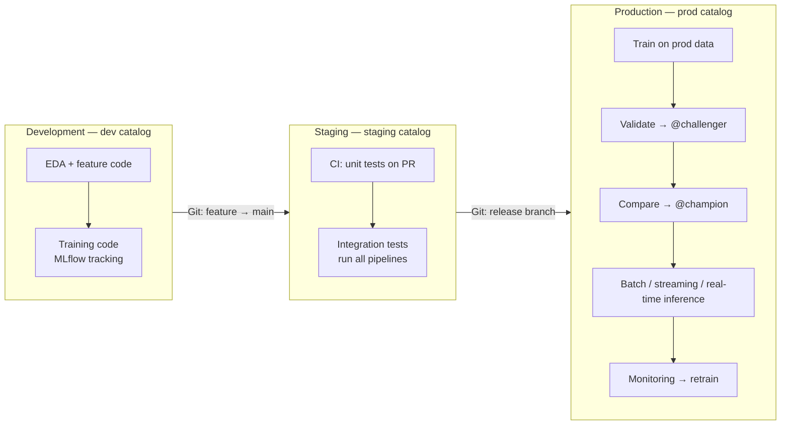

# MLOps Strategy on Databricks

## Overview

MLOps is the set of practices that moves ML work from a notebook to a reliable production system: separate environments, version-controlled pipeline code, tracked experiments, a governed registry, CI/CD, and monitoring. The exam guide opens Section 1 with *"Identify the best practices of an MLOps strategy"* and later asks when to **promote code** versus **promote models**.

> [!abstract]
>
> - Use **separate dev, staging, and prod environments**, each with its own Unity Catalog catalog
> - Keep ML pipelines as **code in Git**; track runs with **MLflow**; manage models with **Models in Unity Catalog**
> - Databricks recommends the **deploy code** pattern in most situations; **deploy models** fits expensive or hard-to-reproduce training
> - Inference reads a **champion alias**, so promotion never requires an inference-code change

> [!tip] What the Exam Tests
>
> - Recognising the recommended MLOps best practices (environment separation, Git, UC registry, CI/CD, monitoring)
> - *Scenarios where promoting code is preferred over promoting models and vice versa*
> - How aliases (`challenger` → `champion`) decouple deployment from inference

---

## Recommended MLOps Workflow



## MLOps Best Practices

| Practice | What Databricks recommends |
| :--- | :--- |
| **Separate environments** | "Databricks recommends creating separate environments for the different stages of ML code and model development" — dev, staging, prod, each with its own UC catalog |
| **Pipelines as code** | "The output of the development process is ML pipeline code" — kept in Git (Git folders) and promoted through dev → staging → release branches |
| **Data in Delta + UC** | Raw data and feature tables are Delta tables with Unity Catalog access controls |
| **Experiment tracking** | MLflow records code snapshots, parameters, metrics, and artifacts for every run |
| **Model lifecycle in UC** | "Use Models in Unity Catalog to manage the model lifecycle" — versioning, governance, deployment status |
| **CI/CD** | Pull requests trigger unit tests; integration tests run the pipelines in staging; merging to the release branch updates production jobs |
| **Champion / challenger** | A newly validated model gets the `Challenger` alias; after comparison it can take the `Champion` alias, which inference pipelines reference |
| **Orchestration** | Training, validation, and deployment as tasks in a multitask job; scheduled retraining on the latest data |
| **Monitoring** | "Data profiling monitors statistical properties, such as data drift and model performance"; alerts can trigger retraining |

Source: [MLOps workflows on Databricks](https://docs.databricks.com/aws/en/machine-learning/mlops/mlops-workflow).

> [!note] Platform update (Oct 2026)
> Infrastructure-as-code for these jobs and pipelines used to be called **Databricks Asset Bundles**. The bundles release notes record that on March 16, 2026 "Databricks Asset Bundles has been renamed to Declarative Automation Bundles" ([Bundles release notes](https://docs.databricks.com/aws/en/release-notes/dev-tools/bundles)). Older MLOps material and questions may still say Asset Bundles.

## Deploy Code vs Deploy Models

| | **Deploy code** (promote code) | **Deploy models** (promote models) |
| :--- | :--- | :--- |
| **What moves between environments** | The training (and inference) **code** | The trained **model artifact** |
| **Where the production model is trained** | In **production**, on production data, by reviewed code | In **development**; the artifact is tested in staging, then copied to production |
| **Databricks recommendation** | "In most situations, Databricks recommends the 'deploy code' approach." | Use when the conditions below apply |
| **Advantages (docs)** | Works where access to production data is restricted; automated retraining is safer because training code is reviewed, tested, and approved; supporting code follows the same path through staging | A simpler handoff for data scientists; when training is expensive, the model is trained only once |
| **Disadvantages (docs)** | The learning curve for data scientists to hand off code to collaborators can be steep | May not be viable if production data is not accessible from dev; automated retraining is tricky; supporting code (feature engineering, inference, monitoring pipelines) must be deployed to production separately |

### **When to prefer deploy models**

The docs say to consider deploy models when one or more of these apply:

- Model training is **very expensive or hard to reproduce** (e.g. a large deep-learning or fine-tuning job)
- **All work is done in a single Databricks workspace**
- You are **not working with external repos or a CI/CD process**

### **When to prefer deploy code**

- The default for most teams
- **Access to production data is restricted** — deploy models may not be viable "if production data is not accessible from the development environment," while deploy code trains where the data lives
- You want automated retraining in production that goes through the same code review and testing as everything else

Source: [Model deployment patterns](https://docs.databricks.com/aws/en/machine-learning/mlops/deployment-patterns).

```python
# Deploy models: copy a validated version from the staging catalog to prod, then alias it
from mlflow import MlflowClient

client = MlflowClient()
copied = client.copy_model_version(
    "models:/staging.ml_team.fraud_detection/1",
    "prod.ml_team.fraud_detection",
)
client.set_registered_model_alias("prod.ml_team.fraud_detection", "champion", copied.version)
```

```text
# Deploy code: no model copy — the release branch's training job runs in prod
release branch merged
  → CI/CD updates the prod training job
  → job trains on prod.ml_team.* data, registers prod.ml_team.fraud_detection vN
  → validation task sets @challenger; comparison task moves @champion
```

## Decoupling Deployment from Inference

Inference code should reference an alias, not a version number:

```python
import mlflow

predict = mlflow.pyfunc.spark_udf(spark, "models:/prod.ml_team.fraud_detection@champion")
scored = spark.read.table("prod.ml_team.transactions").withColumn(
    "fraud_score", predict("amount", "merchant_id", "hour"))
```

When a challenger wins, moving the `champion` alias is the whole deployment — the scoring job is untouched.

## Use Cases

- **Regulated Data, Deploy Code**: A bank's data scientists cannot read production customer data from the dev workspace, so the reviewed training code is promoted and the model is trained in production.
- **Expensive Training, Deploy Models**: A team fine-tunes a large vision model for days on GPUs; they train once in dev, validate the artifact in staging, and copy the version into the prod catalog.

## Common Issues & Errors

### Model Trained in Dev Fails on Production Data

**Scenario:** A model promoted with *deploy models* underperforms because dev data was a stale sample.
**Fix:** Switch to *deploy code* so the model trains on production data, or ensure dev has read access to production-quality data before training.

### Inference Job Breaks After Every Release

**Scenario:** Scoring jobs hard-code `models:/name/5`, so each new version needs a code change.
**Fix:** Load `models:/name@champion` and promote by moving the alias.

## Exam Tips

- ✅ Default answer: **deploy code** + separate dev/staging/prod catalogs + Git + CI/CD + UC registry
- ✅ Pick **deploy models** when training is very expensive/hard to reproduce, everything is in one workspace, or there is no CI/CD/external repo
- ✅ Restricted production data access favours **deploy code**, not deploy models
- ✅ Champion/challenger is implemented with **aliases**, not stages

## Key Takeaways

- MLOps on Databricks = environments as UC catalogs + code in Git + MLflow + Models in UC + CI/CD + monitoring
- Promote code by default; promote models only when retraining is impractical
- Aliases make promotion a metadata change rather than a code change
- Monitoring closes the loop by triggering retraining

## Related Topics

- [Model Registry in Unity Catalog](./07-model-registry.md)
- [Databricks ML Workspace](./01-databricks-ml-workspace.md) — Git folders
- [Model Deployment & Serving](../04-model-deployment/01-model-deployment-serving.md)
- [ML Experimentation Workflow](../03-model-development/04-ml-experimentation-workflow.md)

## Official Documentation

- [MLOps workflows on Databricks](https://docs.databricks.com/aws/en/machine-learning/mlops/mlops-workflow)
- [Model deployment patterns](https://docs.databricks.com/aws/en/machine-learning/mlops/deployment-patterns)
- [Manage model lifecycle in Unity Catalog](https://docs.databricks.com/aws/en/machine-learning/manage-model-lifecycle/)

---

**[← Previous: Model Registry in Unity Catalog](./07-model-registry.md) | [↑ Back to Section](./README.md)**
