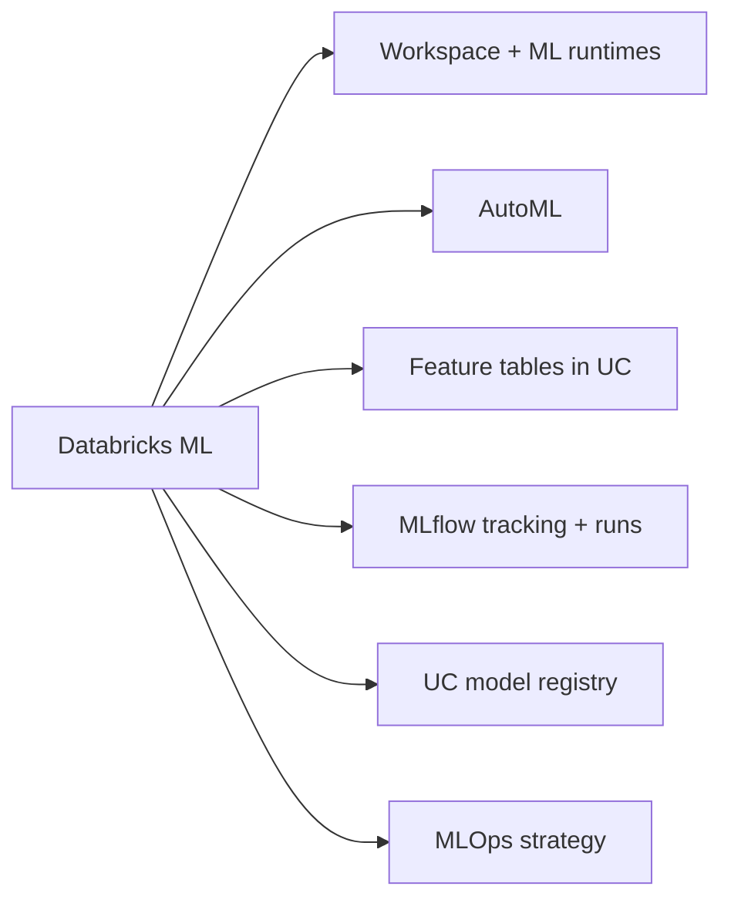

# Databricks Machine Learning (38 % of Exam)

Section 1 of the exam guide and the largest domain. It covers the Databricks-specific ML surface: MLOps strategy, ML runtimes, AutoML, feature tables in Unity Catalog, MLflow tracking, and the Unity Catalog model registry (aliases, tags, champion/challenger promotion).

## Topics Overview

## Section Contents

| File | Topic | Exam-guide bullets covered | Priority |
| :--- | :--- | :--- | :--- |
| [01-databricks-ml-workspace.md](./01-databricks-ml-workspace.md) | Notebooks, widgets, Git folders, permissions | Context for every Section 1 bullet | Medium |
| [02-compute-clusters-ml.md](./02-compute-clusters-ml.md) | ML runtime advantages, compute choices | Advantages of ML runtimes | High |
| [03-databricks-automl.md](./03-databricks-automl.md) | AutoML for classification / regression / forecasting | AutoML model/feature selection; advantages of AutoML | High |
| [04-feature-store.md](./04-feature-store.md) | Feature Engineering in Unity Catalog | UC vs workspace feature tables; create, write, train, score; online vs offline | High |
| [05-mlflow-tracking.md](./05-mlflow-tracking.md) | Manual logging, autolog, log models | Manually log metrics, artifacts, and models | High |
| [06-experiments-runs.md](./06-experiments-runs.md) | Experiments, run search, MLflow UI | Best run via MLflow Client API; information in the MLflow UI | High |
| [07-model-registry.md](./07-model-registry.md) | Models in Unity Catalog | Register via Client API; UC vs workspace registry; tags; champion/challenger aliases | High |
| [08-mlops-strategy.md](./08-mlops-strategy.md) | Environments, CI/CD, deploy code vs deploy models | MLOps best practices; promote code vs promote models | High |

## Key Concepts

| Concept | Why it matters |
| :--- | :--- |
| **Databricks Runtime for ML** | Pre-installed, version-tested ML/DL libraries + MLflow + AutoML; GPU variants |
| **AutoML** | Glass-box baselines: one MLflow run per trial, editable best-trial notebook, SHAP importance |
| **Feature tables in UC** | `FeatureEngineeringClient.create_table` / `write_table(mode="merge")`; `fe.log_model` + `fe.score_batch` |
| **MLflow Client API** | `MlflowClient().search_runs(..., order_by=[...])` to find the best run |
| **Models in Unity Catalog** | `catalog.schema.model`; aliases (`@champion`) instead of stages; governed by UC privileges |
| **Deploy code vs deploy models** | Databricks recommends deploy code in most situations |

## Related Resources

- [MLflow Basics (shared)](../../../shared/fundamentals/mlflow-basics.md)
- [Feature Engineering Basics (shared)](../../../shared/fundamentals/feature-engineering-basics.md)
- [MLflow cheat sheet (shared)](../../../shared/cheat-sheets/mlflow-quick-ref.md)
- [Hands-on Lab 04 — MLflow tracking and Model Registry in UC](../../../labs/04-mlflow-tracking.md)
- [Databricks machine learning documentation](https://docs.databricks.com/aws/en/machine-learning/)

---

**[↑ Back to ML Associate](../README.md) | [Next: Data Processing →](../02-data-processing/README.md)** *(first domain — no previous)*
