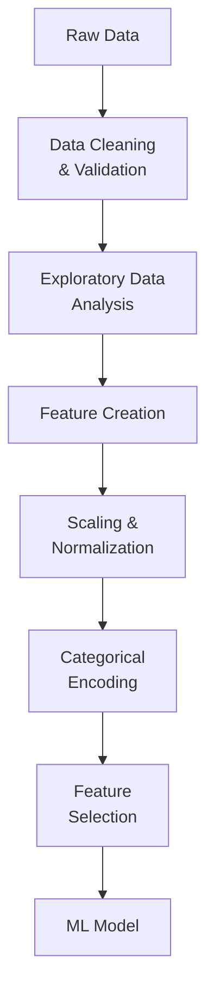

# Feature Engineering Techniques

## Overview

Feature engineering transforms raw data into meaningful features that improve model performance. It's often the most impactful component of machine learning. This file covers the Section 2 (Data Processing) bullets on **imputation**, **one-hot encoding**, and **log-scale transformation**.

> [!abstract]
>
> - Impute with the **mean** (symmetric data), **median** (skewed data / outliers), or **mode** (categorical or discrete data) — after looking at the distribution
> - Spark ML `Imputer` supports `strategy="mean"` (default), `"median"`, and `"mode"` on numeric columns
> - One-hot encoding (`StringIndexer` → `OneHotEncoder`) suits nominal features for linear / distance-based models; avoid it for high-cardinality or ordinal features and usually for tree-based models
> - Log transforms compress right-skewed, positive features or targets that span orders of magnitude

> [!tip] What the Exam Tests
>
> - *Compare and contrast imputing with the mean, median, or mode* — and *impute* with each
> - *Use one-hot encoding* and *identify the model types or data sets for which it is or is not appropriate*
> - *Identify scenarios where log-scale transformation is appropriate*

---

## Feature Engineering Pipeline



## Handling Missing Values

### **Removal vs Imputation**

```python
from pyspark.ml.feature import Imputer
from pyspark.sql import functions as F

df = spark.read.table("data")

# Option 1: REMOVE rows with missing values
# Use if: Missing data is rare (< 5%)

df_clean = df.dropna()

# Option 2: REMOVE columns with too many missing values
# Use if: Column has > 50% missing

df_clean = df.select([c for c in df.columns if df.filter(F.col(c).isNull()).count() / df.count() < 0.5])

# Option 3: IMPUTATION - Replace missing values
# Spark ML Imputer: strategy = "mean" (default) | "median" | "mode"; numeric columns only

imputer = Imputer(
    inputCols=["age", "income", "tenure"],
    outputCols=["age_imp", "income_imp", "tenure_imp"],
    strategy="median"
)
imputer_model = imputer.fit(train_df)          # learn medians on TRAINING data only
df_imputed = imputer_model.transform(df)

# Forward/backward fill (for time series)

from pyspark.sql.window import Window
window = Window.orderBy("date").rowsBetween(-1, 0)
df_filled = df.withColumn("value_filled", F.coalesce(
    F.col("value"),
    F.last(F.col("value"), ignorenulls=True).over(window)
))

# Domain-specific imputation

df_imputed = df.withColumn("category",
    F.when(F.col("category").isNull(), "Unknown")
     .otherwise(F.col("category"))
)
```

### **Mean vs Median vs Mode**

| Strategy | Best for | Weakness | Spark / pandas |
| :--- | :--- | :--- | :--- |
| **Mean** | Continuous, roughly **symmetric** features with no strong outliers | Pulled toward outliers; distorts skewed distributions | `Imputer(strategy="mean")` / `pdf[c].fillna(pdf[c].mean())` |
| **Median** | Continuous features that are **skewed** or contain **outliers** (income, price) | Ignores the shape of the tails | `Imputer(strategy="median")` / `pdf[c].fillna(pdf[c].median())` |
| **Mode** | **Categorical** or discrete features (most frequent value) | Over-represents the dominant level | `Imputer(strategy="mode")` for numeric codes; `fillna({c: most_frequent})` for strings |

```python
from pyspark.sql import functions as F

# Mode for a STRING categorical column (Imputer only accepts numeric columns)
most_frequent = (train_df.groupBy("region").count()
    .orderBy(F.desc("count")).first()["region"])
df = df.fillna({"region": most_frequent})

# Keep a missingness indicator — "was missing" can itself be predictive
df = df.withColumn("income_was_null", F.col("income").isNull().cast("int"))
```

> [!warning] Common Mistake
> There is no "always correct" imputation. A tool such as scikit-learn's `SimpleImputer` does **not** pick a strategy from the distribution — it uses whatever `strategy` you set (default mean). Examine the distribution (histogram, `summary()`), then choose: skew/outliers → median, symmetric → mean, categorical → mode. Fit the imputer on training data only.

Sources: [PySpark `Imputer`](https://spark.apache.org/docs/latest/api/python/reference/api/pyspark.ml.feature.Imputer.html), [scikit-learn `SimpleImputer`](https://scikit-learn.org/stable/modules/generated/sklearn.impute.SimpleImputer.html).

## Categorical Encoding

### **String Indexer**

```python
from pyspark.ml.feature import StringIndexer

# Converts categories to indices (0, 1, 2, ...)

indexer = StringIndexer(
    inputCol="region",
    outputCol="region_idx",
    handleInvalid="keep",            # unseen labels get an extra index instead of an error
    stringOrderType="frequencyDesc"  # default: MOST frequent category gets index 0
)

# Other orders: frequencyAsc (least frequent = 0), alphabetDesc, alphabetAsc
# Ties under frequencyDesc/Asc are broken alphabetically

indexed_df = indexer.fit(df).transform(df)

# Example output (frequencyDesc):
# region     = ["North", "South", "North", "East", "South", "North"]
# region_idx = [0.0,     1.0,     0.0,     2.0,    1.0,     0.0]   # North (3) → 0, South (2) → 1, East (1) → 2

```

### **One-Hot Encoder**

```python
from pyspark.ml.feature import OneHotEncoder

# Converts indices to binary vectors (one-hot)

encoder = OneHotEncoder(
    inputCols=["region_idx"],
    outputCols=["region_vec"],
    dropLast=True  # Drop one column to avoid multicollinearity
)

encoded_df = encoder.fit(df).transform(df)

# Example (with 3 categories and dropLast=True):
# region_idx = 0 → region_vec = [1, 0]
# region_idx = 1 → region_vec = [0, 1]
# region_idx = 2 → region_vec = [0, 0]

```

### **When One-Hot Encoding Is (and Is Not) Appropriate**

| Situation | One-hot? | Why / alternative |
| :--- | :--- | :--- |
| Nominal feature, few levels, **linear / logistic regression, SVM, k-NN, neural nets** | ✅ Yes | These models treat numeric inputs as ordered magnitudes; an index like 0/1/2 would imply a false order |
| **High-cardinality** feature (zip code, user ID, thousands of levels) | ❌ Usually no | Explodes dimensionality into very sparse vectors — use target/frequency encoding, hashing, or embeddings |
| **Ordinal** feature (small < medium < large) | ❌ No | One-hot throws the order away — use an ordinal mapping |
| **Tree-based models** (decision trees, random forest, gradient-boosted trees) | ⚠️ Often not needed | Trees split on indexed categories directly; one-hot splits a categorical feature across many sparse columns and can weaken splits |
| Unseen categories at inference | Plan for it | `StringIndexer(handleInvalid="keep")` and `OneHotEncoder(handleInvalid="keep")` |

> [!note]
> `dropLast=True` (the default) drops one level so the columns are not perfectly collinear — this matters for linear models, not for trees.

### **Target Encoding**

```python

# Replace category with target variable mean
# Use when: High cardinality categories

df_with_target = df.select("region", "label")

# Calculate mean target value for each region

target_encoding = (df_with_target
    .groupBy("region")
    .agg(F.mean("label").alias("region_target_mean"))
)

# Join back to original data

df_target_encoded = (df
    .join(target_encoding, "region")
    .drop("region")
    .withColumnRenamed("region_target_mean", "region_encoded")
)

# Problem: Risk of target leakage if not careful
# Solution: Fit encoding on training set, apply to test set

```

### **Ordinal/Label Encoding**

```python

# Use when: Categories have natural order

# Manual mapping for ordinal data

from pyspark.sql.functions import when, col

df_encoded = df.withColumn("size_encoded",
    when(col("size") == "small", 1)
    .when(col("size") == "medium", 2)
    .when(col("size") == "large", 3)
    .otherwise(0)
)

# StringIndexer cannot follow a business order (small < medium < large):
# frequency/alphabet ordering would scramble it, so prefer the explicit mapping above.
```

## Numerical Feature Scaling

### **StandardScaler**

```python
from pyspark.ml.feature import VectorAssembler, StandardScaler

# Standardize: (x - mean) / std → mean=0, std=1
# Best for: Linear models, Neural Networks, KMeans

assembler = VectorAssembler(inputCols=["age", "income"], outputCol="features")
scaler = StandardScaler(
    inputCol="features",
    outputCol="scaledFeatures",
    withMean=True,     # Center to mean=0
    withStd=True       # Scale to std=1
)

pipeline = Pipeline(stages=[assembler, scaler])
df_scaled = pipeline.fit(df).transform(df)

# Benefits:
# - Prevents feature dominance
# - Speeds up convergence
# - Better for regularization (L1, L2)

```

### **MinMaxScaler**

```python
from pyspark.ml.feature import MinMaxScaler

# Scale to [min, max] range (default: [0, 1])

scaler = MinMaxScaler(
    inputCol="features",
    outputCol="scaledFeatures",
    min=0,
    max=1
)

df_scaled = scaler.fit(df).transform(df)

# Formula: (x - min(x)) / (max(x) - min(x))
# Best for: Tree models don't need scaling, but they use it for NN input
# Sensitive to outliers

```

### **RobustScaler (Manual)**

```python

# Use for data with outliers
# (x - median) / IQR

from pyspark.sql.functions import percentile_approx, col

# Calculate percentiles

percentiles = df.agg(
    percentile_approx("age", 0.25).alias("q1"),
    percentile_approx("age", 0.75).alias("q3")
)

q1 = percentiles.collect()[0]["q1"]
q3 = percentiles.collect()[0]["q3"]
iqr = q3 - q1

# Scale using IQR

df_scaled = df.withColumn("age_scaled", (col("age") - q1) / iqr)
```

## Log-Scale Transformation

Apply a log transform when a feature or target is **positive and strongly right-skewed**, spanning several orders of magnitude (prices, incomes, counts, durations), or when effects are multiplicative. The log compresses large values and makes the distribution more symmetric, which helps linear models and distance-based methods.

```python
from pyspark.sql import functions as F

df_log = (df
    .withColumn("log_price", F.log("price"))        # natural log; price must be > 0
    .withColumn("log1p_reviews", F.log1p("num_reviews")))   # log(1 + x) handles zeros
```

| Appropriate | Not appropriate |
| :--- | :--- |
| Right-skewed, positive values spanning orders of magnitude | A feature that is already ~normal / centred near zero |
| Variance that grows with the level (heteroscedastic) | Zero values (use `log1p`) or negative values (log is undefined) |
| Multiplicative relationships you want to make additive | High-cardinality categoricals (not a cardinality-reduction tool) |

> [!warning] Common Mistake
> If you log-transform the **target**, the model predicts in log space. **Exponentiate predictions** (`exp`, or `expm1` after `log1p`) before computing RMSE/MAE in the original units or explaining predictions to the business — see [Model Evaluation & Metrics](../03-model-development/03-model-evaluation.md).

## Feature Interactions

### **Creating Interaction Features**

```python
from pyspark.sql.functions import col

# Polynomial interaction

df_interactions = df.withColumn("age_income_interaction", col("age") * col("income"))
df_interactions = df_interactions.withColumn("income_squared", col("income") ** 2)

# Polynomial expansion

from pyspark.ml.feature import PolynomialExpansion

poly = PolynomialExpansion(
    inputCol="features",
    outputCol="polyFeatures",
    degree=2  # Create degree-2 polynomials
)

# For features [a, b]:
# Output: [a, b, a², ab, b²]

```

### **Feature Ratios**

```python
# Engineer domain-specific features

df_ratios = (df
    .withColumn("charge_per_tenure", col("monthly_charge") / (col("tenure") + 1))
    .withColumn("total_charge_ratio", col("total_charges") / (col("monthly_charge") + 1))
    .withColumn("service_diversity", col("num_services") / col("account_age"))
)
```

## Feature Selection

### **Filtering by Variance**

```python
from pyspark.ml.feature import VarianceThresholdSelector

# Remove low-variance features (likely not predictive)

selector = VarianceThresholdSelector(
    featuresCol="features",
    outputCol="selectedFeatures",
    varianceThreshold=0.01  # Remove if variance < 0.01
)

df_selected = selector.fit(df).transform(df)
```

### **Correlation Analysis**

```python
# Select features with high correlation to target

from pyspark.sql.functions import corr

correlations = {}
for col_name in numeric_cols:
    corr_value = df.stat.corr(col_name, "label")
    if abs(corr_value) > 0.1:  # Keep if |correlation| > 0.1
        correlations[col_name] = corr_value

print("Important features:", correlations)
```

### **Recursive Feature Elimination (Manual)**

```python
# Iteratively remove least important features

from pyspark.ml.classification import RandomForestClassifier

def rfe_step(df, target_features):
    """Remove least important feature"""
    rf = RandomForestClassifier(
        numTrees=100,
        labelCol="label",
        maxDepth=10
    )

    assembler = VectorAssembler(inputCols=target_features, outputCol="features")
    df_with_features = assembler.transform(df)

    model = rf.fit(df_with_features)

    # Get feature importance
    feature_importance = {}
    for i, feat in enumerate(target_features):
        feature_importance[feat] = model.featureImportances[i]

    # Remove least important
    least_important = min(feature_importance, key=feature_importance.get)
    return [f for f in target_features if f != least_important]

# Iteratively remove until desired number reached

features = numeric_cols.copy()
while len(features) > 10:
    features = rfe_step(df, features)
```

## Temporal Features

### **Time-Based Feature Engineering**

```python
from pyspark.sql.functions import col, dayofweek, dayofyear, month, year, hour
from pyspark.sql.types import TimestampType

df_temporal = (df
    # Basic temporal
    .withColumn("date", col("timestamp").cast(TimestampType()))
    .withColumn("year", year(col("date")))
    .withColumn("month", month(col("date")))
    .withColumn("day_of_week", dayofweek(col("date")))  # 1=Sunday, 7=Saturday
    .withColumn("day_of_year", dayofyear(col("date")))
    .withColumn("hour", hour(col("date")))

    # Derived
    .withColumn("is_weekend", (col("day_of_week").isin([1, 7])).cast("int"))
    .withColumn("is_business_hours", ((col("hour") >= 9) & (col("hour") <= 17)).cast("int"))
    .withColumn("is_month_start", (col("day_of_month") <= 3).cast("int"))
)
```

### **Lag and Lead Features**

```python
from pyspark.sql.window import Window

# Create lag features (previous values)

window = Window.partitionBy("customer_id").orderBy("date").rowsBetween(-1, -1)

df_lag = (df
    .withColumn("prev_value", F.lag("value").over(window))
    .withColumn("prev_prev_value", F.lag("value", 2).over(window))
)

# Create rolling statistics

window_rolling = Window.partitionBy("customer_id").orderBy("date").rowsBetween(-6, 0)

df_rolling = (df
    .withColumn("rolling_mean_7", F.mean("value").over(window_rolling))
    .withColumn("rolling_std_7", F.stddev("value").over(window_rolling))
)
```

## Text Feature Extraction

### **TF-IDF (Term Frequency - Inverse Document Frequency)**

```python
from pyspark.ml.feature import Tokenizer, CountVectorizer, IDF

# Tokenize text

tokenizer = Tokenizer(inputCol="text", outputCol="words")

# Count word frequencies

cv = CountVectorizer(
    inputCol="words",
    outputCol="rawFeatures",
    vocabSize=1000,  # Top 1000 words
    minDF=2  # Appear in at least 2 docs
)

# TF-IDF

idf = IDF(inputCol="rawFeatures", outputCol="features")

# Pipeline it

pipeline = Pipeline(stages=[tokenizer, cv, idf])
features = pipeline.fit(df).transform(df)
```

## Feature Engineering Checklist

```python
checklist = {
    "Data Cleaning": [
        "✓ Handle missing values",
        "✓ Detect outliers",
        "✓ Fix data type issues",
        "✓ Handle duplicates"
    ],
    "Encoding": [
        "✓ Encode categorical variables",
        "✓ Handle high-cardinality categories",
        "✓ Check for multicollinearity",
        "✓ Avoid target leakage"
    ],
    "Scaling": [
        "✓ Normalize/standardize numeric features",
        "✓ Handle different units",
        "✓ Consider outlier sensitivity",
        "✓ Fit on train, apply to test"
    ],
    "Engineering": [
        "✓ Create domain-specific features",
        "✓ Extract temporal patterns",
        "✓ Create feature interactions",
        "✓ Document feature creation"
    ],
    "Selection": [
        "✓ Remove low-variance features",
        "✓ Check feature importance",
        "✓ Handle multicollinearity",
        "✓ Domain expert validation"
    ]
}
```

## Real-World Example: Customer Feature Engineering

```python
%python
from pyspark.sql import functions as F
from pyspark.ml import Pipeline
from pyspark.ml.feature import StringIndexer, OneHotEncoder, VectorAssembler, StandardScaler

# Load raw customer data

df_raw = spark.read.table("raw.customers")

# STEP 1: Impute missing values

from pyspark.ml.feature import Imputer

df_imputed = (Imputer(inputCols=["income"], outputCols=["income"], strategy="median")
    .fit(df_raw)
    .transform(df_raw)
    .fillna({"region": "Unknown"}))

# STEP 2: Create features

df_featured = (df_imputed
    .withColumn("tenure_days", F.datediff(F.current_date(), F.col("signup_date")))
    .withColumn("monthly_usage_ratio", F.col("monthly_usage") / (F.col("historical_usage") + 1))
    .withColumn("is_high_value", (F.col("annual_revenue") > 50000).cast("int"))
)

# STEP 3: Categorical encoding + scaling

pipeline = Pipeline(stages=[
    StringIndexer(inputCol="region", outputCol="region_idx"),
    StringIndexer(inputCol="segment", outputCol="segment_idx"),
    OneHotEncoder(inputCols=["region_idx", "segment_idx"],
                  outputCols=["region_vec", "segment_vec"]),
    VectorAssembler(inputCols=["tenure_days", "monthly_usage_ratio",
                               "is_high_value", "region_vec", "segment_vec"],
                   outputCol="features"),
    StandardScaler(inputCol="features", outputCol="scaledFeatures")
])

df_engineered = pipeline.fit(df_featured).transform(df_featured)

# STEP 4: Save for modeling

(df_engineered.select("customer_id", "scaledFeatures", "label")
    .write.mode("overwrite")
    .saveAsTable("ml_ready.customer_features"))
```

## Use Cases

- **Customer Churn Prediction Pipeline**: Engineering features like tenure-to-charge ratio, rolling 7-day usage averages, and weekend activity flags from raw customer data, then assembling them into a Spark ML Pipeline for model training.
- **High-Cardinality Categorical Handling**: Using target encoding for a `zip_code` column with 40,000 distinct values where one-hot encoding would create too many sparse features, while carefully fitting the encoding only on training data to avoid leakage.

## Common Issues & Errors

### Feature Leakage Causing Unrealistic Metrics

**Scenario:** Model scores 99% accuracy in training but performs poorly in production.
**Fix:** Check for target leakage -- ensure no features are derived from the target variable or future data. Fit transformers (scalers, encoders, imputers) only on training data, then apply the fitted transformer to test data.

### OneHotEncoder Fails on Unseen Categories at Inference Time

**Scenario:** `StringIndexer` raises an error when production data contains a category value not seen during training (e.g., a new `region` value).
**Fix:** Set `handleInvalid="keep"` on the `StringIndexer` to map unknown categories to a separate index rather than throwing an error.

## Exam Tips

- Rule of thumb (not a Databricks rule): drop rows when very few are missing, drop a column when most of it is missing, impute in between
- Mean for symmetric, **median for skewed/outliers**, **mode for categorical**; `Imputer` supports all three on numeric columns
- Log-transform right-skewed positive features/targets; exponentiate log-space predictions before reporting metrics
- One-hot encode nominal features for linear models; avoid it for high-cardinality or ordinal features
- The required sequence is `StringIndexer` (string to numeric index) then `OneHotEncoder` (index to binary vector) -- OHE cannot accept raw strings
- `StandardScaler` is essential for distance-based models (logistic regression, SVM, KMeans) but unnecessary for tree-based models (Random Forest, XGBoost)
- Target encoding risks data leakage -- always fit encoding on training data only, never on the full dataset including test
- `VectorAssembler` combines multiple feature columns into a single `features` vector column required by Spark ML estimators
- `dropLast=True` on `OneHotEncoder` removes one column to prevent multicollinearity in linear models

## Key Takeaways

- Feature engineering often more impactful than algorithm choice
- Missing value handling depends on percentage missing
- Categorical encoding requires careful ordering
- Scaling essential for distance-based and linear models
- Feature interactions capture non-linear relationships
- Always fit transformations on training data, apply to test
- Domain knowledge crucial for creating meaningful features

## Related Topics

- [Exploratory Data Analysis for ML](./01-exploratory-data-analysis.md)
- [Spark ML Pipelines](../03-model-development/01-spark-ml-pipelines.md)
- [Feature Store in Unity Catalog](../01-databricks-machine-learning/04-feature-store.md)
- [Feature Engineering Basics (shared)](../../../shared/fundamentals/feature-engineering-basics.md)

## Official Documentation

- [Spark ML Features](https://spark.apache.org/docs/latest/ml-features.html)
- [PySpark `Imputer`](https://spark.apache.org/docs/latest/api/python/reference/api/pyspark.ml.feature.Imputer.html)
- [PySpark `StringIndexer`](https://spark.apache.org/docs/latest/api/python/reference/api/pyspark.ml.feature.StringIndexer.html)

---

**[← Previous: Exploratory Data Analysis for ML](./01-exploratory-data-analysis.md) | [↑ Back to Section](./README.md)**
