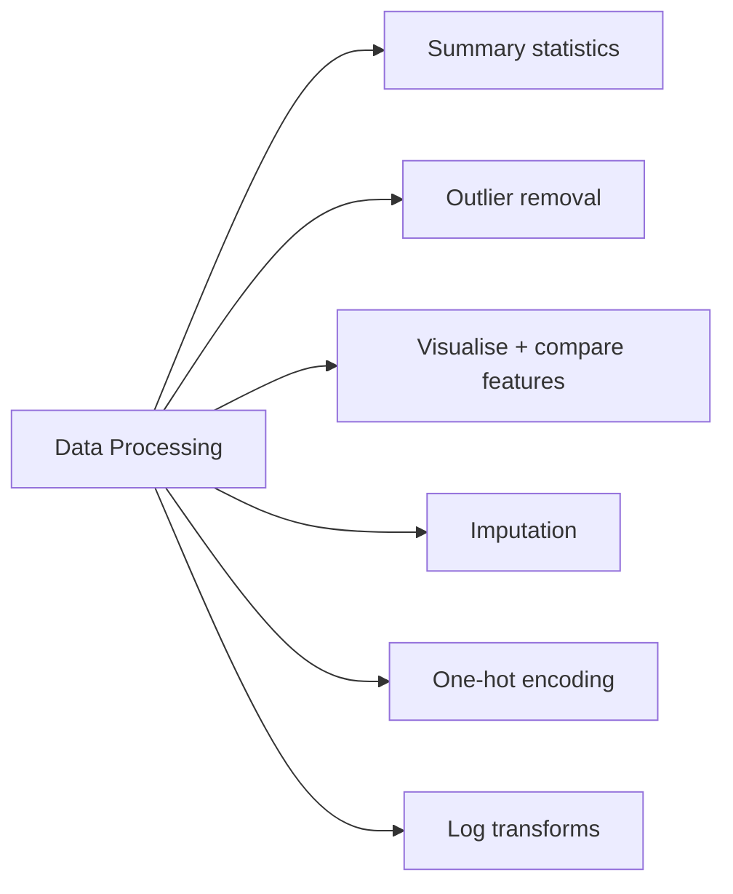

# Data Processing (19 % of Exam)

Section 2 of the exam guide. It covers what you do to the data before training: profiling it with summary statistics, removing outliers, visualising and comparing features, imputing missing values, one-hot encoding categorical features, and deciding when a log transform helps.

> [!note] Section name: PDF vs certification page
> The exam-guide PDF (re-issued "August 2026", exam version Mar 1, 2025) calls this section **"Data Processing (19%)"** and lists the bullets below. The certification web page still labels the 19 % domain **"ML Workflows"**. This guide follows the PDF, which is the source of truth. MLflow tracking — which older versions of this guide filed under "ML Workflows" — is a Section 1 skill in the PDF and now lives in [Databricks Machine Learning](../01-databricks-machine-learning/README.md).

## Topics Overview

## Section Contents

| File | Topic | Exam-guide bullets covered | Priority |
| :--- | :--- | :--- | :--- |
| [01-exploratory-data-analysis.md](./01-exploratory-data-analysis.md) | `summary()`, `dbutils.data.summarize`, outliers, plots, feature comparisons | Summary statistics; outliers (std dev / IQR); visualisations; compare two categorical / two continuous features | High |
| [02-feature-engineering-techniques.md](./02-feature-engineering-techniques.md) | Imputation, encoding, scaling, log transforms | Mean vs median vs mode imputation; impute; one-hot encoding and when it is (not) appropriate; log-scale transformation | High |

## Key Concepts

| Concept | Why it matters |
| :--- | :--- |
| **`df.summary()`** | count, mean, stddev, min, quartiles, max in one call |
| **`dbutils.data.summarize(df)`** | Databricks' rendered data summary of a Spark or pandas DataFrame |
| **IQR fences** | Q1 − 1.5·IQR … Q3 + 1.5·IQR — robust outlier bounds for skewed data |
| **`Imputer(strategy=...)`** | `mean` (default), `median`, `mode` — choose after inspecting the distribution |
| **`StringIndexer` → `OneHotEncoder`** | Index first, then encode; skip one-hot for high-cardinality / ordinal features |
| **Log transform** | For right-skewed positive values; exponentiate log-space predictions before metrics |

## Related Resources

- [Feature Engineering Basics (shared)](../../../shared/fundamentals/feature-engineering-basics.md)
- [PySpark API cheat sheet (shared)](../../../shared/cheat-sheets/pyspark-api-quick-ref.md)
- [Spark ML feature transformers](https://spark.apache.org/docs/latest/ml-features.html)

---

**[← Previous: Databricks Machine Learning](../01-databricks-machine-learning/README.md) | [↑ Back to ML Associate](../README.md) | [Next: Model Development →](../03-model-development/README.md)**
