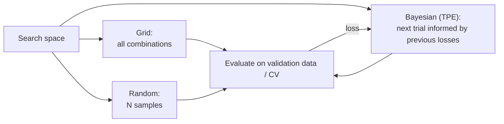

# Hyperparameter Tuning & Cross-Validation

## Overview

Hyperparameters (tree depth, learning rate, regularisation strength) are set *before* training and are chosen by searching: try candidate values, evaluate each on held-out data, keep the best. Section 3 (Model Development, 31 %) tests the search strategies, Hyperopt's `fmin`, parallelising single-node models, cross-validation vs a train-validation split, and counting how many models a grid search trains.

> [!abstract]
>
> - **Grid search** tries every combination; **random search** samples combinations; **Bayesian search** (Hyperopt TPE, Optuna TPE) uses past results to choose the next trial
> - Spark ML: `ParamGridBuilder` + `CrossValidator` (k-fold) or `TrainValidationSplit` (one split); then a final refit on all training data
> - Hyperopt: `fmin(fn, space, algo, max_evals, trials)` minimises a loss; `SparkTrials` parallelises **single-node** models (e.g. scikit-learn) across the cluster
> - Models trained by grid + k-fold CV = **combinations × k** (plus one final refit in tools that refit)

> [!tip] What the Exam Tests
>
> - *Use Hyperopt's `fmin` operation* and *perform random, grid, or Bayesian search*
> - *Parallelize single-node models for hyperparameter tuning* (`SparkTrials`, not for MLlib)
> - *Benefits and downsides of cross-validation vs a train-validation split*, *perform cross-validation*, and *count the models trained*

---

## Search Strategies

| Strategy | How it picks the next trial | Strengths | Weaknesses |
| :--- | :--- | :--- | :--- |
| **Grid search** | Every combination of listed values | Exhaustive, simple, reproducible | Cost grows multiplicatively with every parameter; wastes trials on unimportant parameters |
| **Random search** | Random samples from ranges/distributions | Covers wide ranges cheaply; often as good as grid with far fewer trials | No learning between trials |
| **Bayesian search** (e.g. TPE) | Builds a model of "params → loss" from completed trials and proposes promising regions | Fewest trials to a good result | Sequential by nature — heavy parallelism reduces its advantage |



## Spark ML: Grid Search with Cross-Validation

```python
from pyspark.ml import Pipeline
from pyspark.ml.classification import RandomForestClassifier
from pyspark.ml.evaluation import BinaryClassificationEvaluator
from pyspark.ml.tuning import CrossValidator, ParamGridBuilder, TrainValidationSplit

rf = RandomForestClassifier(featuresCol="features", labelCol="label")
pipeline = Pipeline(stages=[indexer, encoder, assembler, rf])

param_grid = (ParamGridBuilder()
    .addGrid(rf.maxDepth, [4, 8, 12])
    .addGrid(rf.numTrees, [50, 100])
    .build())                                   # 3 x 2 = 6 combinations

evaluator = BinaryClassificationEvaluator(labelCol="label", metricName="areaUnderROC")

cv = CrossValidator(
    estimator=pipeline,                         # whole pipeline -> preprocessing refit inside each fold
    estimatorParamMaps=param_grid,
    evaluator=evaluator,
    numFolds=5,                                 # default is 3
    parallelism=4,                              # evaluate up to 4 param maps concurrently
    seed=42,
)
cv_model = cv.fit(train_df)                     # 6 x 5 = 30 fits, then 1 refit on all of train_df
best_pipeline = cv_model.bestModel
print(cv_model.avgMetrics)                      # mean metric per param map

tvs = TrainValidationSplit(
    estimator=pipeline,
    estimatorParamMaps=param_grid,
    evaluator=evaluator,
    trainRatio=0.8,                             # default 0.75
)
tvs_model = tvs.fit(train_df)                   # 6 fits, then 1 refit
```

- `CrossValidator`: "After identifying the best `ParamMap`, `CrossValidator` finally re-fits the `Estimator` using the best `ParamMap` and the entire dataset"
- `TrainValidationSplit` "only evaluates each combination of parameters once, as opposed to k times in the case of `CrossValidator`"
- `parallelism` defaults to 1 (serial); "a value up to 10 should be sufficient for most clusters"

Source: [Spark ML Tuning](https://spark.apache.org/docs/latest/ml-tuning.html).

### **Counting the models trained**

| Setup | Fits during search | Final refit | Typical exam answer |
| :--- | :--- | :--- | :--- |
| Grid of 3 × 2 × 3 values, 5-fold CV | 18 × 5 = 90 | +1 (if the tool refits) | **combinations × folds** |
| Grid of 6 combinations, `TrainValidationSplit` | 6 | +1 | combinations |
| Hyperopt `max_evals=50`, no CV inside the objective | 50 | — | `max_evals` |
| Hyperopt `max_evals=50`, 3-fold CV inside the objective | 50 × 3 = 150 | — | evals × folds |

> [!warning] Common Mistake
> Multiply, don't add: the grid size is the **product** of the number of values per hyperparameter, and k-fold CV trains **k** models per combination. Spark's `CrossValidator` and scikit-learn's `GridSearchCV(refit=True)` then fit one more model on all the training data; the official sample question counts only combinations × folds, so read whether the question asks about the search or "in total including the final model".

## Cross-Validation vs Train-Validation Split

| | k-fold cross-validation | Single train-validation split |
| :--- | :--- | :--- |
| **How** | Train on k−1 folds, validate on the held-out fold, repeat k times, average | Train once on one part, validate once on the rest |
| **Benefits** | Every row is used for validation once → **lower-variance, more reliable estimate**; better on small datasets | **k times cheaper / faster**; fine on large datasets |
| **Downsides** | **k times the training cost**; slower | Estimate depends on one random split → higher variance; wastes data on small datasets |
| **Spark ML** | `CrossValidator(numFolds=k)` | `TrainValidationSplit(trainRatio=...)` |
| **scikit-learn** | `cross_val_score`, `GridSearchCV(cv=k)` | `train_test_split` |

Neither replaces a final, untouched **test set** for reporting the chosen model's performance.

## Hyperopt: `fmin` for Bayesian and Random Search

```python
import mlflow
from hyperopt import fmin, tpe, rand, hp, Trials, SparkTrials, STATUS_OK, space_eval
from sklearn.ensemble import GradientBoostingClassifier
from sklearn.model_selection import cross_val_score

search_space = {
    "n_estimators": hp.quniform("n_estimators", 50, 500, 50),
    "max_depth": hp.quniform("max_depth", 2, 8, 1),
    "learning_rate": hp.loguniform("learning_rate", -5, 0),   # e^-5 .. e^0
    "subsample": hp.uniform("subsample", 0.5, 1.0),
}

def objective(params):
    model = GradientBoostingClassifier(
        n_estimators=int(params["n_estimators"]),
        max_depth=int(params["max_depth"]),
        learning_rate=params["learning_rate"],
        subsample=params["subsample"],
    )
    auc = cross_val_score(model, X_train, y_train, cv=3, scoring="roc_auc").mean()
    return {"loss": -auc, "status": STATUS_OK}    # fmin MINIMISES, so negate a score

with mlflow.start_run(run_name="gbt_hyperopt"):
    best = fmin(
        fn=objective,
        space=search_space,
        algo=tpe.suggest,                 # Bayesian (Tree-structured Parzen Estimator)
        max_evals=40,                     # number of hyperparameter settings = models to fit
        trials=SparkTrials(parallelism=8),
    )

print(space_eval(search_space, best))     # map hp.choice indices back to values
```

| `fmin` argument | Meaning |
| :--- | :--- |
| `fn` | Objective; returns the loss (scalar or `{"loss": ..., "status": STATUS_OK}`) |
| `space` | Search space built from `hp.*` expressions |
| `algo` | `tpe.suggest` (Bayesian / adaptive) or `rand.suggest` (random search) |
| `max_evals` | "Number of hyperparameter settings to try (the number of models to fit)" |
| `trials` | `Trials()` (driver, sequential) or `SparkTrials(...)` (parallel on Spark workers) |

Grid search is not an `fmin` algorithm — use `ParamGridBuilder` / `GridSearchCV`, or enumerate a grid with `hp.choice` and random/TPE sampling.

### **Parallelising single-node models with `SparkTrials`**

- `SparkTrials` "is designed to parallelize computations for single-machine ML models such as scikit-learn" — each trial trains on one worker
- For **distributed** algorithms (Spark MLlib, Horovod) use the default `Trials` — model building is already parallelised on the cluster
- `parallelism` trade-off: "Because Hyperopt proposes new trials based on past results, there is a trade-off between parallelism and adaptivity" — more parallel trials finish faster but learn less from each other

Source: [Hyperopt concepts](https://docs.databricks.com/aws/en/machine-learning/automl-hyperparam-tuning/hyperopt-concepts).

> [!note] Platform update (Oct 2026)
> The Databricks docs now say "The open-source version of Hyperopt is no longer being maintained," and "Hyperopt is not included in Databricks Runtime for Machine Learning after 16.4 LTS ML." They recommend **Optuna** for single-node optimisation (parallelisable with Joblib, or across Spark executors with MLflow's `MlflowSparkStudy`) and **Ray Tune** for distributed tuning ([Hyperparameter tuning](https://docs.databricks.com/aws/en/machine-learning/automl-hyperparam-tuning/)). The exam guide still names Hyperopt's `fmin` — learn it, then practise the same ideas with Optuna on a current runtime.

```python
# The same idea with Optuna across Spark executors (MLflow 3 / DBR 17.0 ML+)
import mlflow
from mlflow.optuna.storage import MlflowStorage
from mlflow.pyspark.optuna.study import MlflowSparkStudy

storage = MlflowStorage(experiment_id=mlflow.get_experiment_by_name(experiment_path).experiment_id)
study = MlflowSparkStudy(study_name="gbt-tuning", storage=storage)   # default sampler: TPESampler
study.optimize(optuna_objective, n_trials=40, n_jobs=8)
```

Source: [Hyperparameter tuning with Optuna](https://docs.databricks.com/aws/en/machine-learning/automl-hyperparam-tuning/optuna).

## scikit-learn Equivalents

```python
from sklearn.model_selection import GridSearchCV, RandomizedSearchCV
from sklearn.svm import SVC

grid = GridSearchCV(
    SVC(),
    param_grid={"C": [0.1, 1, 10], "kernel": ["linear", "rbf"]},   # 3 x 2 = 6 combinations
    cv=5,                                                          # 6 x 5 = 30 fits (+1 refit)
    scoring="f1",
)
rand_search = RandomizedSearchCV(SVC(), param_distributions={"C": [0.01, 0.1, 1, 10, 100]},
                                 n_iter=10, cv=5)                  # 10 x 5 = 50 fits (+1 refit)
```

## Use Cases

- **Tuning a scikit-learn Model on a Cluster**: A gradient-boosting model that fits on one machine is tuned with Hyperopt TPE and `SparkTrials(parallelism=8)`, running eight trials at a time on workers while MLflow logs each trial as a child run.
- **Cheaper Tuning on Big Data**: A 2-billion-row Spark ML pipeline uses `TrainValidationSplit` instead of 5-fold `CrossValidator` to cut tuning cost by roughly 5×.

## Common Issues & Errors

### `SparkTrials` Used with a Spark MLlib Estimator

**Scenario:** Tuning a `pyspark.ml` model with `SparkTrials` fails or performs badly.
**Fix:** MLlib training is already distributed — use `Trials()` (or Spark ML's `CrossValidator`), and reserve `SparkTrials` for single-node libraries.

### Hyperopt Maximises the Wrong Thing

**Scenario:** The "best" parameters have the *worst* AUC.
**Fix:** `fmin` minimises. Return `-auc` (or `1 - auc`) as the loss; return RMSE/log loss as-is.

## Exam Tips

- ✅ Grid = exhaustive; random = sampled; Bayesian (TPE) = informed by previous trials
- ✅ `fmin(fn, space, algo=tpe.suggest | rand.suggest, max_evals, trials)`; the objective returns a **loss** to minimise
- ✅ `SparkTrials` → single-node models in parallel; `Trials` → distributed MLlib models
- ✅ CV: more reliable, k× cost; train-validation split: cheaper, noisier
- ✅ Models trained = (product of grid sizes) × folds; a final refit adds one
- ✅ `CrossValidator` default `numFolds=3`; `TrainValidationSplit` default `trainRatio=0.75`

## Key Takeaways

- Choose the search strategy by budget: grid for tiny spaces, random for wide spaces, Bayesian when trials are expensive
- Put the whole preprocessing pipeline inside the tuner so each fold is fit without leakage
- Parallelism speeds tuning but reduces how much Bayesian search can learn between trials
- Hyperopt is what the exam names; Optuna and Ray Tune are the platform's current recommendations

## Related Topics

- [Spark ML Pipelines](./01-spark-ml-pipelines.md)
- [Model Evaluation & Metrics](./03-model-evaluation.md)
- [Compute Clusters for ML](../01-databricks-machine-learning/02-compute-clusters-ml.md)
- [Experiments & Runs](../01-databricks-machine-learning/06-experiments-runs.md) — nested runs for tuning trials

## Official Documentation

- [Hyperparameter tuning on Databricks](https://docs.databricks.com/aws/en/machine-learning/automl-hyperparam-tuning/)
- [Hyperopt concepts](https://docs.databricks.com/aws/en/machine-learning/automl-hyperparam-tuning/hyperopt-concepts)
- [Hyperparameter tuning with Optuna](https://docs.databricks.com/aws/en/machine-learning/automl-hyperparam-tuning/optuna)
- [Spark ML Tuning](https://spark.apache.org/docs/latest/ml-tuning.html)

---

**[← Previous: Spark ML Pipelines](./01-spark-ml-pipelines.md) | [↑ Back to Section](./README.md) | [Next: Model Evaluation & Metrics →](./03-model-evaluation.md)**
