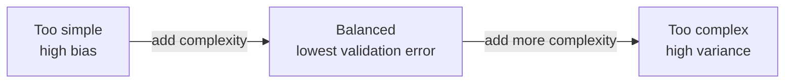

# Model Evaluation & Metrics

## Overview

Training a model is easy; knowing whether it is *good* — and good at the right thing — is the hard part. This file covers the Section 3 (Model Development) bullets on choosing an algorithm, handling imbalanced training data, classification and regression metrics, picking the metric that matches the objective, undoing log transforms before evaluation, and the bias-variance tradeoff.

> [!abstract]
>
> - Classification metrics: accuracy, precision, recall, **F1**, **log loss**, **ROC AUC** (and PR AUC); regression metrics: **RMSE**, **MAE**, **R²**
> - Imbalanced data: resample (over/under-sample), **class weights / cost-sensitive learning**, stratified splits, threshold tuning — and never judge by accuracy alone
> - If the target was log-transformed, **exponentiate predictions** before computing RMSE/MAE or interpreting them
> - Low training error + high validation error = **high variance (overfitting)**; high error on both = **high bias (underfitting)**

> [!tip] What the Exam Tests
>
> - *Use ML foundations to select the appropriate algorithm* and *identify methods to mitigate data imbalance*
> - *Use common classification and regression metrics* and *choose the most appropriate metric for a scenario*
> - *Exponentiate log-transformed variables* and *assess model complexity and the bias-variance tradeoff*

---

## Selecting an Algorithm

| Scenario | Good starting algorithms | Why |
| :--- | :--- | :--- |
| Predict a **number** (price, demand) | Linear regression (with regularisation), random forest / gradient-boosted trees | Regression task; trees capture non-linear effects |
| Predict a **category** (churn yes/no, product type) | Logistic regression, decision tree, random forest, gradient-boosted trees | Classification task |
| Need **interpretability** (regulated decisions) | Linear / logistic regression, shallow decision tree | Coefficients or rules are explainable |
| Strong **non-linear** relationships and interactions | Tree ensembles (random forest, XGBoost/LightGBM, GBT) | Learn interactions without manual feature crosses |
| **Very large** data on Spark | Spark ML `LogisticRegression`, `LinearRegression`, `RandomForest*`, `GBT*` | Distributed training |
| Group similar records **without labels** | k-means clustering | Unsupervised |
| Predict **future values over time** | Forecasting methods (e.g. Prophet / ARIMA via AutoML forecasting) | Time-series structure |

Start simple (a linear or shallow tree baseline), then add complexity only if validation metrics improve.

## Mitigating Class Imbalance

When one class dominates (e.g. 10 % churners), a model can score high accuracy by always predicting the majority class.

| Method | How | Notes |
| :--- | :--- | :--- |
| **Cost-sensitive learning / class weights** | Give minority-class errors a higher cost: `class_weight="balanced"` (scikit-learn), `weightCol` (Spark ML) | Directly counters bias toward the majority class; no data is discarded |
| **Oversample the minority class** | Duplicate minority rows, or synthesise them (e.g. SMOTE) | Apply to the **training** split only |
| **Undersample the majority class** | Randomly drop majority rows | Loses information; fast on big data |
| **Stratified splitting** | Keep the class ratio in train/validation/test | Prevents folds with almost no positives |
| **Threshold tuning** | Move the decision threshold away from 0.5 using the PR or ROC curve | Trades precision for recall |
| **Right metric** | F1, recall, precision, PR AUC, log loss — not accuracy | Measures minority-class performance |

```python
from pyspark.sql import functions as F
from pyspark.ml.classification import LogisticRegression

# Class weights in Spark ML: weight = (#rows / (#classes * #rows_in_class))
counts = {r["label"]: r["count"] for r in train_df.groupBy("label").count().collect()}
n, k = sum(counts.values()), len(counts)
train_w = train_df.withColumn(
    "weight",
    F.when(F.col("label") == 1, n / (k * counts[1])).otherwise(n / (k * counts[0])))

lr = LogisticRegression(featuresCol="features", labelCol="label", weightCol="weight")

# scikit-learn equivalent
from sklearn.ensemble import RandomForestClassifier
rf = RandomForestClassifier(class_weight="balanced")
```

> [!warning] Common Mistake
> Normalising features, using a simpler model, or collecting *more majority-class* data does not fix imbalance. Resample, re-weight, or change the threshold — and evaluate on the **original** class distribution (AutoML, for example, balances only the training split).

## Classification Metrics

| Metric | Formula / meaning | Use when |
| :--- | :--- | :--- |
| **Accuracy** | (TP + TN) / all | Classes are balanced and errors cost the same |
| **Precision** | TP / (TP + FP) — of predicted positives, how many are right | False positives are expensive (spam filter, fraud alerts that block customers) |
| **Recall** (sensitivity) | TP / (TP + FN) — of actual positives, how many are found | False negatives are expensive (disease screening, churn you must catch) |
| **F1** | Harmonic mean of precision and recall | Imbalanced classes; need one number balancing both |
| **ROC AUC** | Area under TPR-vs-FPR curve; threshold-independent ranking quality | Compare models' ranking ability across thresholds |
| **PR AUC** | Area under precision-recall curve | Heavy imbalance where positives are rare |
| **Log loss** | Penalises confident wrong probabilities | You need well-calibrated **probabilities** |

```python
from pyspark.ml.evaluation import BinaryClassificationEvaluator, MulticlassClassificationEvaluator

auc = BinaryClassificationEvaluator(labelCol="label", metricName="areaUnderROC").evaluate(preds)
pr_auc = BinaryClassificationEvaluator(labelCol="label", metricName="areaUnderPR").evaluate(preds)
f1 = MulticlassClassificationEvaluator(labelCol="label", metricName="f1").evaluate(preds)
logloss = MulticlassClassificationEvaluator(labelCol="label", metricName="logLoss").evaluate(preds)

from sklearn.metrics import f1_score, log_loss, roc_auc_score
f1_score(y_true, y_pred); log_loss(y_true, y_proba); roc_auc_score(y_true, y_proba)
```

## Regression Metrics

| Metric | Meaning | Notes |
| :--- | :--- | :--- |
| **RMSE** | √(mean squared error), in target units | Penalises large errors heavily; sensitive to outliers |
| **MAE** | Mean absolute error, in target units | Robust to outliers; every unit of error counts equally |
| **R²** | Share of variance explained (1 = perfect, 0 = predicts the mean, can be < 0) | Unitless; good for comparing fits on the same data |
| **MSE** | Mean squared error | Squared units; same ranking as RMSE |

```python
from pyspark.ml.evaluation import RegressionEvaluator

rmse = RegressionEvaluator(labelCol="price", predictionCol="prediction", metricName="rmse").evaluate(preds)
mae = RegressionEvaluator(labelCol="price", metricName="mae").evaluate(preds)
r2 = RegressionEvaluator(labelCol="price", metricName="r2").evaluate(preds)
```

## Choosing the Metric for the Objective

| Business objective | Metric |
| :--- | :--- |
| "Catch as many fraudulent transactions as possible" | **Recall** (with a precision floor) |
| "Only flag a customer when we are confident" | **Precision** |
| Rare positive class, balance both error types | **F1** or **PR AUC** |
| Rank customers by risk; threshold chosen later | **ROC AUC** |
| Probabilities feed a downstream cost model | **Log loss** |
| Forecast error in dollars, big misses are very costly | **RMSE** |
| Forecast error in dollars, outliers should not dominate | **MAE** |
| How much variance the model explains | **R²** |

## Exponentiating Log-Transformed Targets

If you trained on `log(price)`, the model's predictions are log-prices. RMSE computed on log values is not in dollars, and showing a "predicted price" of 12.3 is meaningless. Convert back first:

```python
from pyspark.sql import functions as F
from pyspark.ml.evaluation import RegressionEvaluator

train = train_df.withColumn("log_price", F.log("price"))
model = rf_pipeline.fit(train)                       # label = log_price

preds = (model.transform(test_df)
    .withColumn("pred_price", F.exp(F.col("prediction"))))   # back to original units

rmse_dollars = RegressionEvaluator(labelCol="price", predictionCol="pred_price",
                                   metricName="rmse").evaluate(preds)
```

```python
import numpy as np
y_pred_dollars = np.expm1(model.predict(X_test))     # if you trained on np.log1p(y)
```

> [!warning] Common Mistake
> Exponentiate **predictions**, then compare with the **original** label. Computing metrics on log-scale values (or comparing log predictions with dollar labels) gives numbers that look small but mean nothing to the business.

## Bias-Variance Tradeoff and Model Complexity



| Symptom | Diagnosis | Remedies |
| :--- | :--- | :--- |
| **High** training error **and high** validation error | **High bias — underfitting** | More complex model (deeper trees, more features, less regularisation), train longer |
| **Low** training error, **much higher** validation error | **High variance — overfitting** | Reduce complexity (shallower trees, fewer features), add regularisation, more training data, early stopping, bagging |
| Low training error, similar low validation error | Good fit | Confirm on the untouched test set |

- **Bias** = error from wrong assumptions (model too simple); **variance** = error from sensitivity to the particular training sample (model too flexible)
- Increasing complexity lowers bias but raises variance; the goal is the complexity with the **lowest validation error**
- Tree depth, number of features, polynomial degree, and inverse regularisation strength are all "complexity knobs"

## Use Cases

- **Churn with 10 % Positives**: The team switches from accuracy to F1 and PR AUC, adds class weights, and tunes the threshold to reach 80 % recall at acceptable precision.
- **House Prices on a Log Scale**: A right-skewed price target is modelled as `log(price)`; predictions are exponentiated before RMSE is reported in dollars.

## Common Issues & Errors

### 95 % Accuracy but the Model Never Finds Fraud

**Scenario:** On data with 5 % fraud, the model predicts "not fraud" for everything.
**Fix:** Evaluate with recall, F1, or PR AUC; apply class weights or resampling; tune the threshold.

### Validation Error Rises While Training Error Keeps Falling

**Scenario:** As `maxDepth` grows, training RMSE keeps dropping but validation RMSE starts increasing.
**Fix:** The model is overfitting — pick the depth with the lowest validation error, add regularisation, or gather more data.

## Exam Tips

- ✅ Imbalance → cost-sensitive learning / class weights or resampling; judge with F1 / recall / PR AUC, not accuracy
- ✅ Precision = "of my positives, how many are right"; recall = "of the real positives, how many did I find"
- ✅ RMSE punishes large errors; MAE is robust to outliers; R² is unitless variance explained
- ✅ Log-transformed target → exponentiate predictions before metrics or interpretation
- ✅ Low train error + high validation error = overfitting (high variance) → reduce complexity / regularise

## Key Takeaways

- The metric must match the cost of each kind of error
- Imbalance is handled in the training data or loss, then measured on realistic data
- Evaluation happens in the target's original units
- Model complexity is a dial between bias and variance — validation error tells you where to stop

## Related Topics

- [Hyperparameter Tuning & Cross-Validation](./02-hyperparameter-tuning.md)
- [Feature Engineering Techniques](../02-data-processing/02-feature-engineering-techniques.md) — log transforms
- [Databricks AutoML](../01-databricks-machine-learning/03-databricks-automl.md) — automatic class balancing
- [ML Experimentation Workflow](./04-ml-experimentation-workflow.md)

## Official Documentation

- [Spark ML evaluation metrics](https://spark.apache.org/docs/latest/mllib-evaluation-metrics.html)
- [Spark ML classification and regression](https://spark.apache.org/docs/latest/ml-classification-regression.html)
- [scikit-learn model evaluation](https://scikit-learn.org/stable/modules/model_evaluation.html)

---

**[← Previous: Hyperparameter Tuning & Cross-Validation](./02-hyperparameter-tuning.md) | [↑ Back to Section](./README.md) | [Next: ML Experimentation Workflow →](./04-ml-experimentation-workflow.md)**
