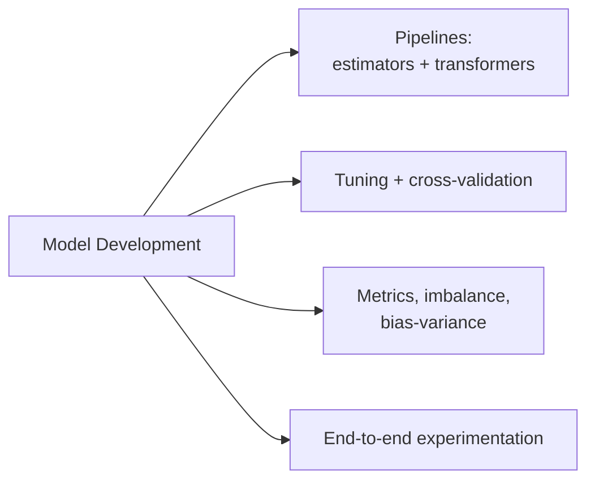

# Model Development (31 % of Exam)

Section 3 of the exam guide and the second-largest domain. It covers choosing an algorithm, building training pipelines with estimators and transformers, handling class imbalance, tuning hyperparameters (grid, random, Bayesian; Hyperopt `fmin`; parallel single-node tuning), cross-validation, evaluation metrics, log-target handling, and the bias-variance tradeoff.

## Topics Overview

## Section Contents

| File | Topic | Exam-guide bullets covered | Priority |
| :--- | :--- | :--- | :--- |
| [01-spark-ml-pipelines.md](./01-spark-ml-pipelines.md) | `Pipeline`, Estimator vs Transformer, `PipelineModel` | Compare estimators and transformers; develop a training pipeline | High |
| [02-hyperparameter-tuning.md](./02-hyperparameter-tuning.md) | Grid / random / Bayesian search, Hyperopt `fmin`, `SparkTrials`, CV vs train-validation split | Hyperopt `fmin`; random/grid/Bayesian search; parallelise single-node models; CV benefits/downsides; perform CV; number of models trained | High |
| [03-model-evaluation.md](./03-model-evaluation.md) | Algorithm choice, imbalance, metrics, log targets, bias-variance | Select algorithm; mitigate imbalance; classification and regression metrics; choose metric; exponentiate log-transformed variables; bias-variance tradeoff | High |
| [04-ml-experimentation-workflow.md](./04-ml-experimentation-workflow.md) | Baseline → iterate → CV → test → register | Develop a training pipeline (end-to-end) | Medium |

## Key Concepts

| Concept | Why it matters |
| :--- | :--- |
| **Estimator vs Transformer** | `fit()` → Model vs `transform()` → DataFrame; anything that learns from data is an Estimator |
| **`CrossValidator` / `TrainValidationSplit`** | k-fold (reliable, k× cost) vs one split (cheap, noisier); both refit the best model |
| **Hyperopt `fmin` + `SparkTrials`** | Bayesian (`tpe.suggest`) or random (`rand.suggest`) search; parallel trials for single-node models |
| **Models trained** | (product of grid sizes) × folds (+1 final refit) |
| **F1 / log loss / ROC AUC; RMSE / MAE / R²** | Pick the metric that matches the cost of errors |
| **Bias-variance** | Low train + high validation error = overfitting; high on both = underfitting |

## Related Resources

- [PySpark API cheat sheet (shared)](../../../shared/cheat-sheets/pyspark-api-quick-ref.md)
- [Spark ML Pipelines guide](https://spark.apache.org/docs/latest/ml-pipeline.html)
- [Hyperparameter tuning on Databricks](https://docs.databricks.com/aws/en/machine-learning/automl-hyperparam-tuning/)

---

**[← Previous: Data Processing](../02-data-processing/README.md) | [↑ Back to ML Associate](../README.md) | [Next: Model Deployment →](../04-model-deployment/README.md)**
