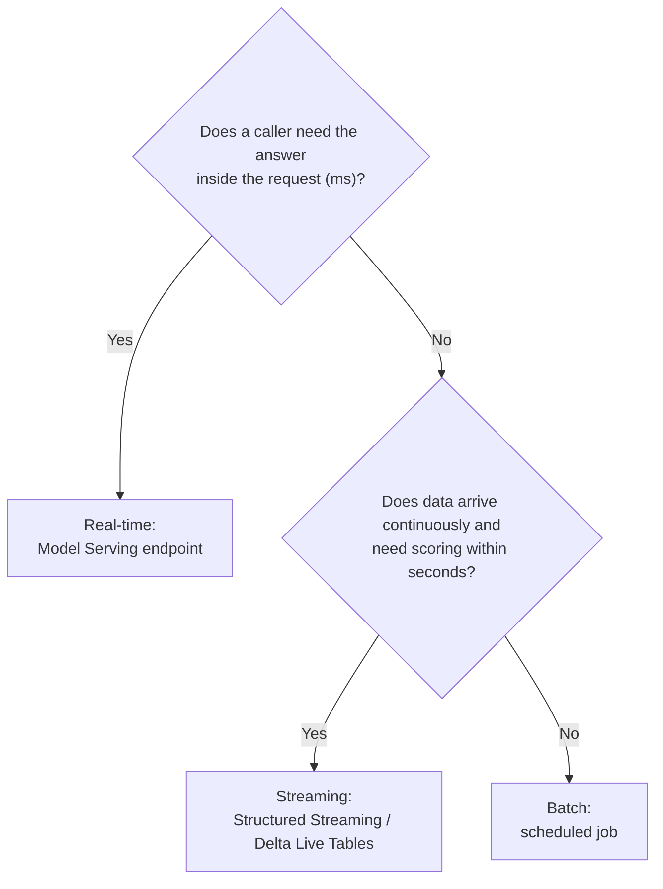
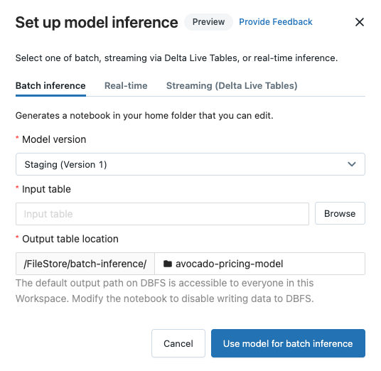

# Model Deployment & Serving

## Overview

Section 4 of the exam guide (**Model Deployment, 12 %**) asks you to choose between **batch, streaming, and real-time** serving, run **batch inference with pandas**, **deploy a custom model** to a Model Serving endpoint, **query** it, and **split traffic** between models. Streaming inference with Delta Live Tables has its own page: [Streaming Inference](./02-streaming-inference.md).

> [!abstract]
>
> - **Batch**: score a whole table on a schedule (pandas for small data; `mlflow.pyfunc.spark_udf` / `fe.score_batch` at scale) — cheapest, highest latency
> - **Streaming**: score records continuously as they arrive (Structured Streaming / Delta Live Tables) — seconds of latency
> - **Real-time**: a **Model Serving** REST endpoint answers individual requests in milliseconds — most infrastructure per prediction
> - One endpoint can serve several model versions with a **`traffic_config`** split (A/B, canary, gradual rollout)

> [!tip] What the Exam Tests
>
> - *Identify the differences and advantages of batch, real-time, and streaming serving* for a scenario
> - *Use pandas to perform batch inference*; *deploy a custom model to a model endpoint*; *deploy and query a model for real-time inference*
> - *Split data between endpoints for real-time inference* (traffic percentages across served models)

---

## Choosing a Serving Approach

| | **Batch** | **Streaming** | **Real-time** |
| :--- | :--- | :--- | :--- |
| **Trigger** | Schedule (hourly / nightly job) | Continuous arrival of events | Each client request |
| **Latency** | Minutes–hours | Seconds | Milliseconds |
| **Throughput** | Very high (whole tables) | High, sustained | Per-request |
| **Cost per prediction** | Lowest | Medium | Highest (always-ready endpoint) |
| **Databricks tools** | Lakeflow Jobs + pandas / `spark_udf` / `fe.score_batch` / `ai_query` | Structured Streaming or Delta Live Tables + `spark_udf` | Model Serving endpoint (REST) |
| **Example** | Nightly marketing segments for every customer | Fraud score per card swipe written to a Delta table | Product recommendation when a page loads |





*The legacy "Set up model inference" dialog offered the same three choices the exam compares — batch, real-time, and streaming via Delta Live Tables (older workspace-registry UI showing a stage and a DBFS output path).*

Rule of thumb: pick the **least-real-time approach that meets the latency requirement** — batch is simplest and most cost-effective when no one waits for a single prediction.

## Batch Inference with pandas

For data that fits on the driver, load the registered model as a generic `pyfunc` and call `predict` on a pandas DataFrame:

```python
import mlflow

mlflow.set_registry_uri("databricks-uc")
model = mlflow.pyfunc.load_model("models:/ml_prod.churn.churn_classifier@champion")

pdf = spark.read.table("ml_prod.churn.customers_today").toPandas()   # small enough for the driver
pdf["churn_prediction"] = model.predict(pdf[feature_columns])

spark.createDataFrame(pdf).write.mode("overwrite").saveAsTable("ml_prod.churn.daily_scores")
```

### **Scaling the same model out with Spark**

```python
import mlflow
from pyspark.sql import functions as F

# Option 1 — MLflow wraps the model as a Spark UDF (pandas batches on every worker)
predict_udf = mlflow.pyfunc.spark_udf(
    spark, "models:/ml_prod.churn.churn_classifier@champion", result_type="double")
scored = (spark.read.table("ml_prod.churn.customers_today")
    .withColumn("churn_prediction", predict_udf(*feature_columns)))

# Option 2 — explicit pandas function over partitions
model_uri = "models:/ml_prod.churn.churn_classifier@champion"

def predict_batches(iterator):
    model = mlflow.pyfunc.load_model(model_uri)        # loaded once per task
    for pdf in iterator:
        pdf["churn_prediction"] = model.predict(pdf[feature_columns])
        yield pdf

scored2 = (spark.read.table("ml_prod.churn.customers_today")
    .mapInPandas(predict_batches, schema="customer_id long, churn_prediction double"))
```

| Tool | Use when |
| :--- | :--- |
| `pyfunc.load_model(...).predict(pandas_df)` | Small data; single machine |
| `mlflow.pyfunc.spark_udf(spark, model_uri)` | Large Spark DataFrames — distributed pandas batches |
| `fe.score_batch(model_uri, df)` | The model was logged with `fe.log_model` (features looked up automatically) |
| `ai_query(...)` in SQL | Batch inference against a serving endpoint from SQL |

> [!warning] Common Mistake
> `df.toPandas()` on tens of millions of rows collects everything to the driver and can run out of memory. Use pandas inference only when the data fits on one machine; otherwise use `spark_udf`.

## Deploying a Custom Model to an Endpoint

A **custom model** is any MLflow model with your own Python logic — typically a subclass of `mlflow.pyfunc.PythonModel` that wraps preprocessing, post-processing, or a library MLflow has no built-in flavor for. Model Serving "can deploy any Python model or custom code as a production-grade API using CPU or GPU compute resources."

### **1. Log and register the custom model**

```python
import mlflow
import mlflow.pyfunc
import pandas as pd

class ChurnWithThreshold(mlflow.pyfunc.PythonModel):
    """Wraps a trained scikit-learn classifier and applies a business threshold."""

    def __init__(self, sk_model, threshold=0.4):
        self.sk_model = sk_model          # serialized with the pyfunc model by MLflow
        self.threshold = threshold

    def predict(self, context, model_input: pd.DataFrame):
        proba = self.sk_model.predict_proba(model_input)[:, 1]
        return pd.DataFrame({"churn_probability": proba,
                             "churn_flag": (proba >= self.threshold).astype(int)})

mlflow.set_registry_uri("databricks-uc")
with mlflow.start_run():
    mlflow.pyfunc.log_model(
        artifact_path="model",
        python_model=ChurnWithThreshold(trained_classifier, threshold=0.4),
        input_example=X_sample,                          # signature is required in UC
        registered_model_name="ml_prod.churn.churn_custom",
    )
```

### **2. Create the serving endpoint**

**UI:** *Serving* → *Create serving endpoint* → choose the Unity Catalog model and version → compute size and scale-to-zero → *Create*.

**MLflow Deployments SDK:**

```python
from mlflow.deployments import get_deploy_client

client = get_deploy_client("databricks")
endpoint = client.create_endpoint(
    config={                                   # full API request payload
        "name": "churn-custom",
        "config": {
            "served_entities": [{
                "name": "churn-custom-3",
                "entity_name": "ml_prod.churn.churn_custom",
                "entity_version": "3",
                "workload_size": "Small",
                "scale_to_zero_enabled": True,
            }]
        },
    },
)
```

**Databricks SDK:**

```python
from databricks.sdk import WorkspaceClient
from databricks.sdk.service.serving import EndpointCoreConfigInput, ServedEntityInput

w = WorkspaceClient()
w.serving_endpoints.create(
    name="churn-custom",
    config=EndpointCoreConfigInput(
        served_entities=[ServedEntityInput(
            entity_name="ml_prod.churn.churn_custom",
            entity_version="3",
            workload_size="Small",
            scale_to_zero_enabled=True,
        )]
    ),
)
```

| Setting | Effect |
| :--- | :--- |
| `workload_size` | Concurrency capacity (`Small`, `Medium`, `Large`); GPU workload types exist for GPU models |
| `scale_to_zero_enabled` | Scales to zero when idle — saves cost, adds cold-start latency on the next request |
| `served_entities` | One or more model versions behind the endpoint (older code uses `served_models`) |

Sources: [Deploy custom models](https://docs.databricks.com/aws/en/machine-learning/model-serving/custom-models), [Create custom model serving endpoints](https://docs.databricks.com/aws/en/machine-learning/model-serving/create-manage-serving-endpoints).

## Querying a Real-Time Endpoint

The REST invocation URL is `https://<databricks-instance>/serving-endpoints/<endpoint-name>/invocations`.

```bash
curl -X POST -u token:$DATABRICKS_TOKEN \
  https://<databricks-instance>/serving-endpoints/churn-custom/invocations \
  -H 'Content-Type: application/json' \
  -d '{"dataframe_split": {"columns": ["tenure", "monthly_charge"], "data": [[12, 65.5], [3, 45.0]]}}'
```

```python
import mlflow.deployments

client = mlflow.deployments.get_deploy_client("databricks")
response = client.predict(
    endpoint="churn-custom",
    inputs={"dataframe_records": [{"tenure": 12, "monthly_charge": 65.5}]},
)
print(response)
```

| Input key | Shape |
| :--- | :--- |
| `dataframe_split` (recommended) | `{"columns": [...], "data": [[...], ...]}` — pandas `split` orientation |
| `dataframe_records` | `[{"col": value, ...}, ...]` — pandas `records` orientation (column order not guaranteed) |
| `instances` / `inputs` | Tensor input (row / columnar) |

From SQL, the same endpoint can be called with the `ai_query` function. Source: [Query serving endpoints for custom models](https://docs.databricks.com/aws/en/machine-learning/model-serving/score-custom-model-endpoints).

## Splitting Traffic Between Models

Serve several versions behind **one** endpoint and route a percentage of requests to each — for A/B tests, canary releases, or gradual champion → challenger rollouts:

```python
from mlflow.deployments import get_deploy_client

client = get_deploy_client("databricks")
client.update_endpoint_config(
    endpoint="churn-custom",
    config={
        "served_entities": [
            {"name": "champion-v3", "entity_name": "ml_prod.churn.churn_custom",
             "entity_version": "3", "workload_size": "Small", "scale_to_zero_enabled": False},
            {"name": "challenger-v4", "entity_name": "ml_prod.churn.churn_custom",
             "entity_version": "4", "workload_size": "Small", "scale_to_zero_enabled": False},
        ],
        "traffic_config": {
            "routes": [
                {"served_model_name": "champion-v3", "traffic_percentage": 90},
                {"served_model_name": "challenger-v4", "traffic_percentage": 10},
            ]
        },
    },
)
```

- Percentages across routes must add up to **100**
- Shift gradually (90/10 → 50/50 → 0/100) while monitoring; move the `champion` alias when the challenger wins
- The UI exposes the same split: each served entity gets a traffic percentage

## Monitoring Served Models

Request/response logging to a Unity Catalog Delta table lets you monitor latency, errors, and prediction drift and join predictions to ground-truth labels later.

> [!note] Platform update (Oct 2026)
>
> - The docs now call the product simply **Model Serving** (older material: "Mosaic AI Model Serving").
> - The legacy custom-model inference-table docs (`auto_capture_config`) are marked retired; Databricks recommends **AI Gateway-enabled inference tables** for custom model, foundation model, and agent endpoints ([Inference tables (legacy)](https://docs.databricks.com/aws/en/machine-learning/model-serving/inference-tables)).
> - **Free Edition** (for hands-on practice; Community Edition was retired on January 1, 2026) has limits on active endpoints and no GPU serving endpoints, no provisioned throughput, and no custom models on GPU or batch inference ([Free Edition limitations](https://docs.databricks.com/aws/en/getting-started/free-edition-limitations)).

## Use Cases

- **Nightly Batch Scoring**: A Lakeflow Job runs at 02:00, loads `@champion` with `spark_udf`, and overwrites a predictions table for the marketing team — no endpoint is needed.
- **Real-Time Recommendations**: A web app calls a Model Serving endpoint for each page view; a 90/10 traffic split tests a new model version on live traffic.

## Common Issues & Errors

### Endpoint Returns 400 for Valid-Looking Requests

**Scenario:** Requests fail with a schema or input error.
**Fix:** Send one of the accepted formats (`dataframe_split`, `dataframe_records`, `instances`, `inputs`) with column names that match the model signature.

### First Request After Idle Time Is Very Slow

**Scenario:** The first call after a quiet period takes far longer than later calls.
**Fix:** The endpoint scaled to zero. Disable `scale_to_zero_enabled` (or keep provisioned concurrency) for latency-critical production endpoints.

## Exam Tips

- ✅ No low-latency requirement + whole dataset on a schedule → **batch** (cheapest)
- ✅ Continuously arriving events scored within seconds → **streaming** (see [Streaming Inference](./02-streaming-inference.md))
- ✅ A caller waits for each prediction → **real-time Model Serving endpoint**
- ✅ Custom logic = subclass `mlflow.pyfunc.PythonModel`, log with `mlflow.pyfunc.log_model`, register in UC, serve
- ✅ Query URL: `/serving-endpoints/<name>/invocations` with `dataframe_split` / `dataframe_records`
- ✅ Traffic split = multiple `served_entities` + `traffic_config.routes` percentages summing to 100

## Key Takeaways

- Match the serving approach to the latency requirement, not to what is most sophisticated
- The same registered model can be used for batch (`spark_udf`), streaming, and real-time serving
- Custom `pyfunc` models package preprocessing and business rules with the model
- Traffic splitting enables safe, measurable rollouts of new versions

## Related Topics

- [Streaming Inference](./02-streaming-inference.md)
- [Model Registry in Unity Catalog](../01-databricks-machine-learning/07-model-registry.md)
- [Feature Store in Unity Catalog](../01-databricks-machine-learning/04-feature-store.md) — `score_batch` and online lookups
- [MLOps Strategy](../01-databricks-machine-learning/08-mlops-strategy.md)

## Official Documentation

- [Model Serving](https://docs.databricks.com/aws/en/machine-learning/model-serving/)
- [Deploy custom models](https://docs.databricks.com/aws/en/machine-learning/model-serving/custom-models)
- [Create custom model serving endpoints](https://docs.databricks.com/aws/en/machine-learning/model-serving/create-manage-serving-endpoints)
- [Query serving endpoints for custom models](https://docs.databricks.com/aws/en/machine-learning/model-serving/score-custom-model-endpoints)

---

**[↑ Back to Section](./README.md) | [Next: Streaming Inference →](./02-streaming-inference.md)**
