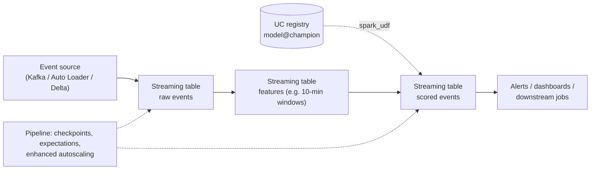

# Streaming Inference

## Overview

Streaming inference scores records **continuously as they arrive** — clickstream events, card transactions, sensor readings — and writes predictions to a table within seconds. The exam guide bullet is *"Identify how streaming inference is performed with Delta Live Tables"*: load the registered model as a Spark UDF and apply it inside a pipeline's streaming table, letting the pipeline manage state, checkpoints, and autoscaling.

> [!abstract]
>
> - Pattern: `mlflow.pyfunc.spark_udf(spark, "models:/<uc_model>@champion")` applied to `spark.readStream` inside a **Delta Live Tables** streaming table
> - The pipeline handles checkpoints, retries, data-quality expectations, lineage, and **enhanced autoscaling** of compute as event volume changes
> - A plain **Structured Streaming** job with the same UDF also works, but you manage compute sizing, checkpoints, and orchestration yourself
> - Calling a Model Serving endpoint from a streaming UDF adds a network round-trip per batch — avoid it for high-throughput scoring

> [!tip] What the Exam Tests
>
> - That streaming inference with Delta Live Tables means **applying the model as a Spark UDF inside the pipeline**
> - Why a Delta Live Tables pipeline suits fluctuating, high-volume streams (managed, dynamically resized compute)
> - Telling streaming apart from batch and real-time serving

---

> [!note] Platform update (Oct 2026)
> The exam guide says **Delta Live Tables**. The product was renamed Lakeflow Declarative Pipelines and then, per the release notes, "Lakeflow Declarative Pipelines has been renamed to Lakeflow Spark Declarative Pipelines" on November 12, 2025 ([November 2025 release notes](https://docs.databricks.com/aws/en/release-notes/product/2025/november)). The Python API is now `from pyspark import pipelines as dp`; the docs say you "may still use `dlt`, but Databricks recommends using `pipelines`" ([Python language reference](https://docs.databricks.com/aws/en/ldp/developer/python-ref)). Answer exam questions in Delta Live Tables terms.

## How It Works



## Streaming Inference in a Pipeline

### **Current API (`pyspark.pipelines`)**

```python
import mlflow
from pyspark import pipelines as dp
from pyspark.sql import functions as F

mlflow.set_registry_uri("databricks-uc")
model_uri = "models:/ml_prod.podcast.low_engagement_detector@champion"
score_udf = mlflow.pyfunc.spark_udf(spark, model_uri, result_type="double")

feature_cols = ["listen_seconds", "pause_count", "skip_count"]

@dp.table(comment="Podcast events scored for low engagement")
def scored_events():
    return (spark.readStream.table("ml_prod.podcast.engagement_features")
        .withColumn("low_engagement_score", score_udf(*feature_cols))
        .withColumn("scored_at", F.current_timestamp()))
```

### **Exam-era syntax (`dlt`)**

```python
import dlt
import mlflow

score_udf = mlflow.pyfunc.spark_udf(
    spark, "models:/ml_prod.podcast.low_engagement_detector@champion", result_type="double")

@dlt.table(comment="Podcast events scored for low engagement")
@dlt.expect_or_drop("has_features", "listen_seconds IS NOT NULL")
def scored_events():
    return (spark.readStream.table("ml_prod.podcast.engagement_features")
        .withColumn("low_engagement_score", score_udf("listen_seconds", "pause_count", "skip_count")))
```

Key points:

- The model is loaded **once per worker** by `spark_udf` and applied to micro-batches in pandas batches — no per-record network calls
- Because the alias is resolved when the pipeline starts, promoting a new `@champion` takes effect on the next pipeline update/restart
- Data-quality **expectations** (`expect`, `expect_or_drop`, `expect_or_fail`) can guard the features before scoring

## Why a Pipeline Suits Fluctuating Streams

"Enhanced autoscaling implements optimization of streaming workloads" by adding and removing machines as load changes; it "is enabled by default for all new pipelines," and "for serverless pipelines, enhanced autoscaling is always on" ([Optimize pipeline cluster utilization with autoscaling](https://docs.databricks.com/aws/en/ldp/auto-scaling)).

| Option | Throughput | Compute sizing | Operational burden | Verdict for high-volume, fluctuating streams |
| :--- | :--- | :--- | :--- | :--- |
| **Delta Live Tables pipeline + model as Spark UDF** | High — model runs next to the data | **Managed, dynamically resized** (enhanced autoscaling) | Low: checkpoints, retries, lineage, expectations built in | ✅ Best fit |
| **Structured Streaming job + model as Spark UDF** | High | You size the cluster — the docs say "Don't enable autoscaling for Structured Streaming jobs" | Higher: you manage checkpoints, restarts, monitoring | Works, more to manage |
| **Pipeline or streaming job calling a Model Serving endpoint per batch** | Limited by HTTP round-trips and endpoint capacity | Two systems to scale | Highest | ❌ Extra latency and overhead |

Sources: [Optimize pipeline cluster utilization with autoscaling](https://docs.databricks.com/aws/en/ldp/auto-scaling), [Production considerations for Structured Streaming](https://docs.databricks.com/aws/en/structured-streaming/production).

## Plain Structured Streaming Alternative

```python
import mlflow

score_udf = mlflow.pyfunc.spark_udf(
    spark, "models:/ml_prod.podcast.low_engagement_detector@champion", result_type="double")

(spark.readStream.table("ml_prod.podcast.engagement_features")
    .withColumn("low_engagement_score", score_udf("listen_seconds", "pause_count", "skip_count"))
    .writeStream
    .option("checkpointLocation", "/Volumes/ml_prod/podcast/checkpoints/scored_events")
    .trigger(processingTime="30 seconds")
    .toTable("ml_prod.podcast.scored_events"))
```

## Streaming vs Batch vs Real-Time

| Requirement | Choose |
| :--- | :--- |
| Score the full customer base once a night | Batch |
| Score every event within seconds and store the result | **Streaming** |
| Return a prediction inside a user's request | Real-time (Model Serving) |

## Use Cases

- **Low-Engagement Detection**: Listening events (play, pause, exit) are aggregated into 10-minute windows and scored by an anomaly model inside a pipeline whose compute grows and shrinks with traffic through the day.
- **Card Fraud Flags**: Transactions are scored as they land and high scores are written to an alerts table consumed by an investigations dashboard.

## Common Issues & Errors

### New Champion Not Picked Up

**Scenario:** The `champion` alias was moved, but the streaming table still uses the old model.
**Fix:** The UDF resolved the alias when the pipeline started — run a new pipeline update (or restart the stream) after promotion.

### Streaming Scoring Falls Behind at Peak Hours

**Scenario:** Processing lag grows when event volume spikes.
**Fix:** Run the scoring in a pipeline with enhanced autoscaling (or serverless), avoid per-record calls to external endpoints, and keep the model in-process with `spark_udf`.

## Exam Tips

- ✅ Streaming inference with Delta Live Tables = **model loaded as a Spark UDF and applied in a streaming table** of the pipeline
- ✅ "High throughput + compute must resize as volume fluctuates" → Delta Live Tables pipeline (enhanced autoscaling)
- ✅ Routing a stream through a serving endpoint adds overhead — not the best answer for high-volume streams
- ✅ Load the model by alias (`@champion`) so promotion needs no code change

## Key Takeaways

- Streaming inference reuses the same registered model as batch scoring — only the input is a stream
- Pipelines add managed state, quality checks, lineage, and autoscaling around the scoring step
- Keep the model in-process (`spark_udf`) for throughput; reserve endpoints for request/response use cases
- Delta Live Tables is now Lakeflow Spark Declarative Pipelines — same idea, new name and import

## Related Topics

- [Model Deployment & Serving](./01-model-deployment-serving.md)
- [Model Registry in Unity Catalog](../01-databricks-machine-learning/07-model-registry.md)
- [Streaming Fundamentals (shared)](../../../shared/fundamentals/streaming-fundamentals.md)
- [Lakeflow Declarative Pipelines quick reference (shared)](../../../shared/cheat-sheets/lakeflow-declarative-pipelines-quick-ref.md)

## Official Documentation

- [Lakeflow Spark Declarative Pipelines Python reference](https://docs.databricks.com/aws/en/ldp/developer/python-ref)
- [Optimize pipeline cluster utilization with autoscaling](https://docs.databricks.com/aws/en/ldp/auto-scaling)
- [`mlflow.pyfunc.spark_udf`](https://mlflow.org/docs/latest/api_reference/python_api/mlflow.pyfunc.html)

---

**[← Previous: Model Deployment & Serving](./01-model-deployment-serving.md) | [↑ Back to Section](./README.md)**
