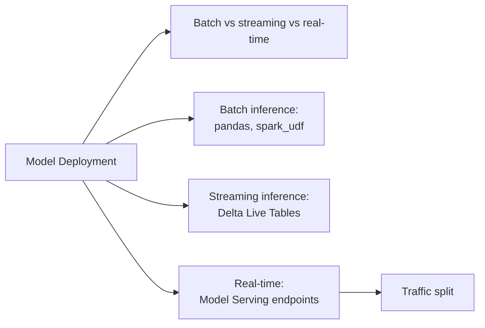

# Model Deployment (12 % of Exam)

Section 4 of the exam guide. It covers choosing between batch, streaming, and real-time serving; batch inference with pandas (and its Spark scale-out); streaming inference with Delta Live Tables; deploying a custom model to a Model Serving endpoint; querying it; and splitting traffic between served models. Registering and promoting models (aliases, tags) is a Section 1 skill — see [Model Registry in Unity Catalog](../01-databricks-machine-learning/07-model-registry.md).

## Topics Overview

## Section Contents

| File | Topic | Exam-guide bullets covered | Priority |
| :--- | :--- | :--- | :--- |
| [01-model-deployment-serving.md](./01-model-deployment-serving.md) | Serving approaches, pandas batch inference, custom model endpoints, querying, traffic split | Batch vs real-time vs streaming; deploy a custom model; pandas batch inference; deploy and query real-time; split traffic between endpoints | High |
| [02-streaming-inference.md](./02-streaming-inference.md) | Model as Spark UDF inside a pipeline | Streaming inference with Delta Live Tables | High |

## Key Concepts

| Concept | Why it matters |
| :--- | :--- |
| **Batch inference** | Cheapest; scheduled scoring of whole tables (`pyfunc` + pandas, `spark_udf`, `fe.score_batch`) |
| **Streaming inference** | `spark_udf` applied to `spark.readStream` in a Delta Live Tables (now Lakeflow Spark Declarative Pipelines) streaming table |
| **Model Serving endpoint** | REST API at `/serving-endpoints/<name>/invocations`; `served_entities`, `workload_size`, `scale_to_zero_enabled` |
| **Custom model** | `mlflow.pyfunc.PythonModel` subclass logged with `mlflow.pyfunc.log_model` |
| **Traffic split** | `traffic_config.routes` percentages across served entities (sum = 100) |

## Related Resources

- [MLflow cheat sheet (shared)](../../../shared/cheat-sheets/mlflow-quick-ref.md)
- [Model Serving documentation](https://docs.databricks.com/aws/en/machine-learning/model-serving/)
- [Hands-on Lab 04 — MLflow tracking and Model Registry in UC](../../../labs/04-mlflow-tracking.md)

---

**[← Previous: Model Development](../03-model-development/README.md) | [↑ Back to ML Associate](../README.md)**
