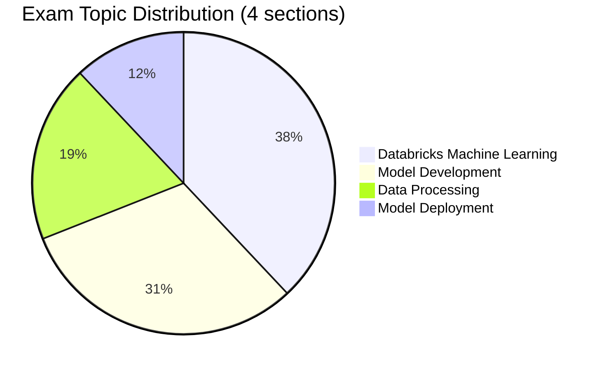

# Databricks Machine Learning Associate

> [!important]
> **What changed in the latest exam guide (re-issued "August 2026"; exam version Mar 1, 2025)**
>
> - **Same exam, new document.** The PDF's Update Information table still says *Exam Published: March 1, 2025* and *Exam Guide Updated: March 1, 2025*. Weights are unchanged: **38 / 19 / 31 / 12 %**.
> - **This guide is now realigned 1 : 1 to the PDF sections.** Section 2 is **Data Processing** (summary statistics, outliers, imputation, one-hot encoding, log transforms) and all **MLflow + feature-table + registry** skills sit in **Section 1**. The previous layout followed the certification web page, which labels the 19 % domain "ML Workflows"; the folders `02-model-development/` and `03-ml-workflows/` were replaced by `02-data-processing/` and `03-model-development/`.
> - **Question format:** 48 scored *multiple-choice and multiple-selection* questions (plus up to 10 unscored items) in 90 minutes.
> - **New study pages** for bullets that had no coverage: [Exploratory Data Analysis](./02-data-processing/01-exploratory-data-analysis.md), [Hyperparameter Tuning](./03-model-development/02-hyperparameter-tuning.md), [Model Evaluation](./03-model-development/03-model-evaluation.md), [MLOps Strategy](./01-databricks-machine-learning/08-mlops-strategy.md), [Streaming Inference](./04-model-deployment/02-streaming-inference.md).
> - **Platform names have moved on since the exam was written** — the guide still says *Delta Live Tables* (now Lakeflow Spark Declarative Pipelines) and tests *Hyperopt* (no longer in Databricks Runtime ML after 16.4 LTS ML). Topic pages keep the exam wording and add `Platform update (Oct 2026)` notes.
> - For hands-on practice the guide now points to **Databricks Free Edition** (Community Edition retired January 1, 2026).
>
> Source of truth: [exam guide PDF](https://www.databricks.com/sites/default/files/2026-10/Databricks-Certified-Machine-Learning-Associate-Exam-Guide-August-2026.pdf) · [certification page](https://www.databricks.com/learn/certification/machine-learning-associate).

> [!note] Section 2 name: PDF vs certification page
> The PDF names Section 2 **"Data Processing (19%)"**; the certification web page lists the same 19 % domain as **"ML Workflows"**. The PDF's bullets (summary statistics, outliers, imputation, one-hot encoding, log transforms) are what this guide follows.

## Exam Overview

| Detail              | Information                                     |
| ------------------- | ----------------------------------------------- |
| **Certification**   | Databricks Certified Machine Learning Associate |
| **Exam guide**      | Re-issued "August 2026" PDF — exam published and guide updated **March 1, 2025** |
| **Scored questions**| 48 multiple-choice and multiple-selection       |
| **Unscored items**  | Up to 10 (time already included)                |
| **Duration**        | 90 minutes                                      |
| **Result**          | Pass / fail (the exam guide does not publish a numeric passing score) |
| **Languages**       | English, Japanese, Portuguese (BR), Korean      |
| **Code in stems**   | Python (ML); SQL possible for non-ML data manipulation |
| **Experience**      | 6+ months hands-on with Databricks for the listed tasks (recommended) |
| **Recertification** | Every 2 years — see [Renewal Guide](../../shared/appendix/renewal-guide.md) |
| **Cost**            | USD 200 (plus applicable taxes)                 |
| **Delivery**        | Online proctored or test center                 |
| **Hands-on practice** | [Databricks Free Edition](https://docs.databricks.com/aws/en/getting-started/free-edition) |

## Exam Domain Weights (official — exam version March 1, 2025)

## Study Topics

| Section | Weight | Focus |
| :--- | :---: | :--- |
| [01 — Databricks Machine Learning](./01-databricks-machine-learning/README.md) | 38 % | MLOps strategy, ML runtimes, AutoML, feature tables in UC, MLflow tracking + Client API, UC model registry (aliases, tags) |
| [02 — Data Processing](./02-data-processing/README.md) | 19 % | Summary statistics, outliers (std dev / IQR), visualisations, feature comparisons, imputation, one-hot encoding, log transforms |
| [03 — Model Development](./03-model-development/README.md) | 31 % | Algorithm choice, imbalance, estimators vs transformers, pipelines, Hyperopt / grid / random / Bayesian search, cross-validation, metrics, bias-variance |
| [04 — Model Deployment](./04-model-deployment/README.md) | 12 % | Batch vs streaming vs real-time, pandas batch inference, streaming with Delta Live Tables, custom model endpoints, querying, traffic split |

### Practice & Resources

| Resource                                                        | Description                              |
| --------------------------------------------------------------- | ---------------------------------------- |
| [Practice Questions](./resources/practice-questions/README.md)  | Topic-specific practice questions mapped to the four sections |
| [Mock Exam 1](./resources/mock-exam/README.md)                  | Full-length 48-question practice exam    |
| [Mock Exam 2](./resources/mock-exam-2/README.md)                | Alternative 48-question practice exam    |
| [Exam Tips](./resources/exam-tips.md)                           | Exam strategies and tips                 |
| [Final Review](./resources/final-review.md)                     | 20-minute exam-morning scan              |
| [Official Links](./resources/official-links.md)                 | Documentation and resources              |

## Interview Preparation

After completing this certification, explore:

- [Interview Prep Resource](../../shared/interview-prep/README.md) - System design, feature engineering, and model architecture questions

## Prerequisites

Review these shared fundamentals:

- [Spark Fundamentals](../../shared/fundamentals/spark-fundamentals.md)
- [MLflow Basics](../../shared/fundamentals/mlflow-basics.md)
- [Feature Engineering Basics](../../shared/fundamentals/feature-engineering-basics.md)

## Study Progress Tracker

- [ ] Section 1 — Databricks Machine Learning (MLOps, ML runtimes, AutoML, feature tables, MLflow, UC registry)
- [ ] Section 2 — Data Processing (summary stats, outliers, imputation, one-hot encoding, log transforms)
- [ ] Section 3 — Model Development (pipelines, tuning, cross-validation, metrics, bias-variance)
- [ ] Section 4 — Model Deployment (batch, streaming, real-time, custom endpoints, traffic split)
- [ ] Run Hands-on Lab 04 (MLflow + Model Registry in UC)
- [ ] Take Mock Exam 1 and Mock Exam 2

## Official Resources

- [Databricks Certification Page](https://www.databricks.com/learn/certification/machine-learning-associate)
- [Exam Guide PDF (re-issued August 2026)](https://www.databricks.com/sites/default/files/2026-10/Databricks-Certified-Machine-Learning-Associate-Exam-Guide-August-2026.pdf)
- [Databricks machine learning documentation](https://docs.databricks.com/aws/en/machine-learning/)

## Recommended Path

Complete this certification before attempting [ML Professional](../ml-professional/README.md).
