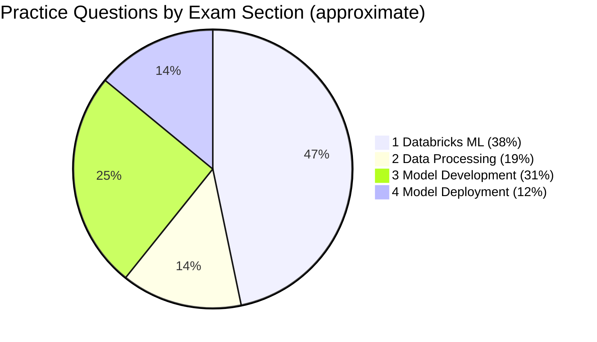

# Practice Questions — ML Associate

Topic-focused practice questions mapped to the four sections of the exam guide (re-issued "August 2026"; exam version March 1, 2025). Files 01–04 are the original topic sets (updated for Unity Catalog and current APIs); files 05–08 were added for the 2026 refresh and target exam-guide bullets that had no questions. Questions added in that refresh are marked *(2026 guide)* in their heading.

## Question Files

| File | Topic | Questions | Exam-guide section (weight) |
| :--- | :--- | :---: | :--- |
| [01 — Databricks ML: Runtimes, Compute & AutoML](./01-databricks-ml.md) | ML runtimes, compute, AutoML, Git folders | 13 | 1 — Databricks Machine Learning (38 %) |
| [02 — MLflow Tracking & Experiments](./02-ml-workflows.md) | Manual logging, autolog, search runs, experiments | 13 | 1 — Databricks Machine Learning (38 %) |
| [03 — Spark ML Pipelines, Tuning & Feature Tables](./03-feature-engineering.md) | Pipelines, `CrossValidator`, feature tables in UC | 15 | 3 — Model Development (31 %) and 1 (feature tables) |
| [04 — Model Registry & Deployment](./04-mlflow-deployment.md) | UC registration, aliases, `spark_udf`, endpoints | 8 | 1 (registry) and 4 — Model Deployment (12 %) |
| [05 — Unity Catalog, MLOps & MLflow Client](./05-unity-catalog-mlops.md) | MLOps practices, deploy code vs models, feature tables, Client API, tags, champion/challenger | 14 | 1 — Databricks Machine Learning (38 %) |
| [06 — Data Processing](./06-data-processing.md) | Summary statistics, outliers, plots, imputation, one-hot encoding, log transforms | 15 | 2 — Data Processing (19 %) |
| [07 — Model Development](./07-model-development.md) | Algorithms, imbalance, Hyperopt, search strategies, CV, metrics, bias-variance | 18 | 3 — Model Development (31 %) |
| [08 — Model Deployment](./08-model-deployment.md) | Batch vs streaming vs real-time, pandas inference, custom endpoints, traffic split, Delta Live Tables | 11 | 4 — Model Deployment (12 %) |

**Total: 107 practice questions**

> [!note]
> File names (and therefore question IDs in the practice quiz) were kept stable so saved progress is not lost; the headings and the table above give the current section mapping. The certification web page calls the 19 % section "ML Workflows", while the exam-guide PDF calls it "Data Processing" — this guide follows the PDF.

## How to Use

1. Attempt each question independently before revealing the answer
2. Use the foldable `Answer` callout to check your reasoning
3. Keep a tally of correct/incorrect answers per section
4. Focus extra study time on any section where you score below 70%
5. Once comfortable with all sections, attempt [Mock Exam 1](../mock-exam/README.md) and [Mock Exam 2](../mock-exam-2/README.md)

## Topic Coverage

---

[← Back to Resources](../README.md)
