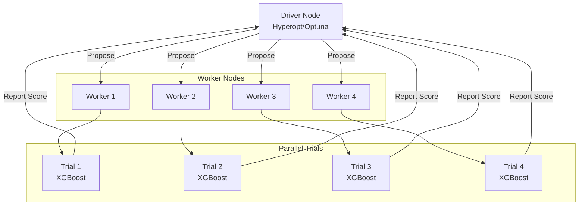

# Distributed Hyperparameter Tuning

## Overview

Scaling hyperparameter optimization to large distributed systems using Spark, XGBoost, and specialized frameworks for enterprise ML. The September 2025 exam guide names two tools explicitly: **distributed tuning with Optuna integrated with MLflow**, and **distributed tuning with Ray**.

> [!abstract]
>
> - Trials are independent, so tuning **scales out** well: the driver proposes configurations and workers evaluate them in parallel.
> - **Optuna + MLflow**: `MlflowStorage` stores the study in an MLflow experiment, and `MlflowSparkStudy` runs trials in parallel on Spark executors. Each trial is logged to MLflow.
> - **Ray Tune** runs on a Ray-on-Spark cluster (`setup_ray_cluster`) and adds schedulers such as ASHA and PBT for early stopping and adaptive search.
> - **Hyperopt + `SparkTrials`** is the older Databricks pattern. The September 2025 exam guide names Optuna and Ray, not Hyperopt, and Databricks Runtime ML no longer ships Hyperopt (see the platform update below).

> [!tip] What the Exam Tests
>
> - The minimal-setup way to distribute Optuna trials and log each one to MLflow (`MlflowStorage` + `MlflowSparkStudy`)
> - Starting Ray on Databricks and running a Ray Tune search
> - How `parallelism` / `n_jobs` trades speed against the adaptivity of Bayesian search

> [!note] Platform update (Oct 2026)
> Open-source Hyperopt is no longer maintained. Databricks Runtime ML stops including it after **16.4 LTS ML**. For a similar distributed experience, Databricks recommends **Optuna** (single-node or with `MlflowSparkStudy`) or **Ray Tune**. MLflow 3.0, which provides the Optuna integration, is pre-installed in Databricks Runtime 17.0 ML and above ([Hyperparameter tuning](https://docs.databricks.com/aws/en/machine-learning/automl-hyperparam-tuning/), [Optuna](https://docs.databricks.com/aws/en/machine-learning/automl-hyperparam-tuning/optuna)). The `SparkTrials` material below stays as background: older practice questions still use it, and the trial-parallelism concepts carry over to Optuna and Ray Tune.

---

## Distributed Tuning Architecture



## Distributed XGBoost Tuning

```python
from pyspark.ml.tuning import CrossValidator, ParamGridBuilder
from xgboost.spark import SparkXGBClassifier
from pyspark.ml.evaluation import BinaryClassificationEvaluator
import mlflow

# Distributed XGBoost on Spark (xgboost>=1.7, Databricks Runtime 12.0 ML+).
# Disable cluster autoscaling: distributed XGBoost does not support it.

xgb_classifier = SparkXGBClassifier(
    features_col="features",
    label_col="label",
    num_workers=8,     # number of concurrent Spark tasks used for training
    use_gpu=True,      # one GPU per Spark task
)

# Define distributed parameter grid

param_grid = (
    ParamGridBuilder()
    .addGrid(xgb_classifier.max_depth, [3, 5, 7])
    .addGrid(xgb_classifier.learning_rate, [0.05, 0.1])
    .addGrid(xgb_classifier.n_estimators, [100, 200])
    .build()
)

print(f"Total parameter combinations: {len(param_grid)}")

# Cross-validation with parallelism

evaluator = BinaryClassificationEvaluator(metricName="areaUnderROC")

cv = CrossValidator(
    estimator=xgb_classifier,
    estimatorParamMaps=param_grid,
    evaluator=evaluator,
    numFolds=3,
    parallelism=1,  # each fit already uses num_workers tasks; don't oversubscribe slots
    seed=42
)

# Start MLflow tracking

mlflow.start_run(run_name="xgboost_distributed_tuning")

# Fit with distributed computing

cv_model = cv.fit(train_df)

# Log results

mlflow.log_param("total_combinations", len(param_grid))
mlflow.log_metric("best_cv_score", max(cv_model.avgMetrics))
mlflow.log_param("num_folds", 3)

mlflow.end_run()

# Get best model

best_model = cv_model.bestModel
print(f"Best ROC-AUC: {max(cv_model.avgMetrics):.4f}")
```

## Spark Trials with Hyperopt

```python
from hyperopt import hp, fmin, tpe, SparkTrials, space_eval
import mlflow

# Define search space for distributed optimization

space = {
    'max_depth': hp.choice('max_depth', range(3, 15)),
    'learning_rate': hp.loguniform('learning_rate', -5, 0),
    'min_child_weight': hp.choice('min_child_weight', range(1, 7)),
    'subsample': hp.uniform('subsample', 0.5, 1.0),
    'colsample_bytree': hp.uniform('colsample_bytree', 0.5, 1.0),
    'reg_alpha': hp.loguniform('reg_alpha', -2, 1),
    'reg_lambda': hp.loguniform('reg_lambda', -2, 1)
}

# Prepare pandas data on the driver; SparkTrials ships it to each trial
X_train_pd, y_train_pd = train_pdf[feature_cols], train_pdf["label"]
X_val_pd, y_val_pd = val_pdf[feature_cols], val_pdf["label"]

def objective_spark(params):
    """Objective function for Spark distributed optimization"""
    
    with mlflow.start_run(nested=True):
        mlflow.log_params(params)
        
        from xgboost import XGBClassifier
        from sklearn.metrics import roc_auc_score
        
        # Train model
        model = XGBClassifier(
            max_depth=int(params['max_depth']),
            learning_rate=params['learning_rate'],
            min_child_weight=int(params['min_child_weight']),
            subsample=params['subsample'],
            colsample_bytree=params['colsample_bytree'],
            reg_alpha=params['reg_alpha'],
            reg_lambda=params['reg_lambda'],
            n_estimators=100,
            random_state=42
        )
        
        # X_train_pd / X_val_pd are pandas objects prepared on the driver
        # (never reference a Spark DataFrame inside a SparkTrials objective)
        model.fit(X_train_pd, y_train_pd)
        
        # Evaluate
        y_pred_proba = model.predict_proba(X_val_pd)[:, 1]
        auc = roc_auc_score(y_val_pd, y_pred_proba)
        
        mlflow.log_metric("auc", auc)
        
        return {'loss': -auc, 'status': 'ok'}

# Distributed trials

spark_trials = SparkTrials(
    parallelism=16,  # Number of trials evaluated concurrently
    timeout=3600  # Maximum seconds for the whole fmin() call
)

# Run distributed optimization

best = fmin(
    fn=objective_spark,
    space=space,
    algo=tpe.suggest,
    max_evals=100,  # Total evaluations
    trials=spark_trials,
    verbose=1
)

best_params = space_eval(space, best)
print(f"Best parameters: {best_params}")
```

## Population-Based Training (PBT)

```python
# PBT: Evolutionary approach with migration

from datetime import datetime
import random

class PopulationBasedTraining:
    """Simple PBT implementation"""
    
    def __init__(self, population_size=16, generations=20):
        self.population_size = population_size
        self.generations = generations
        self.population = []
    
    def initialize_population(self, param_space):
        """Initialize random population"""
        for i in range(self.population_size):
            individual = {
                "id": i,
                "params": self._random_params(param_space),
                "score": 0,
                "ready_to_evaluate": True
            }
            self.population.append(individual)
    
    def _random_params(self, param_space):
        """Generate random parameters"""
        return {
            k: random.uniform(v["min"], v["max"]) 
            for k, v in param_space.items()
        }
    
    def evaluate_population(self, train_func):
        """Evaluate all ready individuals"""
        for individual in self.population:
            if individual["ready_to_evaluate"]:
                score = train_func(individual["params"])
                individual["score"] = score
                individual["ready_to_evaluate"] = False
    
    def exploit_and_explore(self, param_space):
        """PBT exploration-exploitation step"""
        # Sort by score
        self.population.sort(key=lambda x: x["score"], reverse=True)
        
        # Bottom half replaced by variants of top performers
        mid_point = len(self.population) // 2
        
        for i in range(mid_point, len(self.population)):
            # Select top performer
            top_performer = random.choice(self.population[:mid_point])
            
            # Copy and mutate
            self.population[i]["params"] = self._mutate_params(
                top_performer["params"],
                param_space
            )
            self.population[i]["ready_to_evaluate"] = True
    
    def _mutate_params(self, params, param_space, mutation_rate=0.25):
        """Mutate parameters"""
        mutated = params.copy()
        
        for key in mutated:
            if random.random() < mutation_rate:
                # Random reset or scale
                if random.random() < 0.5:
                    # Random reset
                    mutated[key] = random.uniform(
                        param_space[key]["min"],
                        param_space[key]["max"]
                    )
                else:
                    # Scale by 0.8-1.2
                    mutated[key] *= random.uniform(0.8, 1.2)
        
        return mutated
    
    def run(self, param_space, train_func):
        """Run PBT optimization"""
        self.initialize_population(param_space)
        
        for generation in range(self.generations):
            print(f"Generation {generation + 1}/{self.generations}")
            
            # Evaluate
            self.evaluate_population(train_func)
            
            # Exploit and explore
            self.exploit_and_explore(param_space)
            
            # Report best
            best = max(self.population, key=lambda x: x["score"])
            print(f"  Best score: {best['score']:.4f}")
        
        return max(self.population, key=lambda x: x["score"])
```

## Optuna with MLflow (Distributed)

Optuna defines the search space *inside* the objective with `trial.suggest_*` calls. Its default sampler is TPE (Bayesian-style), and pruners stop unpromising trials early. MLflow 3 adds two classes that make Optuna distributed with almost no setup ([Optuna on Databricks](https://docs.databricks.com/aws/en/machine-learning/automl-hyperparam-tuning/optuna)):

| Class | Import | Role |
| :--- | :--- | :--- |
| `MlflowStorage` | `from mlflow.optuna.storage import MlflowStorage` | Optuna storage backend on the MLflow Tracking Server. It takes the shared `experiment_id` and batches writes to avoid REST API throttling |
| `MlflowSparkStudy` | `from mlflow.pyspark.optuna.study import MlflowSparkStudy` | Launches Optuna trials in parallel on **PySpark executors**. Defaults to `TPESampler` and `MedianPruner` |

```python
import mlflow
import sklearn.datasets
import sklearn.ensemble
import sklearn.metrics
import sklearn.model_selection
import sklearn.svm
from mlflow.optuna.storage import MlflowStorage
from mlflow.pyspark.optuna.study import MlflowSparkStudy


def objective(trial):
    # Search space is defined inside the objective
    regressor_name = trial.suggest_categorical("regressor", ["SVR", "RandomForest"])
    if regressor_name == "SVR":
        model = sklearn.svm.SVR(C=trial.suggest_float("svr_c", 1e-3, 1e3, log=True))
    else:
        model = sklearn.ensemble.RandomForestRegressor(
            max_depth=trial.suggest_int("rf_max_depth", 2, 32)
        )
    X, y = sklearn.datasets.fetch_california_housing(return_X_y=True)
    X_tr, X_va, y_tr, y_va = sklearn.model_selection.train_test_split(X, y, random_state=0)
    model.fit(X_tr, y_tr)
    return sklearn.metrics.mean_squared_error(y_va, model.predict(X_va))  # value to minimize


experiment_id = mlflow.get_experiment_by_name("/Users/someone@example.com/optuna-tuning").experiment_id
storage = MlflowStorage(experiment_id=experiment_id)       # shared study state lives in MLflow

study = MlflowSparkStudy(study_name="housing-tuning", storage=storage)
study.optimize(objective, n_trials=64, n_jobs=8)            # 8 trials at a time on executors

print(study.best_params, study.best_value)
```

| Approach | Distributed? | MLflow logging | Setup |
| :--- | :--- | :--- | :--- |
| `optuna.create_study().optimize(..., n_jobs=k)` | No. Threads on the driver | Manual, or Optuna's `MLflowCallback` | Minimal, single node |
| `MlflowStorage` + **`MlflowSparkStudy`** | **Yes**, across Spark executors | Built in: every trial goes to the experiment | **Minimal** (the exam's "minimal setup" answer) |
| Optuna inside Ray Tune (`OptunaSearch`) | Yes, across a Ray cluster | Through Ray's MLflow integration | Requires a Ray-on-Spark cluster |
| Hand-rolled async / multiprocessing | Partly | Manual | High, fragile |

> [!warning] Common Mistake
> `study.optimize(objective, n_jobs=16)` on a plain Optuna study uses **threads on the driver**. It isn't distributed across the cluster. Distribution on Databricks comes from `MlflowSparkStudy` (Spark executors) or Ray.

## Ray Tune for Distributed Hyperparameter Optimization

Ray Tune runs trials as Ray tasks and adds trial schedulers: ASHA for early stopping, PBT for population-based training. On Databricks, start a Ray-on-Spark cluster first, then run a `Tuner` ([Ray on Databricks](https://docs.databricks.com/aws/en/machine-learning/ray/), [Ray and MLflow](https://docs.databricks.com/aws/en/machine-learning/ray/ray-mlflow)).

```python
import os

import mlflow
import ray
from mlflow.utils.databricks_utils import get_databricks_env_vars
from ray import tune
from ray.tune.schedulers import ASHAScheduler
from ray.util.spark import setup_ray_cluster, shutdown_ray_cluster

setup_ray_cluster(min_worker_nodes=2, max_worker_nodes=4, num_cpus_per_node=8)
ray.init(ignore_reinit_error=True)

mlflow_db_creds = get_databricks_env_vars("databricks")   # credentials for Ray workers
EXPERIMENT = "/Users/someone@example.com/ray-tune-xgb"
mlflow.set_experiment(EXPERIMENT)


def train_xgb(config, parent_run_id):
    import xgboost as xgb
    from sklearn.metrics import roc_auc_score

    os.environ.update(mlflow_db_creds)                     # workers authenticate to MLflow
    mlflow.set_experiment(EXPERIMENT)
    with mlflow.start_run(tags={"mlflow.parentRunId": parent_run_id}):
        mlflow.log_params(config)
        model = xgb.XGBClassifier(n_estimators=200, **config).fit(X_train, y_train)
        auc = roc_auc_score(y_val, model.predict_proba(X_val)[:, 1])
        mlflow.log_metric("val_auc", auc)
        tune.report({"val_auc": auc})                      # feed the score back to Tune


with mlflow.start_run(run_name="ray_tune_xgb") as parent:
    tuner = tune.Tuner(
        tune.with_parameters(train_xgb, parent_run_id=parent.info.run_id),
        param_space={
            "max_depth": tune.randint(3, 10),
            "learning_rate": tune.loguniform(1e-3, 0.3),
            "subsample": tune.uniform(0.6, 1.0),
        },
        tune_config=tune.TuneConfig(
            metric="val_auc", mode="max", num_samples=32, scheduler=ASHAScheduler(),
        ),
    )
    best = tuner.fit().get_best_result()
    mlflow.log_params({f"best_{k}": v for k, v in best.config.items()})
    mlflow.log_metric("best_val_auc", best.metrics["val_auc"])

shutdown_ray_cluster()
```

Key points:

- The driver opens the **parent** run. Each trial (a Ray task on a worker) opens its own run, linked through the `mlflow.parentRunId` tag. The Databricks docs pass the parent `run_id` into each task for the same reason: the worker processes don't share the driver's active run.
- Workers need MLflow credentials. `get_databricks_env_vars("databricks")` captures them on the driver, and each task applies them with `os.environ.update(...)`.
- With a single-node model per trial (XGBoost here), the training data travels with the trial. For large data, load it from Delta or a Volume inside the trial, or use Ray Data.
- `tune.report({...})` returns metrics to Tune. Schedulers like ASHA use those intermediate reports to stop bad trials early.

### Optuna vs Ray Tune vs Hyperopt on Databricks

| Library | Distribution mechanism on Databricks | Status (Oct 2026) |
| :--- | :--- | :--- |
| **Optuna** | `MlflowSparkStudy` on Spark executors, or inside Ray Tune | Recommended. MLflow 3 integration built in |
| **Ray Tune** | Ray-on-Spark cluster (`setup_ray_cluster`) | Recommended for distributed search, especially deep learning and large searches |
| **Hyperopt** | `SparkTrials` on Spark executors | Not maintained. Removed from Databricks Runtime ML after 16.4 LTS ML |

## Scaling Considerations

```python
# Memory and computation estimation

def estimate_tuning_resources(param_space, max_evals, model_training_time_sec):
    """Estimate resources needed for tuning"""
    
    # Number of combinations
    combinations = 1
    for param in param_space.values():
        combinations *= param["num_values"]
    
    # Estimate total time
    if combinations < max_evals:
        # Grid search - all combinations
        total_time = combinations * model_training_time_sec
    else:
        # Sampling - max_evals
        total_time = max_evals * model_training_time_sec
    
    # Parallelism speedup
    parallel_workers = 16
    actual_time = total_time / parallel_workers
    
    print(f"Single-threaded time: {total_time/3600:.1f} hours")
    print(f"With {parallel_workers} workers: {actual_time/3600:.1f} hours")
    
    return actual_time

# Communication overhead

def estimate_communication_overhead(num_trials, num_workers, data_size_gb):
    """Communication cost in distributed tuning"""
    
    # Cost per trial: data broadcast + results
    bytes_per_trial = data_size_gb * 1e9
    total_bytes = bytes_per_trial * num_trials
    
    # Network bandwidth (10 Gbps)
    bandwidth_bps = 10e9
    time_overhead = total_bytes / bandwidth_bps
    
    print(f"Communication time: {time_overhead:.1f} seconds")
    
    return time_overhead
```

## Practice Questions

> [!success]- Question 1: Parallelism in Tuning
> What limits the parallelism in distributed hyperparameter tuning?
>
> **Answer: Synchronization between trials and data communication**
>
> - Each trial needs data (network transfer)
>
> - Driver must coordinate all trials
>
> - 16-32 workers typically optimal per cluster
>
> [!success]- Question 2: PBT vs Bayesian Optimization
> When is Population-Based Training better than Bayesian Optimization?
>
> **Answer: PBT for long-running training with multiple epochs**
>
> - Bayesian: Better for quick evaluation
>
> - PBT: Can adjust hyperparams mid-training based on progress
>
> - PBT naturally parallelizable

## Use Cases

- **Parallel SparkTrials for Rapid Experimentation**: Using `SparkTrials(parallelism=16)` to distribute 100 Hyperopt evaluations across a 16-node cluster, reducing wall-clock tuning time from 8 hours (sequential) to 40 minutes while automatically logging every trial to MLflow.
- **Large-Scale Model Selection on Multi-GPU Clusters**: Running 100+ SparkTrials across a 16-node GPU cluster to simultaneously evaluate XGBoost, LightGBM, and neural network configurations, selecting the best model family and hyperparameters in a single job.

## Common Issues & Errors

### SparkTrials Parallelism Set Too High

**Scenario:** Setting `SparkTrials(parallelism=64)` on a 16-worker cluster causes trials to queue and time out because there are not enough executors to run all trials simultaneously.
**Fix:** Set `parallelism` to match the number of available worker nodes (or cores, depending on per-trial resource needs). For GPU workloads, set parallelism equal to the number of GPUs. Monitor the Spark UI to confirm trials are actually running in parallel and not queuing.

### Distributed Trials Fail on Worker Nodes

**Scenario:** `SparkTrials` jobs fail with serialisation errors or missing library exceptions on worker nodes, even though the objective function runs locally on the driver.
**Fix:** Ensure all Python packages used inside the objective function are installed on every worker (use cluster-scoped init scripts or `%pip install`). Avoid referencing Spark DataFrames inside the objective when using `SparkTrials` -- convert to Pandas on the driver first, since each trial runs in its own process on a worker.

### Optuna "parallel" study runs no faster on a large cluster

**Scenario:** `optuna.create_study().optimize(objective, n_jobs=32)` on a 16-worker cluster still runs every trial on the driver.
**Fix:** Plain Optuna `n_jobs` uses driver threads. Use `MlflowSparkStudy` with `MlflowStorage` to run trials on Spark executors, or run Optuna through Ray Tune on a Ray-on-Spark cluster.

### Ray trials can't log to MLflow

**Scenario:** Trials fail with authentication errors when calling `mlflow.log_metric` inside a Ray task.
**Fix:** Capture credentials on the driver with `get_databricks_env_vars("databricks")`, apply them in each task with `os.environ.update(...)`, and call `mlflow.set_experiment(...)` inside the task.

## Exam Tips

> [!tip]
>
> - "Distribute Optuna trials across the cluster **and** log each trial to MLflow with minimal setup" means `MlflowStorage(experiment_id=...)` + `MlflowSparkStudy(...).optimize(...)`.
> - Ray Tune needs a Ray cluster first: `ray.util.spark.setup_ray_cluster(...)` on a Databricks cluster.
> - Higher trial parallelism finishes sooner but gives Bayesian samplers (TPE) fewer completed results to learn from per round. Balance speed against search efficiency.
> - Hyperopt and `SparkTrials` show up in older material. The current exam guide names Optuna and Ray.

## Key Takeaways

- **Trials are independent**, so tuning scales out: driver proposes, workers evaluate, results flow back
- **Optuna + MLflow**: `MlflowStorage` (study state in an MLflow experiment) + `MlflowSparkStudy` (trials on Spark executors), with every trial logged
- **Ray Tune**: `setup_ray_cluster` → `tune.Tuner(...)` with schedulers such as ASHA / PBT; pass MLflow credentials and the parent run ID into trials
- **Hyperopt `SparkTrials`**: legacy pattern; Hyperopt is not in Databricks Runtime ML after 16.4 LTS ML
- **Distributed XGBoost** (`xgboost.spark.SparkXGBClassifier`) parallelises *each fit*; trial-level parallelism parallelises *across fits*. Don't oversubscribe task slots with both
- **Parallelism trade-off**: more concurrent trials means faster wall-clock time but less adaptive Bayesian search

## Related Topics

- [Tuning Fundamentals](./05-tuning-fundamentals.md)
- [Bayesian Optimization](./06-bayesian-optimization.md)
- [Scaling ML Workloads](./09-scaling-ml-workloads.md) — Ray vs Spark, vertical vs horizontal scaling
- [Advanced MLflow Tracking](./10-advanced-mlflow-tracking.md) — parent / child run structure

## Official Documentation

- [Hyperparameter tuning on Databricks](https://docs.databricks.com/aws/en/machine-learning/automl-hyperparam-tuning/)
- [Hyperparameter tuning with Optuna](https://docs.databricks.com/aws/en/machine-learning/automl-hyperparam-tuning/optuna)
- [Ray on Databricks](https://docs.databricks.com/aws/en/machine-learning/ray/)
- [Integrate Ray and MLflow](https://docs.databricks.com/aws/en/machine-learning/ray/ray-mlflow)
- [Distributed XGBoost with `xgboost.spark`](https://docs.databricks.com/aws/en/machine-learning/train-model/xgboost-spark)

---

**[← Previous: Bayesian Optimization](./06-bayesian-optimization.md) | [↑ Back to Model Development](./README.md) | [Next: Spark ML Pipelines →](./08-spark-ml-pipelines.md)**
