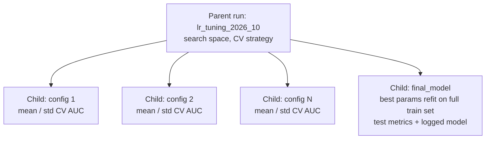

# Advanced MLflow Tracking

## Overview

The **Advanced MLflow Usage** section of the exam guide tests three skills. You structure complex experiments with **nested runs**, log custom parameters, metrics, and artifacts programmatically, and build **custom model objects** that do feature engineering at prediction time. The basics (`mlflow.autolog()`, the run and experiment hierarchy) are in [MLflow Basics](../../../shared/fundamentals/mlflow-basics.md).

> [!abstract]
>
> - **Nested runs** (`mlflow.start_run(nested=True)`) group child runs under a parent. A common layout is a parent per tuning job, a child per hyperparameter configuration, and a final-model run for the winner.
> - The `log_*` family covers parameters (`log_param(s)`), time-series metrics (`log_metric(..., step=)`), tags, files (`log_artifact(s)`), and structured artifacts (`log_dict`, `log_table`, `log_figure`, `log_text`, `log_input`).
> - A **custom `mlflow.pyfunc.PythonModel`** bundles request-time feature engineering, the model, and post-processing in one artifact, so training and serving run the same transformation code.

> [!tip] What the Exam Tests
>
> - Choosing the run structure that ties a final model back to its hyperparameter search and keeps the MLflow UI comparable
> - Picking the right API to log a metric series, a config file, a plot, or a table
> - Writing `load_context()` and `predict()` correctly, and logging artifacts with the `artifacts` dict, signatures, and a Unity Catalog model name

---

## Nested Runs for Complex Experiments

A flat list of runs tagged with fold numbers makes comparison hard. Nesting gives the MLflow UI a tree it can collapse and compare.



Recommended structure for **k-fold cross-validated tuning followed by a final refit**:

1. **One parent run** for the whole experiment. Log the search space, number of folds, and dataset version.
2. **One child run per hyperparameter configuration**. Log the parameters and the **aggregated** CV metrics (mean and standard deviation across folds). Per-fold values can go in as a metric series using `step=fold`.
3. **One final run** that refits the best configuration on the full training set, evaluates it on the hold-out set, and logs the model. Keep it under the same parent (or tag it with the parent ID) so the final model stays linked to the search that produced it.

```python
import mlflow
import numpy as np
from sklearn.linear_model import LogisticRegression
from sklearn.metrics import roc_auc_score
from sklearn.model_selection import StratifiedKFold

param_grid = [{"C": c, "penalty": "l2"} for c in (0.01, 0.1, 1.0, 10.0)]
kfold = StratifiedKFold(n_splits=5, shuffle=True, random_state=42)

with mlflow.start_run(run_name="lr_tuning_2026_10") as parent:
    mlflow.log_params({"search": "grid", "n_folds": 5, "n_configs": len(param_grid)})

    results = []
    for i, params in enumerate(param_grid):
        with mlflow.start_run(run_name=f"config_{i}", nested=True):
            mlflow.log_params(params)
            fold_aucs = []
            for fold, (tr, va) in enumerate(kfold.split(X_train, y_train)):
                model = LogisticRegression(max_iter=1000, **params).fit(X_train[tr], y_train[tr])
                auc = roc_auc_score(y_train[va], model.predict_proba(X_train[va])[:, 1])
                mlflow.log_metric("fold_auc", auc, step=fold)   # per-fold series
                fold_aucs.append(auc)
            mlflow.log_metrics({"cv_auc_mean": np.mean(fold_aucs), "cv_auc_std": np.std(fold_aucs)})
            results.append((np.mean(fold_aucs), params))

    best_auc, best_params = max(results, key=lambda r: r[0])

    with mlflow.start_run(run_name="final_model", nested=True):
        mlflow.log_params(best_params)
        mlflow.set_tag("selected_from_parent", parent.info.run_id)
        final_model = LogisticRegression(max_iter=1000, **best_params).fit(X_train, y_train)
        mlflow.log_metric("test_auc", roc_auc_score(y_test, final_model.predict_proba(X_test)[:, 1]))
        mlflow.sklearn.log_model(final_model, name="model", input_example=X_train[:5])
```

Query the children of a parent programmatically through the `mlflow.parentRunId` system tag:

```python
children = mlflow.search_runs(
    filter_string=f"tags.mlflow.parentRunId = '{parent.info.run_id}'",
    order_by=["metrics.cv_auc_mean DESC"],
)
```

| Structure | Verdict | Why |
| :--- | :--- | :--- |
| Flat runs + tags for config and fold | ❌ | No hierarchy; the UI can't collapse or compare configurations cleanly |
| Parent per **fold**, child per config | ❌ | Inverts the hierarchy; each configuration is scattered across k parents |
| Parent for experiment, children **only** for the final model, all CV results as parent metrics | ❌ | Loses per-configuration comparison |
| Parent for experiment → child per config (aggregated CV metrics) → final-model run | ✅ | Comparable configurations, and the final model stays linked to its search |

> [!note]
> Hyperopt with `SparkTrials`, Optuna's `MlflowSparkStudy`, and MLflow autologging create this parent/child layout for you, with one child per trial. When code runs inside Spark executors (for example in `applyInPandas`), pass the parent run ID explicitly. See [Scaling ML Workloads](./09-scaling-ml-workloads.md#group-specific-model-training).

## Logging Custom Parameters, Metrics, and Artifacts

| Need | API | Notes |
| :--- | :--- | :--- |
| One / many hyperparameters | `mlflow.log_param(key, value)` / `mlflow.log_params(dict)` | Params are write-once per run |
| Metric value, or a series over epochs / folds | `mlflow.log_metric(key, value, step=n)` / `mlflow.log_metrics(dict, step=n)` | `step` makes a chart in the UI |
| Searchable metadata | `mlflow.set_tag(key, value)` / `mlflow.set_tags(dict)` | e.g. `git_sha`, `data_version`, `owner` |
| A local file or directory | `mlflow.log_artifact(path, artifact_path=None)` / `mlflow.log_artifacts(dir)` | Feature-importance CSV, model card, config files |
| A Python dict as JSON or YAML | `mlflow.log_dict(d, "config/params.yaml")` | Format inferred from the extension |
| A Matplotlib or Plotly figure | `mlflow.log_figure(fig, "plots/roc.png")` | No temporary file needed |
| A table (dict or pandas DataFrame) | `mlflow.log_table(df, "eval/predictions.json")` | Stored as a JSON artifact, viewable in the UI |
| Free text | `mlflow.log_text(text, "notes/summary.md")` | |
| The dataset used | `mlflow.log_input(dataset, context="training")` | Records lineage for the run |
| Log to a specific run (not the active one) | `MlflowClient().log_metric(run_id, key, value, step=n)` | Useful from callbacks and background jobs |

Source: [MLflow Python API](https://mlflow.org/docs/latest/api_reference/python_api/mlflow.html).

```python
import matplotlib.pyplot as plt
import mlflow
import pandas as pd
from sklearn.metrics import RocCurveDisplay

with mlflow.start_run(run_name="custom_logging_demo"):
    mlflow.set_tags({"git_sha": git_sha, "data_version": "2026-10-01"})
    mlflow.log_dict({"features": feature_cols, "threshold": 0.95}, "config/inference.yaml")

    for epoch, loss in enumerate(training_losses):
        mlflow.log_metric("train_loss", loss, step=epoch)

    fig, ax = plt.subplots()
    RocCurveDisplay.from_predictions(y_test, y_score, ax=ax)
    mlflow.log_figure(fig, "plots/roc_curve.png")

    mlflow.log_table(
        pd.DataFrame({"y_true": y_test, "y_score": y_score}),
        artifact_file="eval/test_predictions.json",
    )

    pd.DataFrame({"feature": feature_cols, "importance": importances}).to_csv("fi.csv", index=False)
    mlflow.log_artifact("fi.csv", artifact_path="explainability")
```

## Custom Model Objects with Real-Time Feature Engineering

A built-in flavor such as `mlflow.sklearn` serialises only the estimator. If the model needs features computed from the raw request (time-of-day flags, ratios against a stored profile, text cleaning), training and serving can drift apart unless that logic ships **inside** the model. A custom `PythonModel` handles this:

- `load_context(self, context)` runs **once** when the model loads. Load heavy artifacts (estimators, lookup files, encoders) here through `context.artifacts["<name>"]`, which resolves to a local path.
- `predict(self, context, model_input, params=None)` runs **per request**. Compute the features, call the estimator, and shape the output. Since MLflow 2.20, `context` can be omitted from `predict` when unused.

```python
import mlflow
import pandas as pd
from mlflow.models import infer_signature


class FraudModelWithRealtimeFeatures(mlflow.pyfunc.PythonModel):

    def load_context(self, context):
        import joblib
        # Trusted artifact: packaged into this model by our own training run
        self.model = joblib.load(context.artifacts["estimator"])
        self.merchant_avg = pd.read_parquet(context.artifacts["merchant_profile"]).set_index("merchant_id")

    def _engineer(self, df: pd.DataFrame) -> pd.DataFrame:
        ts = pd.to_datetime(df["event_ts"])
        out = pd.DataFrame(index=df.index)
        out["amount"] = df["amount"]
        out["hour_of_day"] = ts.dt.hour
        out["is_night"] = ts.dt.hour.isin(range(0, 6)).astype(int)
        avg = df["merchant_id"].map(self.merchant_avg["avg_amount"]).fillna(df["amount"])
        out["amount_vs_merchant_avg"] = df["amount"] / avg
        return out

    def predict(self, context, model_input: pd.DataFrame, params=None):
        features = self._engineer(model_input)
        proba = self.model.predict_proba(features)[:, 1]
        return pd.DataFrame({"fraud_probability": proba})


raw_example = pd.DataFrame({
    "event_ts": ["2026-10-01T02:13:00"], "amount": [940.0], "merchant_id": ["m_42"],
})

mlflow.set_registry_uri("databricks-uc")
with mlflow.start_run(run_name="fraud_pyfunc"):
    mlflow.pyfunc.log_model(
        name="fraud_model",
        python_model=FraudModelWithRealtimeFeatures(),
        artifacts={
            "estimator": "/Volumes/main/fraud/artifacts/gbm.joblib",
            "merchant_profile": "/Volumes/main/fraud/artifacts/merchant_profile.parquet",
        },
        signature=infer_signature(raw_example, pd.DataFrame({"fraud_probability": [0.97]})),
        input_example=raw_example,
        pip_requirements=["scikit-learn", "pandas", "pyarrow", "joblib"],
        registered_model_name="main.fraud.fraud_realtime_model",
    )
```

Design notes:

- The **signature describes the raw request** (`event_ts`, `amount`, `merchant_id`), not the engineered features, because that's what callers send. Unity Catalog requires a signature to register a model ([Custom models](https://docs.databricks.com/aws/en/machine-learning/model-serving/custom-models)).
- The training pipeline should call the **same** `_engineer` logic (for example from a shared module passed with `code_paths`), so offline and online features match.
- For feature values that must be **looked up** (such as a customer's 30-day spend) rather than derived from the request, use Feature Engineering in Unity Catalog with an online store, or an on-demand `FeatureFunction`. See [Feature Engineering Client and Online Serving](./11-feature-engineering-client-online-serving.md).
- In MLflow 3, `name=` replaces the deprecated `artifact_path=` argument of `log_model` ([`mlflow.pyfunc` API](https://mlflow.org/docs/latest/api_reference/python_api/mlflow.pyfunc.html)).

## Use Cases

- **Auditable tuning**: A regulator asks which search produced the production model. The parent run holds the search space, the children hold per-configuration CV results, and the final-model run carries the registered version.
- **Per-epoch training curves**: `log_metric("val_loss", v, step=epoch)` produces a chart in the run page without any custom plotting.
- **Request-time features for fraud scoring**: A custom pyfunc derives `hour_of_day` and an amount ratio from the raw payload, so the serving endpoint and offline evaluation compute features identically.

## Common Issues & Errors

### `Exception: Run with UUID ... is already active`

**Scenario:** Code calls `mlflow.start_run()` inside an active run without `nested=True`.
**Fix:** Pass `nested=True` for child runs, or use `with mlflow.start_run(...)` blocks so runs are closed reliably.

### `MlflowException` when registering to Unity Catalog

**Scenario:** `registered_model_name="catalog.schema.model"` fails because the model has no signature.
**Fix:** Provide `signature=` or an `input_example=` so MLflow can infer one, and call `mlflow.set_registry_uri("databricks-uc")` first.

### Serving fails with `FileNotFoundError` for an artifact

**Scenario:** `predict()` opens `/dbfs/...` or a local path that exists only on the training cluster.
**Fix:** Pass every file through the `artifacts` dict and read it via `context.artifacts[...]` in `load_context()`. MLflow copies those files into the model package.

## Exam Tips

> [!tip]
>
> - The best structure for "tune with k-fold CV, then retrain the best model" is a parent for the experiment, a child per hyperparameter set with **aggregated** CV metrics, and a separate final-model run for the best set.
> - `log_metric(..., step=)` is for series. `log_param` is for inputs (write-once). `log_dict`, `log_table`, and `log_figure` save structured artifacts without temporary files.
> - Expensive initialization belongs in `load_context()`, not `predict()`.
> - A custom pyfunc is the answer when preprocessing or feature engineering must be **identical at training and serving time** and no built-in flavor captures it.

## Key Takeaways

- **Nested runs** keep complex experiments comparable; link children with `nested=True`, or with the `mlflow.parentRunId` tag when running in executors
- **Final model linked to its search**: refit the best configuration in a dedicated run under the same parent
- **Pick the right logger**: params, metrics (with `step`), tags, artifacts, `log_dict` / `log_table` / `log_figure` / `log_text`, `log_input`
- **Custom `PythonModel`**: `load_context` loads artifacts once; `predict` engineers features from the raw request and scores
- **Unity Catalog registration needs a signature**; describe the raw request schema

## Related Topics

- [MLflow Basics (shared)](../../../shared/fundamentals/mlflow-basics.md)
- [MLflow cheat sheet (shared)](../../../shared/cheat-sheets/mlflow-quick-ref.md)
- [Distributed Hyperparameter Tuning](./07-distributed-tuning.md) — trials logged as child runs
- [Model Serving and Deployment](../03-model-deployment/01-model-serving-deployment.md) — serving custom pyfunc models

## Official Documentation

- [MLflow Python API (`mlflow`)](https://mlflow.org/docs/latest/api_reference/python_api/mlflow.html)
- [MLflow `pyfunc` API](https://mlflow.org/docs/latest/api_reference/python_api/mlflow.pyfunc.html)
- [Deploy custom models with Model Serving](https://docs.databricks.com/aws/en/machine-learning/model-serving/custom-models)

---

**[← Previous: Scaling ML Workloads](./09-scaling-ml-workloads.md) | [↑ Back to Model Development](./README.md) | [Next: Feature Engineering Client and Online Serving →](./11-feature-engineering-client-online-serving.md)**
