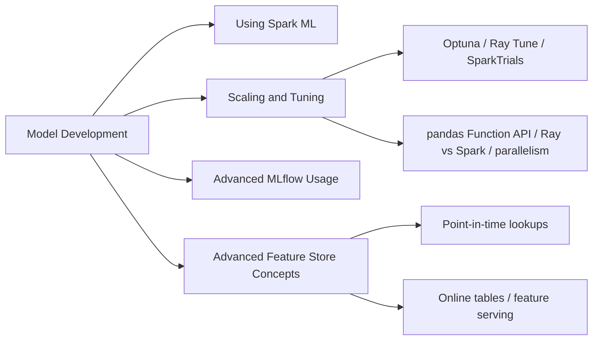

# Model Development (44 % of Exam)

The largest domain in the September 2025 blueprint, tied with ML Ops. The exam guide splits it into four sections: **Using Spark ML**, **Scaling and Tuning** (pandas Function API, Optuna, Ray, vertical vs horizontal scaling, parallelism strategies), **Advanced MLflow Usage**, and **Advanced Feature Store Concepts** (point-in-time lookups, FeatureEngineering Client pipelines, online tables, streaming and on-demand features).

## Topics Overview

## Section Contents

| File | Topic | Exam guide section | Priority |
| :--- | :--- | :--- | :--- |
| [01-feature-store-fundamentals.md](./01-feature-store-fundamentals.md) | Feature store concepts, offline vs online, training-serving skew | Advanced Feature Store Concepts | Medium |
| [02-databricks-feature-store.md](./02-databricks-feature-store.md) | Feature tables and lookups (legacy `FeatureStoreClient` examples) | Advanced Feature Store Concepts | Medium |
| [03-advanced-feature-techniques.md](./03-advanced-feature-techniques.md) | Feature selection, encoding, temporal and embedding features | Using Spark ML (feature preparation) | Medium |
| [04-feature-store-production.md](./04-feature-store-production.md) | Productionising feature pipelines, governance, freshness | Advanced Feature Store Concepts | Medium |
| [05-tuning-fundamentals.md](./05-tuning-fundamentals.md) | Grid / random / Bayesian search; `CrossValidator` | Using Spark ML (tuning), Scaling and Tuning | High |
| [06-bayesian-optimization.md](./06-bayesian-optimization.md) | Bayesian optimization, TPE, search-space design | Scaling and Tuning | Medium |
| [07-distributed-tuning.md](./07-distributed-tuning.md) | **Optuna `MlflowSparkStudy`**, **Ray Tune**, `SparkTrials`, distributed XGBoost | Scaling and Tuning | High |
| [08-spark-ml-pipelines.md](./08-spark-ml-pipelines.md) | **Spark ML pipelines**: estimators vs transformers, tuning, evaluation, batch / streaming scoring, Spark ML vs single-node | Using Spark ML | High |
| [09-scaling-ml-workloads.md](./09-scaling-ml-workloads.md) | **pandas Function API** (`applyInPandas`), vertical vs horizontal, data vs model parallelism, **Ray vs Spark** | Scaling and Tuning | High |
| [10-advanced-mlflow-tracking.md](./10-advanced-mlflow-tracking.md) | **Nested runs**, custom params / metrics / artifacts, custom pyfunc with real-time feature engineering | Advanced MLflow Usage | High |
| [11-feature-engineering-client-online-serving.md](./11-feature-engineering-client-online-serving.md) | **Point-in-time** lookups, `FeatureEngineeringClient` pipelines, **online tables via SDK**, streaming features, **on-demand features + feature serving** | Advanced Feature Store Concepts | High |

## Key Concepts

| Concept | Why it matters |
| :--- | :--- |
| **Spark ML `Pipeline`** | `StringIndexer` → `OneHotEncoder` → `VectorAssembler` → estimator; scales with data volume |
| **`groupBy().applyInPandas()`** | Trains or scores one model per group in parallel; each group must fit in memory |
| **Optuna + `MlflowSparkStudy`** | Distributes Optuna trials over Spark executors with `MlflowStorage`; each trial is logged to MLflow |
| **Ray on Databricks** | `setup_ray_cluster` → Ray Tune / Ray Train; Ray for task parallelism, Spark for data parallelism |
| **Nested runs** | Parent experiment run → child per configuration → final-model run |
| **Feature Engineering in UC** | `FeatureEngineeringClient` replaces the legacy workspace `FeatureStoreClient` |
| **Point-in-time lookup** | Time series feature table + `timestamp_lookup_key` prevents label leakage |
| **Online tables / Online Feature Store** | Low-latency synced copy for serving; legacy online tables are now replaced by Lakebase-backed Online Feature Stores |
| **`FeatureFunction`** | On-demand feature computed by a UC Python UDF at training *and* serving time |

> [!note] Platform update (Oct 2026)
> **Hyperopt** is no longer maintained and isn't in Databricks Runtime ML after 16.4 LTS ML. Use Optuna or Ray Tune. **Legacy online tables** became inaccessible after January 15, 2026. Use Databricks Online Feature Stores (Lakebase) or Lakebase synced tables. The exam guide still says "online tables", so learn both names. Details and sources are in [07](./07-distributed-tuning.md) and [11](./11-feature-engineering-client-online-serving.md).

## Related Resources

- [Feature Engineering Basics (shared)](../../../shared/fundamentals/feature-engineering-basics.md)
- [Spark Fundamentals (shared)](../../../shared/fundamentals/spark-fundamentals.md)
- [MLflow Basics (shared)](../../../shared/fundamentals/mlflow-basics.md)
- [Feature Engineering in Unity Catalog documentation](https://docs.databricks.com/aws/en/machine-learning/feature-store/)
- [Hyperparameter tuning documentation](https://docs.databricks.com/aws/en/machine-learning/automl-hyperparam-tuning/)
- [Ray on Databricks documentation](https://docs.databricks.com/aws/en/machine-learning/ray/)

---

**[↑ Back to ML Professional](../README.md) | [Next: ML Ops →](../02-ml-ops/README.md)** *(first domain — no previous)*
