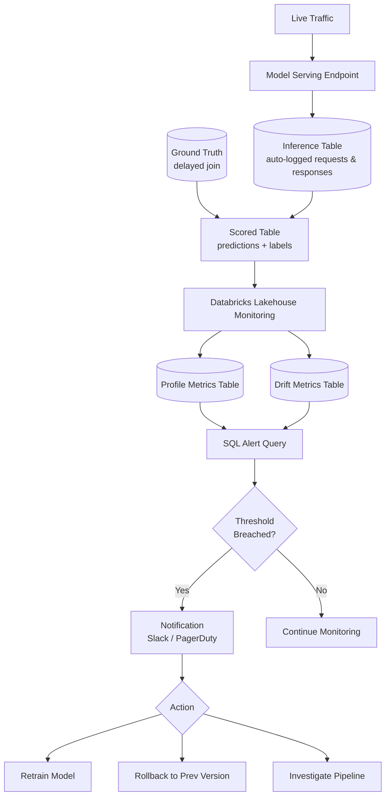

# Model Monitoring and Observability

## Overview

A model that performs well during offline evaluation can degrade silently once deployed to production. Real-world data distributions shift over time, upstream pipelines change without notice, and the relationship between inputs and outputs evolves as business conditions change. Without continuous monitoring, you have no signal that anything is wrong until a downstream business metric collapses — by which point the damage is already done.

Effective production monitoring covers three distinct layers:

- **Data quality (inputs)**: Are the features arriving in the expected distribution and format? Missing values, unexpected nulls, out-of-range values, and upstream schema changes all corrupt inputs before predictions are made.
- **Model performance (outputs vs. ground truth)**: Is the model still making accurate predictions? This requires joining predictions with delayed ground truth labels.
- **System / operational health**: Is the endpoint up, fast, and handling load? Latency spikes and elevated error rates hurt user experience even when the model itself is correct.

> [!abstract]
>
> - **Inference tables** log every served request and response to Delta. They're the raw material for every other monitoring layer.
> - **Lakehouse Monitoring** (now called **data profiling**) builds InferenceLog, TimeSeries, or Snapshot profiles. Each writes profile and drift metric tables, with granularities, slices, baselines, and custom metrics.
> - **Endpoint health** (latency, request rate, error rate, CPU, memory) comes from Model Serving metrics and can be exported to Prometheus or Datadog.
> - **SQL alerts** on the metric tables notify stakeholders and can kick off retraining.

> [!tip] What the Exam Tests
>
> - Picking the table type and profile type that solve a monitoring need, and explaining why
> - Building a monitor on a snapshot, time series, or inference table
> - Evaluating model performance over time, per slice, and per granularity from the metric tables
> - Naming the components of a monitoring pipeline and the infrastructure metrics used for endpoint health

---

## Monitoring Architecture



## Inference Tables

Databricks Model Serving can automatically log every request and response to a Delta table — this is called an **inference table**. This logging must be configured before production traffic starts; it cannot be applied retroactively to requests that have already been served.

Enabling inference table logging when creating or updating an endpoint:

```python
from databricks.sdk import WorkspaceClient
from databricks.sdk.service.serving import AutoCaptureConfigInput, ServedEntityInput

client = WorkspaceClient()

# Enable (legacy) inference table logging on an existing endpoint

client.serving_endpoints.update_config(
    name="fraud-classifier-endpoint",
    served_entities=[
        ServedEntityInput(
            entity_name="ml_catalog.models.fraud_classifier",
            entity_version="12",
            workload_size="Small",
            scale_to_zero_enabled=False,
        )
    ],
    auto_capture_config=AutoCaptureConfigInput(
        catalog_name="ml_catalog",
        schema_name="inference_logs",
        table_name_prefix="fraud_classifier",
        enabled=True,
    ),
)
```

> [!note] Platform update (Oct 2026)
> `auto_capture_config` creates the original (legacy) inference table, and its documentation page is retired. For custom model, foundation model, and agent serving endpoints, Databricks recommends **AI Gateway-enabled inference tables**. Once an endpoint migrates to an AI Gateway inference table, it can't switch back ([Inference tables (retired docs)](https://docs.databricks.com/aws/en/machine-learning/model-serving/inference-tables)). AI Gateway-enabled tables use a different schema, for example `request_time` (TIMESTAMP), `served_entity_id`, and `execution_duration_ms` instead of `timestamp_ms` and `execution_time_ms`. For route-optimized custom model endpoints, `requester` is `NULL` ([Inference tables for serving endpoints](https://docs.databricks.com/aws/en/ai-gateway/inference-tables-serving-endpoints)). The monitoring workflow is unchanged: log every request, join late labels on the request ID, and profile the result.

### Inference Table Schema

| Column | Type | Description |
| :--- | :--- | :--- |
| `databricks_request_id` | STRING | Unique request identifier for joining with ground truth |
| `timestamp_ms` | LONG | Unix timestamp in milliseconds |
| `request` | STRING | JSON request payload containing model inputs |
| `response` | STRING | JSON response payload containing model predictions |
| `status_code` | INT | HTTP response code — 200 for success, 4xx/5xx for errors |
| `execution_time_ms` | LONG | End-to-end inference latency in milliseconds |
| `sampling_fraction` | DOUBLE | Fraction logged when sampling is enabled (default: 1.0) |
| `served_model_name` | STRING | Name of the served model version that handled the request |

### Joining Predictions with Delayed Ground Truth

Ground truth labels are rarely available immediately. In fraud detection, for example, you may not know whether a transaction was truly fraudulent for 7–14 days. The `databricks_request_id` column is the join key between inference logs and your ground truth system:

```sql
-- Join predictions with ground truth labels (available 7 days later)
SELECT
    p.databricks_request_id,
    CAST(
        JSON_EXTRACT_SCALAR(p.request, '$.dataframe_records[0].amount')
        AS DOUBLE
    ) AS transaction_amount,
    CAST(
        JSON_EXTRACT_SCALAR(p.response, '$.predictions[0]')
        AS DOUBLE
    ) AS predicted_fraud_score,
    g.actual_fraud_label,
    DATE(FROM_UNIXTIME(p.timestamp_ms / 1000)) AS prediction_date,
    p.execution_time_ms
FROM ml_catalog.inference_logs.fraud_classifier_payload AS p
INNER JOIN gold.fraud_ground_truth AS g
    ON p.databricks_request_id = g.request_id
WHERE
    DATEDIFF(
        current_date(),
        DATE(FROM_UNIXTIME(p.timestamp_ms / 1000))
    ) BETWEEN 7 AND 14
```

Write the result of this join to a scored table (e.g., `ml_catalog.inference_logs.fraud_classifier_scored`) that becomes the input table for Lakehouse Monitoring.

## Databricks Lakehouse Monitoring

Lakehouse Monitoring (LHM) is a native Databricks feature that profiles a Unity Catalog Delta table on a schedule and computes statistical, drift, and model-quality metrics. It writes two metric tables and an auto-generated dashboard.

> [!note] Platform update (Oct 2026)
> Current docs call this feature **data profiling** ("Data profiling was formerly known as Lakehouse Monitoring"). It sits under **data quality monitoring**, next to table-level **anomaly detection** ([Data quality monitoring](https://docs.databricks.com/aws/en/data-governance/unity-catalog/data-quality-monitoring/)). The `w.quality_monitors` SDK API used below is **deprecated**. New code uses `w.data_quality.create_monitor(...)` with a `DataProfilingConfig` (see [Current API](#current-api-data-profiling-with-wdata_quality) below). The exam guide uses the Lakehouse Monitoring name, and the concepts are unchanged: profile types, metric tables, baselines, slices, granularities, and custom metrics.

### Choosing the Profile Type for a Table

| Table / use case | Profile type | Why |
| :--- | :--- | :--- |
| Model requests and predictions with timestamps (inference table or scored table), optionally with labels | **InferenceLog** | Adds **model-quality** metrics (accuracy, log loss, F1, RMSE, R²…), slices automatically by `model_id_col`, and computes fairness metrics for Boolean slices |
| Any table with a timestamp column (feature table, event log) where you track distributions per time window | **TimeSeries** | Metrics per window at each **granularity**; drift between consecutive windows |
| Table without a meaningful timestamp, rewritten or updated in place (dimension table, nightly batch scoring snapshot) | **Snapshot** | Profiles the **whole table** at each refresh; maximum 4 TB (use TimeSeries above that) |

### Creating an InferenceLog Monitor

```python
from databricks.sdk import WorkspaceClient
from databricks.sdk.service.catalog import (
    MonitorCronSchedule,
    MonitorInferenceLog,
    MonitorInferenceLogProblemType,
)

client = WorkspaceClient()

# Scored table: inference log + delayed labels; request_time cast from timestamp_ms to TIMESTAMP
monitor = client.quality_monitors.create(
    table_name="ml_catalog.inference_logs.fraud_classifier_scored",
    assets_dir="/Workspace/Shared/ml-monitoring/fraud-classifier",
    output_schema_name="ml_catalog.monitoring_outputs",
    inference_log=MonitorInferenceLog(
        problem_type=MonitorInferenceLogProblemType.PROBLEM_TYPE_CLASSIFICATION,
        prediction_col="predicted_label",
        prediction_proba_col="predicted_fraud_score",   # needed for log_loss and roc_auc_score
        label_col="actual_fraud_label",
        timestamp_col="request_time",
        model_id_col="served_model_name",
        granularities=["1 day", "1 week"],
    ),
    baseline_table_name="ml_catalog.ml_baselines.fraud_classifier_baseline",
    slicing_exprs=["merchant_category", "amount > 1000"],
    schedule=MonitorCronSchedule(
        quartz_cron_expression="0 0 6 * * ?",   # refresh daily at 06:00
        timezone_id="UTC",
    ),
)

client.quality_monitors.run_refresh(table_name="ml_catalog.inference_logs.fraud_classifier_scored")
```

Key configuration concepts:

- **Granularities** set the time-window sizes for TimeSeries and InferenceLog profiles, from 5 minutes up to 1 year (for example `"1 hour"`, `"1 day"`, `"1 week"`, `"1 month"`). Each window size produces its own rows.
- **Slicing expressions** (`slicing_exprs`) each slice the data independently. A column name creates one slice per distinct value (the top 100 values for high-cardinality columns). A predicate such as `amount > 1000` creates two slices, true and false. The whole table is the row where `slice_key` and `slice_value` are `NULL`.
- **Baseline table** (optional): the reference distribution for `BASELINE` drift, such as the training or validation set for an inference profile. It should match the monitored table's schema, except for the timestamp column.
- When a time series or inference profile is first created, it analyzes only the **30 days** before creation. After that, all new data is processed.

### LHM Output Tables

| Table | Contents |
| :--- | :--- |
| `{output_schema}.{table_name}_profile_metrics` | Summary statistics per column, window, granularity, slice, and model ID (`count`, `num_nulls`, `percent_null`, `avg`, `median`, `distinct_count`, `frequent_items`…), plus **model-quality** columns for InferenceLog profiles |
| `{output_schema}.{table_name}_drift_metrics` | Drift statistics per column, window, and slice, with `drift_type` = `CONSECUTIVE` (vs previous window) or `BASELINE` (vs baseline table). See [Drift Detection](./04-drift-detection-remediation.md#lakehouse-monitoring-drift-metrics-table) |

Both are ordinary Delta tables in the output schema. Query them with SQL, build dashboards on them, and attach SQL alerts to them. Metrics that span several columns, such as model accuracy, are stored with `column_name = ':table'` ([Data profiling metric tables](https://docs.databricks.com/aws/en/lakehouse-monitoring/monitor-output)).

## Performance Metrics by Model Type

### Classification Models

InferenceLog profiles with `problem_type = PROBLEM_TYPE_CLASSIFICATION` and both `label_col` and `prediction_col` compute these per window and slice:

- **`accuracy_score`**: fraction of correct predictions
- **`precision`, `recall`, `f1_score`, `confusion_matrix`**: structs with averaged scores; essential under class imbalance
- **`roc_auc_score`** and **`log_loss`**: require `prediction_proba_col`. Log loss measures **probability calibration**
- **Fairness and bias** (`predictive_parity`, `predictive_equality`, `equal_opportunity`, `statistical_parity`) for Boolean-valued slices

### Regression Models

With `problem_type = PROBLEM_TYPE_REGRESSION`: `mean_squared_error`, `root_mean_squared_error`, `mean_average_error`, `mean_absolute_percentage_error`, and `r2_score`. For a metric that isn't built in, such as mean residual or a business cost, define a **custom metric** (below).

### Evaluating Model Performance Trends Over Time

```sql
-- Daily accuracy and log loss for each model version, whole table (no slice)
SELECT
    window.start            AS window_start,
    model_id_col            AS model_version,
    accuracy_score,
    log_loss
FROM ml_catalog.monitoring_outputs.fraud_classifier_scored_profile_metrics
WHERE column_name = ':table'
  AND granularity = '1 day'
  AND log_type = 'INPUT'
  AND slice_key IS NULL
ORDER BY window_start DESC, model_version
```

Change the filter to `slice_key = 'merchant_category'` to compare the same metrics **per segment**. Use `granularity = '1 week'` for a smoother trend. This is the "evaluate metrics at different granularities and with feature slicing" skill from the exam guide.

## Custom Metrics

When built-in statistics aren't enough, add **custom metrics**, defined as SQL expressions in Jinja templates ([Custom metrics](https://docs.databricks.com/aws/en/lakehouse-monitoring/custom-metrics)):

| Type | Computed from | Stored in |
| :--- | :--- | :--- |
| **Aggregate** | Columns of the primary table, such as a weighted error | Profile metrics table |
| **Derived** | Previously computed aggregate metrics (no table scan) | Profile metrics table |
| **Drift** | Aggregate or derived metrics compared across two windows, or primary vs baseline (`{{current_df}}` vs `{{base_df}}`) | Drift metrics table |

```python
from pyspark.sql import types as T
from databricks.sdk.service.catalog import MonitorMetric, MonitorMetricType

custom_metrics = [
    MonitorMetric(
        type=MonitorMetricType.CUSTOM_METRIC_TYPE_AGGREGATE,
        name="false_negative_cost",
        input_columns=[":table"],
        definition="sum(CASE WHEN actual_fraud_label = 1 AND predicted_label = 0 THEN amount ELSE 0 END)",
        output_data_type=T.StructField("output", T.DoubleType()).json(),
    ),
    MonitorMetric(
        type=MonitorMetricType.CUSTOM_METRIC_TYPE_DRIFT,
        name="false_negative_cost_delta",
        input_columns=[":table"],
        definition="{{current_df}}.false_negative_cost - {{base_df}}.false_negative_cost",
        output_data_type=T.StructField("output", T.DoubleType()).json(),
    ),
]
# Pass custom_metrics=custom_metrics to quality_monitors.create(...) or update(...)
```

## Endpoint Health Metrics

Operational health doesn't need ground truth. Model Serving exposes **infrastructure metrics**: **latency, request rate, error rate, CPU usage, and memory usage**. They're available by default in the Serving UI for the last 14 days and can be streamed to observability tools ([Monitor model quality and endpoint health](https://docs.databricks.com/aws/en/machine-learning/model-serving/monitor-diagnose-endpoints)).

For alerting outside Databricks, scrape the endpoint's metrics export API, `GET /api/2.0/serving-endpoints/{name}/metrics` (OpenMetrics format), with **Prometheus** or **Datadog**. Exported metrics include `request_count_total`, `request_4xx_count_total`, `request_5xx_count_total`, `request_latency_ms`, `model_prediction_latency_ms`, `cpu_usage_percentage`, `mem_usage_percentage`, and `provisioned_concurrent_requests_total` ([Export endpoint health metrics](https://docs.databricks.com/aws/en/machine-learning/model-serving/metrics-export-serving-endpoint)).

| Signal | Source | Typical alert |
| :--- | :--- | :--- |
| Latency (p50 / p95 / p99) | Serving UI metrics, `request_latency_ms`, or `execution_time_ms` in the inference table | p95 above the SLA |
| Request rate | `request_count_total`, request counts per window | Sudden drop to near zero (routing failure) or a spike beyond capacity |
| Error rate | `request_4xx_count_total` / `request_5xx_count_total`, `status_code` in the inference table | 5xx > 1 % |
| CPU / memory | `cpu_usage_percentage`, `mem_usage_percentage` | Sustained > 80 % means scale out (larger workload size) |
| Provisioned concurrency | `provisioned_concurrent_requests_total` | Saturation relative to configured concurrency |

You can also derive the same signals from the **inference table** for long-term history:

```sql
-- Operational metrics from the inference table (last 30 days)
SELECT
    DATE(FROM_UNIXTIME(timestamp_ms / 1000))  AS date,
    COUNT(*)                                   AS total_requests,
    PERCENTILE(execution_time_ms, 0.50)        AS p50_latency_ms,
    PERCENTILE(execution_time_ms, 0.95)        AS p95_latency_ms,
    PERCENTILE(execution_time_ms, 0.99)        AS p99_latency_ms,
    ROUND(
        SUM(CASE WHEN status_code != 200 THEN 1 ELSE 0 END)
        / COUNT(*) * 100, 2
    )                                          AS error_rate_pct
FROM ml_catalog.inference_logs.fraud_classifier_payload
WHERE timestamp_ms >= UNIX_TIMESTAMP(current_date() - 30) * 1000
GROUP BY DATE(FROM_UNIXTIME(timestamp_ms / 1000))
ORDER BY date DESC
```

## Components of a Monitoring Pipeline

| Component | Implementation on Databricks |
| :--- | :--- |
| **Logging** | Inference tables on the serving endpoint; batch scoring writes predictions to Delta |
| **Ground-truth join** | Scheduled job joins late labels on `databricks_request_id` (or a business key) into a scored table |
| **Drift detection** | LHM drift metrics table (`BASELINE` and `CONSECUTIVE`) |
| **Model performance** | LHM InferenceLog model-quality columns, per window, slice, and model version |
| **Model / endpoint health** | Serving UI metrics, metrics export API, inference-table latency and status codes |
| **Alerting and action** | Databricks SQL alerts on the metric tables → notification destinations → retraining job |

## Setting Up Alerts

Write a Databricks SQL query against the profile or drift metrics table, create a **SQL alert** on it, and choose how often it evaluates. Email notification is the default. Add webhook, Slack, or PagerDuty destinations to reach other stakeholders ([Profile alerts](https://docs.databricks.com/aws/en/lakehouse-monitoring/monitor-alerts)).

### Sample Alert Query: Calibration Degradation

```sql
-- Returns a row (and fires the alert) when yesterday's log loss breaches the agreed threshold.
-- Set the threshold from the validation / baseline log loss plus an agreed tolerance.
SELECT
    window.start   AS window_start,
    model_id_col   AS model_version,
    log_loss
FROM ml_catalog.monitoring_outputs.fraud_classifier_scored_profile_metrics
WHERE column_name = ':table'
  AND log_type = 'INPUT'
  AND slice_key IS NULL
  AND granularity = '1 day'
  AND window.start = date_sub(current_date(), 1)
  AND log_loss > 0.35
```

Alert configuration steps:

1. Create a SQL alert in Databricks SQL on the query above.
2. Set the **trigger condition** to "query returns any rows" (or a threshold on a result column).
3. Set the **schedule** to run after the monitor refresh, for example daily at 07:00.
4. Set **notification destinations**: email for the model owners, plus Slack or PagerDuty for on-call.
5. Set a **rearm** period so the same incident doesn't page repeatedly.

For automated action, add a job task that checks the metric and triggers the retraining job. See [Model Lifecycle Orchestration](./02-model-lifecycle-orchestration.md#drift-triggered-retraining).

### Current API: Data Profiling with `w.data_quality`

```python
from databricks.sdk import WorkspaceClient
from databricks.sdk.service.dataquality import (
    AggregationGranularity,
    DataProfilingConfig,
    InferenceLogConfig,
    InferenceProblemType,
    Monitor,
)

w = WorkspaceClient()
schema = w.schemas.get(full_name="ml_catalog.monitoring_outputs")
table = w.tables.get(full_name="ml_catalog.inference_logs.fraud_classifier_scored")

w.data_quality.create_monitor(
    monitor=Monitor(
        object_type="table",               # always "table" for data profiling
        object_id=table.table_id,
        data_profiling_config=DataProfilingConfig(
            output_schema_id=schema.schema_id,
            assets_dir="/Workspace/Shared/ml-monitoring/fraud-classifier",
            inference_log=InferenceLogConfig(
                problem_type=InferenceProblemType.INFERENCE_PROBLEM_TYPE_CLASSIFICATION,
                prediction_column="predicted_label",
                label_column="actual_fraud_label",
                timestamp_column="request_time",
                model_id_column="served_model_name",
                granularities=[AggregationGranularity.AGGREGATION_GRANULARITY_1_DAY],
            ),
            slicing_exprs=["merchant_category"],
        ),
    ),
)
```

Source: [Create a data profile using the API](https://docs.databricks.com/aws/en/lakehouse-monitoring/create-monitor-api). Refreshes run through `w.data_quality.create_refresh(...)`, and only one profile can exist per table in a metastore.

## Common Pitfalls

- **Not enabling inference tables from day one**: Retroactive logging is not possible. If inference tables are not configured before the endpoint receives traffic, that historical data is lost. Always enable `auto_capture_config` at endpoint creation.
- **Label delay creates a monitoring blind spot**: Ground truth may arrive 7–30 days late. You cannot compute AUC or accuracy in real time. Use prediction drift monitoring (output distribution) as a leading indicator while waiting for labels.
- **Monitoring only aggregate metrics**: A model that is accurate on average may be systematically wrong for a specific demographic or business segment. Add per-segment monitoring (e.g., group by merchant category or geographic region) to catch fairness issues.
- **Alert fatigue from overly sensitive thresholds**: Start with conservative thresholds (e.g., AUC drop > 10%), observe baseline variance over 2–4 weeks, then tighten to a meaningful threshold (e.g., > 5%). Firing too often causes teams to ignore alerts.
- **Not setting a baseline table**: Without a baseline, LHM computes only `CONSECUTIVE` drift (window vs previous window). `BASELINE` drift, comparing against training data or a known-good period, needs `baseline_table_name`. Set the baseline to your training or validation data distribution, or to a known-good production window.
- **Forgetting to refresh the monitor**: LHM runs on a schedule. If the schedule is misconfigured or the refresh fails silently, the monitoring output tables become stale without any visible error.

## Practice Questions

> [!success]- Question 1: Retroactive Inference Logging
>
> A model was deployed to production six months ago without inference table logging enabled.
> The team now wants to evaluate model performance over the past month.
> What is their only viable option?
>
> A) Enable inference table logging now — it will backfill historical requests automatically
> B) Reconstruct predictions from application logs if the calling service preserved request/response payloads, then evaluate going forward with inference tables enabled
> C) Query the MLflow tracking server for historical predictions
> D) Use Databricks Lakehouse Monitoring to retroactively compute predictions
>
> **Correct Answer: B**
>
> Inference table logging cannot be applied retroactively. Once a request has been served without logging enabled, that data is gone from the platform's perspective. The only recovery path is to check whether the upstream application service preserved request/response data in its own logs. Going forward, enable `auto_capture_config` immediately.
<!-- -->
> [!success]- Question 2: Lakehouse Monitoring Monitor Type
>
> Your team runs a fraud classification model. Predictions are logged to an inference table, and
> ground truth labels arrive after a 7-day delay. You want Databricks Lakehouse Monitoring to
> compute AUC, precision, and recall automatically. Which monitor type should you configure?
>
> A) TimeSeries
> B) Snapshot
> C) InferenceLog
> D) ClassificationMonitor
>
> **Correct Answer: C**
>
> The `InferenceLog` monitor type is specifically designed for ML serving scenarios. It accepts `prediction_col`, `label_col`, and `problem_type` parameters and computes model performance metrics (AUC, precision, recall, F1 for classification; RMSE, MAE, R² for regression) per time window in addition to data quality statistics. `TimeSeries` and `Snapshot` compute data quality metrics but do not understand the ML prediction/label context.
<!-- -->
> [!success]- Question 3: Monitoring Without Ground Truth Labels
>
> Your model's ground truth labels are available only after a 14-day business process delay.
> What monitoring approach can you use in the meantime to detect potential model degradation?
>
> A) Disable monitoring until labels are available — results would be meaningless
> B) Monitor prediction distribution drift (output distribution) as a leading indicator of concept drift
> C) Compute AUC using training labels as a proxy for production ground truth
> D) Use RMSE on the raw prediction scores without a reference value
>
> **Correct Answer: B**
>
> When ground truth is delayed, monitoring the distribution of model predictions (output distribution drift) serves as a leading indicator. If the model begins producing a very different distribution of scores — for example, flagging 40% of transactions as fraudulent when the historical average is 2% — something has changed upstream. This does not prove concept drift but is a strong signal to investigate before labels arrive. Option C is invalid because training labels describe training data, not production data.

## Use Cases

- **Three-Layer Production Model Monitoring**: Setting up data quality checks on input features, prediction distribution monitoring via Lakehouse Monitoring, and operational health dashboards (latency, error rate, QPS) to detect issues across the entire serving stack.
- **Proactive Fraud Model Health Checks**: Scheduling daily monitoring jobs that compare prediction score distributions against a baseline, triggering Slack alerts when PSI exceeds 0.2 so the team can investigate before ground-truth labels confirm degradation.

## Common Issues & Errors

### Artifact Access Denied

**Scenario:** Models fail to load from MLflow registry during serving.
**Fix:** Check Unity Catalog permissions or traditional workspace access controls on the underlying storage.

### Monitoring Dashboard Missing Recent Predictions

**Scenario:** The Lakehouse Monitoring dashboard shows stale data because the inference table has not been refreshed or the monitoring profile has not been re-computed.
**Fix:** Ensure the inference table is enabled on the serving endpoint BEFORE production traffic begins (it cannot backfill). Schedule the monitoring `refresh()` job to run at least as frequently as the reporting cadence. Verify the inference table Delta path has not been moved or compacted in a way that breaks the monitor's table reference.

## Exam Tips

> [!tip]
>
> - Match the **profile type to the table**: inference or scored tables → **InferenceLog**; timestamped feature or event tables → **TimeSeries**; tables without a usable timestamp that are rewritten in place → **Snapshot**.
> - Model-quality metrics (accuracy, log loss, F1, RMSE, R²) appear only for **InferenceLog** profiles with `label_col` and `prediction_col`. `log_loss` and `roc_auc_score` also need `prediction_proba_col`.
> - "Per segment" means **`slicing_exprs`**. "Per day vs per week" means **granularities**. A business-specific measure means a **custom metric** (aggregate, derived, or drift).
> - Endpoint **health** (latency, request rate, error rate, CPU, memory) comes from Model Serving metrics and the metrics export API, not from the profile tables.
> - Exam wording "Lakehouse Monitoring" = current docs "data profiling".

## Key Takeaways

- **Three monitoring layers**: Data quality (inputs), model performance (predictions vs ground truth), system/operational health (latency, error rate)
- **Inference tables**: Enable BEFORE production traffic starts — requests already served cannot be backfilled retroactively
- **Lakehouse Monitoring (now "data profiling")**: InferenceLog / TimeSeries / Snapshot profiles write `{table}_profile_metrics` and `{table}_drift_metrics` Delta tables plus a dashboard
- **Granularities and slices**: Metrics per time window size and per `slicing_exprs` slice; whole-table rows have `slice_key IS NULL`; multi-column metrics use `column_name = ':table'`
- **Custom metrics**: Aggregate and derived (profile table) and drift (drift table), defined as SQL templates
- **Endpoint health**: Latency, request rate, error rate, CPU, memory in the Serving UI (14 days) or exported to Prometheus / Datadog
- **SQL alerts on metric tables**: Notify email / Slack / PagerDuty / webhooks when thresholds are breached; chain to retraining
- **Remediation actions**: Retrain on recent data, roll back to `previous_champion` alias, investigate upstream pipeline schema changes

## Related Topics

- [Drift Detection & Remediation](./04-drift-detection-remediation.md)
- [Model Versioning & Registry](../02-ml-ops/01-model-versioning-registry.md)
- [MLflow Basics](../../../shared/fundamentals/mlflow-basics.md)
- [Model Lifecycle Orchestration](./02-model-lifecycle-orchestration.md) — drift-triggered retraining

## Official Documentation

- [Data quality monitoring (data profiling, formerly Lakehouse Monitoring)](https://docs.databricks.com/aws/en/data-governance/unity-catalog/data-quality-monitoring/)
- [Data profiling metric tables](https://docs.databricks.com/aws/en/lakehouse-monitoring/monitor-output)
- [Custom metrics](https://docs.databricks.com/aws/en/lakehouse-monitoring/custom-metrics)
- [Profile alerts](https://docs.databricks.com/aws/en/lakehouse-monitoring/monitor-alerts)
- [Create a data profile using the API](https://docs.databricks.com/aws/en/lakehouse-monitoring/create-monitor-api)
- [Monitor model quality and endpoint health](https://docs.databricks.com/aws/en/machine-learning/model-serving/monitor-diagnose-endpoints)
- [Export serving endpoint health metrics](https://docs.databricks.com/aws/en/machine-learning/model-serving/metrics-export-serving-endpoint)

---

**[← Previous: Model Lifecycle Orchestration](./02-model-lifecycle-orchestration.md) | [↑ Back to ML Ops](./README.md) | [Next: Drift Detection and Remediation →](./04-drift-detection-remediation.md)**
