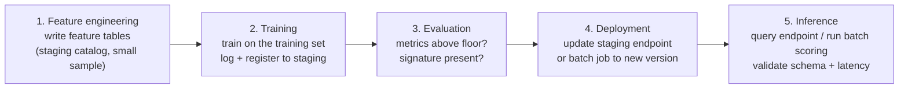

# Validation Testing for ML Systems

## Overview

The **Validation Testing** section of the exam guide covers four skills. You write unit tests for functions used in Databricks notebooks, place unit and integration tests in the right environment (dev, staging, prod), design an integration test that spans the whole ML system (feature engineering → training → evaluation → deployment → inference), and compare ways of organizing functions and their tests.

> [!abstract]
>
> - **Unit tests** check one function with known inputs and expected outputs. They're fast, run on every pull request, and use `pytest` for Python.
> - Databricks recommends keeping Python **functions and their unit tests outside notebooks**, in workspace files or Git folders, and running the tests from a notebook or CI.
> - **Integration tests** run the pipelines together in **staging**, on a limited data subset that matches production as closely as is reasonable.
> - A change affects **its own stage and everything downstream of it**. Upstream stages don't need retesting.

> [!tip] What the Exam Tests
>
> - Writing a unit test for a notebook function (input → expected output) and running `pytest` from a notebook
> - Matching test types to environments: unit tests in dev and on PRs, integration tests in staging, validation and monitoring in prod
> - Designing an end-to-end integration test and deciding which tests must re-run after a given change
> - Trade-offs of the three ways to organize functions and tests (same notebook, `%run` notebooks, Python files)

---

## Organizing Functions and Unit Tests

The Databricks guidance ([Unit testing for notebooks](https://docs.databricks.com/aws/en/notebooks/testing)) lists three organizations. For **Python and R**, store functions and their unit tests **outside notebooks**. For **Scala**, put functions in one notebook and their tests in a separate notebook. For **SQL**, store functions as SQL UDFs.

| Approach | Benefits | Challenges |
| :--- | :--- | :--- |
| **Functions + tests in Python files** (workspace files / Git folder), imported by notebooks | Callable from notebooks **and** outside them (CI, wheels, jobs). Test frameworks run naturally. Databricks workspace tools can discover, run, and track Python unit tests | Not available for Scala notebooks. More files to maintain |
| **Functions in one notebook, tests in another** (linked with `%run`) | Functions are reusable across notebooks | More notebooks to maintain. Functions can't be used, and are hard to test, outside notebooks |
| **Functions + tests in the same notebook** | Everything in one place; easy to track | Hard to reuse. Can't be used, and is hard to test, outside notebooks |

```text
fraud-model/                    # Git folder
├── src/fraud_model/
│   ├── __init__.py
│   ├── features.py             # pure functions used by the feature notebook
│   └── evaluation.py
├── tests/
│   ├── test_features.py
│   └── test_evaluation.py
├── notebooks/
│   ├── 01_feature_engineering.py   # imports from src/
│   └── run_unit_tests.py           # runs pytest
└── databricks.yml              # bundle definition (see Environments & Bundles)
```

## Writing Unit Tests

A unit test pins **one** function's behaviour: given *these* inputs, return *this* output, including edge cases.

```python
# src/fraud_model/features.py
import pandas as pd
from pyspark.sql import DataFrame, functions as F


def amount_ratio(amount: float, avg_amount: float | None) -> float | None:
    """Ratio of a transaction to the customer's average; None when undefined."""
    if avg_amount is None or avg_amount == 0:
        return None
    return amount / avg_amount


def add_night_flag(df: DataFrame, ts_col: str = "event_ts") -> DataFrame:
    """Adds is_night = 1 for events between 00:00 and 05:59."""
    return df.withColumn("is_night", (F.hour(F.col(ts_col)) < 6).cast("int"))
```

```python
# tests/test_features.py
import datetime as dt

import pytest
from pyspark.testing import assertDataFrameEqual

from fraud_model.features import add_night_flag, amount_ratio


@pytest.mark.parametrize(
    "amount, avg, expected",
    [(100.0, 50.0, 2.0), (10.0, 0.0, None), (10.0, None, None)],
)
def test_amount_ratio(amount, avg, expected):
    assert amount_ratio(amount, avg) == expected


def test_add_night_flag(spark):
    df = spark.createDataFrame(
        [(dt.datetime(2026, 10, 1, 2, 0),), (dt.datetime(2026, 10, 1, 14, 0),)], ["event_ts"]
    )
    expected = spark.createDataFrame(
        [(dt.datetime(2026, 10, 1, 2, 0), 1), (dt.datetime(2026, 10, 1, 14, 0), 0)],
        ["event_ts", "is_night"],
    )
    assertDataFrameEqual(add_night_flag(df), expected)
```

```python
# tests/conftest.py: reuse the notebook / job Spark session
import pytest
from pyspark.sql import SparkSession


@pytest.fixture(scope="session")
def spark():
    return SparkSession.builder.getOrCreate()
```

Run the tests from a notebook. This is the pattern in the Databricks docs:

```python
%pip install pytest
```

```python
import sys

import pytest

sys.dont_write_bytecode = True   # avoid writing .pyc files (read-only filesystems)
retcode = pytest.main([".", "-v", "-p", "no:cacheprovider"])
assert retcode == 0, "The pytest invocation failed. See the log for details."
```

The final `assert` makes the notebook cell fail, and so a CI job task fails too, when any test fails.

## Test Types by Environment

The recommended MLOps workflow uses separate **development**, **staging**, and **production** environments. Each maps to its own Unity Catalog catalog ([MLOps workflows](https://docs.databricks.com/aws/en/machine-learning/mlops/mlops-workflow)).

| Environment | What runs | Tests performed | Data |
| :--- | :--- | :--- | :--- |
| **Development** (dev branch, `dev` catalog) | Exploratory notebooks, feature and training code under development | **Unit tests** run locally / in notebooks while developing | Dev or read-only prod data |
| **Pull request / CI** | CI job on the merge request to `main` | **Unit tests** run automatically; a failure rejects the PR | Small fixtures |
| **Staging** (`staging` catalog) | All pipelines deployed together: feature engineering, training, inference, monitoring | **Integration tests** of the full system; also re-run unit tests | Limited subset; environment close to production |
| **Production** (release branch, `prod` catalog) | Scheduled or triggered production pipelines | **Model validation** (evaluation gate, challenger vs champion), deployment checks, ongoing **monitoring** | Full production data |

In the **deploy code** pattern, the same training code runs in every environment. In staging it runs on a limited subset of data as part of the integration tests, and in production it trains the final model on full data ([Model deployment patterns](https://docs.databricks.com/aws/en/machine-learning/mlops/deployment-patterns)).

## Designing an Integration Test for an ML System

An ML integration test verifies that the stages **work together**: each stage's output is a valid input for the next stage, and the system as a whole produces usable predictions.



| Stage | Integration assertion (examples) |
| :--- | :--- |
| Feature engineering | Feature table exists with the expected primary key, schema, and non-empty rows. Point-in-time join returns no future timestamps |
| Training | A run is logged, and a model version is registered in the `staging` catalog with a signature |
| Evaluation | Metrics computed on the hold-out set meet a minimum floor (not a business-grade threshold, just a sanity check) |
| Deployment | The endpoint reaches `READY` on the new version, or the batch job completes |
| Inference | A sample request returns predictions with the expected schema and within the latency budget |

```python
# Last task of the staging integration job: end-to-end inference check
import time

import mlflow.deployments

client = mlflow.deployments.get_deploy_client("databricks")
sample = spark.table("staging.fraud.integration_sample").limit(20).toPandas()

start = time.time()
response = client.predict(
    endpoint="fraud-classifier-staging",
    inputs={"dataframe_split": sample.drop(columns=["is_fraud"]).to_dict(orient="split")},
)
latency_ms = (time.time() - start) * 1000

preds = response["predictions"]
assert len(preds) == len(sample), "Prediction count mismatch"
assert all(0.0 <= p <= 1.0 for p in preds), "Scores must be probabilities"
assert latency_ms < 2000, f"Latency budget exceeded: {latency_ms:.0f} ms"
```

### Which integration tests must re-run after a change?

A change invalidates the stage it touches **and every stage downstream of it**:

| Change | Re-run | Not needed |
| :--- | :--- | :--- |
| Feature transformation logic or feature table schema | Feature engineering, training, evaluation, deployment (and inference) | — |
| **Model hyperparameters** (training code only) | **Training, evaluation, deployment** (retrain → re-evaluate → redeploy) | **Feature engineering**: features are unchanged |
| Evaluation metric or threshold | Evaluation, deployment | Feature engineering, training |
| Serving configuration (workload size, traffic split) | Deployment, inference | Feature engineering, training, evaluation |

## Use Cases

- **PR gate for a feature library**: A CI job runs `pytest` against `src/` on every pull request. A failure blocks the merge before any expensive job runs.
- **Nightly staging integration run**: A Lakeflow Job in staging chains feature engineering (1 % sample), training (few iterations), evaluation (sanity floor), endpoint update, and a smoke-test query.
- **Hyperparameter-only change**: The team skips the feature-engineering integration test and re-runs training, evaluation, and deployment, which saves the most expensive upstream stage.

## Common Issues & Errors

### `ModuleNotFoundError` when importing project code in a notebook

**Scenario:** A notebook in a Git folder can't import `fraud_model.features`.
**Fix:** Make sure the package directory (with `__init__.py`) is on the Python path. In Git folders, the repository root is added to `sys.path` automatically; for other layouts, add the `src` path explicitly or install the project as a wheel.

### Tests pass in the notebook but CI never fails

**Scenario:** `pytest.main(...)` reports failures, but the job task succeeds.
**Fix:** Assert on the return code (`assert retcode == 0`) so the cell, and the task, fail.

### Integration tests are slow and expensive

**Scenario:** Staging integration runs on full production volumes.
**Fix:** Run on a representative **limited subset** and reduced training budgets. The goal is to prove the pipelines connect, not to produce the production model.

## Exam Tips

> [!tip]
>
> - "Test that a function produces expected outputs for specific inputs" is a **unit test**. "Test that feature engineering, training, evaluation, deployment, and inference work together" is an **integration test**.
> - Unit tests run in dev and on every PR. Integration tests run in **staging**. Production runs model validation and monitoring.
> - Hyperparameter changes re-run **training, evaluation, and deployment**, not feature engineering.
> - Python files (workspace files / Git folders) are the most reusable and testable organization. `%run` notebooks and same-notebook tests are simpler but hard to test outside notebooks.

## Key Takeaways

- **Unit tests** = isolated function, known input → expected output; `pytest`; assert on the return code
- **Organize Python functions and tests outside notebooks** for reuse and CI; `%run` and same-notebook layouts trade testability for convenience
- **Dev → PR (unit) → staging (integration on a subset) → prod (validation + monitoring)**
- **Integration test** spans feature engineering, training, evaluation, deployment, and inference, with assertions at each hand-off
- **Downstream rule**: re-run the changed stage and everything after it

## Related Topics

- [Environments and Bundles](./08-environments-and-bundles.md) — deploy-code architecture, catalogs per environment, bundles
- [Model Lifecycle Orchestration](./02-model-lifecycle-orchestration.md) — multi-task jobs and evaluation gates
- [Model Serving and Deployment](../03-model-deployment/01-model-serving-deployment.md) — querying endpoints in tests

## Official Documentation

- [Unit testing for notebooks](https://docs.databricks.com/aws/en/notebooks/testing)
- [MLOps workflows on Databricks](https://docs.databricks.com/aws/en/machine-learning/mlops/mlops-workflow)
- [Model deployment patterns](https://docs.databricks.com/aws/en/machine-learning/mlops/deployment-patterns)
- [PySpark testing utilities](https://spark.apache.org/docs/latest/api/python/reference/pyspark.testing.html)

---

**[← Previous: Compliance and Audit Logging](./06-compliance-audit-logging.md) | [↑ Back to ML Ops](./README.md) | [Next: Environments and Bundles →](./08-environments-and-bundles.md)**
