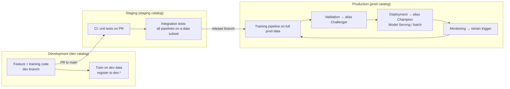

# Environments and Bundles for ML

## Overview

This file covers two exam-guide sections. **Model Lifecycle Management** asks you to describe the components of a lifecycle pipeline for the **deploy code** strategy and to map Databricks features to lifecycle activities. **Environment Architectures** asks you to design scalable ML environments and to **define Databricks ML assets (model serving endpoints, MLflow experiments, registered models) with DABs (Databricks Asset Bundles)**.

> [!abstract]
>
> - **Deploy code** (recommended): the *code* moves dev → staging → prod, and the model is trained in each environment, finally on production data. **Deploy models**: the *model artifact* is trained once and promoted.
> - Use separate **development, staging, and production** environments, each with its own Unity Catalog **catalog** (`dev`, `staging`, `prod`). Data scientists get read-write in dev and read-only access to prod.
> - A **bundle** (`databricks.yml`) declares jobs, pipelines, `experiments`, `registered_models`, `model_serving_endpoints`, and `quality_monitors` as version-controlled configuration, with one **target** per environment.
> - `databricks bundle validate` → `deploy -t <target>` → `run` is the deployment loop; **MLOps Stacks** (`databricks bundle init mlops-stacks`) scaffolds the whole layout.

> [!tip] What the Exam Tests
>
> - Why deploy code is the default, and when deploy models (or a hybrid) is justified
> - Which Databricks feature serves each lifecycle activity (aliases for stable references, Lakeflow Jobs for orchestration, data profiling for monitoring, and so on)
> - Environment isolation through catalogs, workspaces, and access control
> - Declaring experiments, UC registered models, and serving endpoints in one bundle, deployable to dev/staging/prod

> [!note] Platform update (Oct 2026)
> **Databricks Asset Bundles was renamed Declarative Automation Bundles on March 16, 2026** ([bundles release notes](https://docs.databricks.com/aws/en/release-notes/dev-tools/bundles)). The exam guide says "DABs (Databricks Asset Bundles)"; the current certification page says "Declarative Automation Bundles". They're the same feature, and the `databricks bundle ...` CLI commands and `databricks.yml` configuration shown below are unchanged in the current docs ([bundle resources](https://docs.databricks.com/aws/en/dev-tools/bundles/resources)).

---

## Model Lifecycle Architecture: Deploy Code



| Aspect | **Deploy code** (recommended) | Deploy models |
| :--- | :--- | :--- |
| What is promoted | Training, feature, inference, and monitoring **code** | The trained **model artifact** |
| Where the final model trains | **Production**, on production data | Development |
| Staging role | Run the same code on a limited data subset (integration tests) | Test the artifact |
| Strengths | Production-only data access works; automated retraining is safe because the code was reviewed and tested; supporting code follows the same path | Fewer moving parts when training is very expensive or hard to reproduce |
| Weaknesses | Training compute in every environment | Supporting pipelines must be deployed separately; retraining requires redoing the promotion |

Databricks recommends **deploy code** "in most situations". A hybrid deploys code to staging, trains there on full data, then deploys the model to production ([Model deployment patterns](https://docs.databricks.com/aws/en/machine-learning/mlops/deployment-patterns)).

Architecture components of a deploy-code lifecycle pipeline:

1. **Source control**: a Git repository with dev branches, PRs to `main`, and release branches. A release triggers CI/CD to update production jobs.
2. **CI**: unit tests on every PR, plus integration tests in staging.
3. **Production pipelines**, all defined as code: feature refresh, training, validation, deployment, batch inference, and monitoring.
4. **Unity Catalog model registry** in the `prod` catalog, with **aliases** (`Challenger`, `Champion`) marking the state of each version.
5. **Monitoring** whose alerts trigger retraining (see [Model Lifecycle Orchestration](./02-model-lifecycle-orchestration.md)).

## Mapping Databricks Features to Lifecycle Activities

| Lifecycle activity | Databricks feature(s) |
| :--- | :--- |
| Data ingestion and preparation | Lakeflow Connect, Lakeflow Spark Declarative Pipelines, Delta Lake |
| Feature engineering and reuse | Feature Engineering in Unity Catalog (`FeatureEngineeringClient`), online feature stores |
| Experiment tracking | MLflow experiments and runs (nested runs, autologging) |
| Model registration and versioning | MLflow Model Registry in **Unity Catalog** (`catalog.schema.model`, versions, lineage) |
| Stable references to a specific version | **Model aliases** (`@Champion`, `@Challenger`), not "latest version" |
| Validation and promotion gates | Lakeflow Jobs evaluation task (metrics vs thresholds, challenger vs champion) + alias reassignment |
| Real-time deployment | Model Serving endpoints (served entities, traffic config, inference tables) |
| Batch and streaming inference | Lakeflow Jobs with `spark_udf` / `fe.score_batch` / Structured Streaming |
| Monitoring | Inference tables, data profiling (formerly Lakehouse Monitoring), SQL alerts, endpoint metrics |
| CI/CD and infrastructure as code | Declarative Automation Bundles (formerly DABs), Git folders, MLOps Stacks |
| Governance and audit | Unity Catalog grants, lineage, system tables (`system.access.audit`) |

> [!tip]
> When you compare a new model against "the production model" over a long project, reference the production version through an **alias** that your deployment code maintains. `get_latest_version()` drifts as new versions are registered.

## Designing Scalable ML Environments

Recommendations from the Databricks MLOps workflow ([MLOps workflows](https://docs.databricks.com/aws/en/machine-learning/mlops/mlops-workflow)):

| Environment | Unity Catalog catalog | Who has access | What lives there |
| :--- | :--- | :--- | :--- |
| Development | `dev` | Data scientists: **read-write**. Ideally **read-only** access to prod data and models for analysis | Temporary data, feature tables, experiment models |
| Staging | `staging` | CI identities; developers may need access for debugging | Test pipelines, test registrations (generally temporary) |
| Production | `prod` | ML engineers own the pipelines; data scientists typically **have no write or compute access** | Production tables, feature tables, models, inference tables, metric tables |

Best practices for scale:

- **Separate environments, same code.** Parameterize catalog and schema names (bundle variables / job parameters) instead of hard-coding them.
- **Isolate by catalog, and by workspace when required.** Use catalogs with grants for data separation. Add separate workspaces when organizational, network, or compliance boundaries require them. Production assets are registered only in `prod.*`.
- **Run production as a service principal.** Bundle **production mode** recommends a service principal and can enforce it with `run_as` ([deployment modes](https://docs.databricks.com/aws/en/dev-tools/bundles/deployment-modes)).
- **Use job compute or serverless for pipelines.** All-purpose clusters are for interactive development.
- **Keep staging close to production.** "The staging environment should match the production environment as closely as is reasonable."

## Defining ML Assets in a Bundle

A bundle describes workspace resources as YAML. The resource types relevant to this exam are `experiments`, `registered_models` (Unity Catalog), `model_serving_endpoints`, `jobs`, `pipelines`, and `quality_monitors` ([bundle resources](https://docs.databricks.com/aws/en/dev-tools/bundles/resources)).

```yaml
# databricks.yml
bundle:
  name: fraud-mlops

variables:
  model_name:
    default: fraud_classifier

resources:
  experiments:
    fraud_experiment:
      name: /Workspace/Shared/${bundle.target}-fraud-experiment
      permissions:
        - level: CAN_READ
          group_name: users

  registered_models:
    fraud_model:
      name: ${var.model_name}
      catalog_name: ${bundle.target}          # dev / staging / prod catalog
      schema_name: fraud
      comment: Fraud classifier for the ${bundle.target} target
      grants:
        - privileges:
            - EXECUTE
          principal: account users

  model_serving_endpoints:
    fraud_endpoint:
      name: ${bundle.target}-fraud-endpoint
      config:
        served_entities:
          - entity_name: ${bundle.target}.fraud.${var.model_name}
            entity_version: "3"
            workload_size: Small
            scale_to_zero_enabled: false
        traffic_config:
          routes:
            - served_model_name: ${var.model_name}-3
              traffic_percentage: 100

  jobs:
    training_job:
      name: ${bundle.target}-fraud-training
      tasks:
        - task_key: train
          notebook_task:
            notebook_path: ./notebooks/train.py
            base_parameters:
              catalog: ${bundle.target}
              experiment_name: ${resources.experiments.fraud_experiment.name}

targets:
  dev:
    mode: development          # [dev <user>] prefixes, paused schedules
    default: true
    workspace:
      host: https://dev-workspace.cloud.databricks.com
  staging:
    workspace:
      host: https://staging-workspace.cloud.databricks.com
  prod:
    mode: production           # stricter validation
    workspace:
      host: https://prod-workspace.cloud.databricks.com
    run_as:
      service_principal_name: 11111111-2222-3333-4444-555555555555
```

```bash
databricks bundle validate -t staging     # schema + reference checks
databricks bundle deploy   -t staging     # create / update all resources
databricks bundle run      -t staging training_job
databricks bundle deploy   -t prod        # same definitions, prod target
```

What the bundle gives you:

- **Version control**: experiments, models, endpoints, and jobs live in Git next to the code that uses them.
- **Reproducibility**: the same definitions deploy to every target. Only variables and target overrides differ.
- **One streamlined deployment** for all ML resources, instead of separate scripts, UI clicks, or a mix of Terraform and CLI calls.

| Alternative | Why it's weaker for "version-controlled, reproducible, multi-environment ML infra" |
| :--- | :--- |
| MLflow Projects + separate job per component | Packages code, not workspace resources such as endpoints or UC models |
| Terraform for infra + CLI for ML components | Two tools and two state models; more moving parts |
| CLI-submitted one-off job runs | Not declarative; nothing describes the desired end state |

### MLOps Stacks

`databricks bundle init mlops-stacks` creates a deploy-code project built on bundles, with optional ML code and CI/CD components covering development, staging, and production workspaces ([MLOps Stacks](https://docs.databricks.com/aws/en/machine-learning/mlops/mlops-stacks)). Use it as the reference layout for the exam's lifecycle questions.

## Use Cases

- **Three-environment fraud platform**: One `databricks.yml` defines the experiment, the UC model `${bundle.target}.fraud.fraud_classifier`, the serving endpoint, and the training job. CI deploys `-t staging` on merge and `-t prod` on release.
- **Regulated data**: Production data is readable only in the prod workspace and catalog. Deploy code lets the production training job, running as a service principal, train there without exposing the data to developers.
- **Long-running model rebuild**: The team validates candidates against the model version behind the `@Champion` alias rather than "latest", so mid-project production updates don't change the baseline unnoticed.

## Common Issues & Errors

### Bundle deploy fails in production mode

**Scenario:** `databricks bundle deploy -t prod` fails validation on user-specific paths or a missing `run_as`.
**Fix:** Set `run_as` to a service principal (recommended), or explicitly set `run_as` and `permissions`, and avoid user-scoped `root_path` / `artifact_path` in production targets.

### Serving endpoint in the bundle points at the wrong catalog

**Scenario:** The staging endpoint serves `prod.fraud.fraud_classifier`.
**Fix:** Build `entity_name` from `${bundle.target}` or a variable so each target references its own catalog.

### Schedules don't fire after deploying to dev

**Scenario:** A job deployed with `mode: development` never runs on schedule.
**Fix:** Development mode pauses schedules and triggers by design. Unpause a specific job with `pause_status: UNPAUSED`, or test with `databricks bundle run`.

## Exam Tips

> [!tip]
>
> - "Version-controlled, reproducible, deployable to dev/staging/prod, covering experiments + UC models + endpoints" means configure them **in a bundle** and deploy per target.
> - **Deploy code** is the default answer. Pick deploy models only when the scenario stresses very expensive or non-reproducible training.
> - Data scientists: read-write dev, read-only prod. Production pipelines run under a service principal.
> - "DABs" (exam) = "Declarative Automation Bundles" (current docs and certification page).

## Key Takeaways

- **Deploy code**: promote code, retrain per environment, final model trained on prod data; recommended in most situations
- **Lifecycle features**: UC registry + aliases, Lakeflow Jobs, Model Serving, inference tables + data profiling, bundles + Git
- **Environment design**: dev / staging / prod catalogs, least-privilege access, parameterized names, service principals in prod
- **Bundles** declare `experiments`, `registered_models`, `model_serving_endpoints`, `jobs`, `pipelines`, `quality_monitors`; `validate` → `deploy -t` → `run`
- **MLOps Stacks** scaffolds a deploy-code bundle project

## Related Topics

- [Validation Testing](./07-validation-testing.md) — unit and integration tests per environment
- [Model Versioning and Registry](./01-model-versioning-registry.md) — aliases and UC registry
- [Model Lifecycle Orchestration](./02-model-lifecycle-orchestration.md) — retraining triggers and evaluation gates
- [A/B Testing and Canary Deployments](../03-model-deployment/02-ab-testing-canary.md) — rollout after deployment

## Official Documentation

- [Model deployment patterns](https://docs.databricks.com/aws/en/machine-learning/mlops/deployment-patterns)
- [MLOps workflows on Databricks](https://docs.databricks.com/aws/en/machine-learning/mlops/mlops-workflow)
- [MLOps Stacks](https://docs.databricks.com/aws/en/machine-learning/mlops/mlops-stacks)
- [Declarative Automation Bundles resources](https://docs.databricks.com/aws/en/dev-tools/bundles/resources)
- [Bundle deployment modes](https://docs.databricks.com/aws/en/dev-tools/bundles/deployment-modes)
- [Bundles release notes](https://docs.databricks.com/aws/en/release-notes/dev-tools/bundles)

---

**[← Previous: Validation Testing](./07-validation-testing.md) | [↑ Back to ML Ops](./README.md)**
