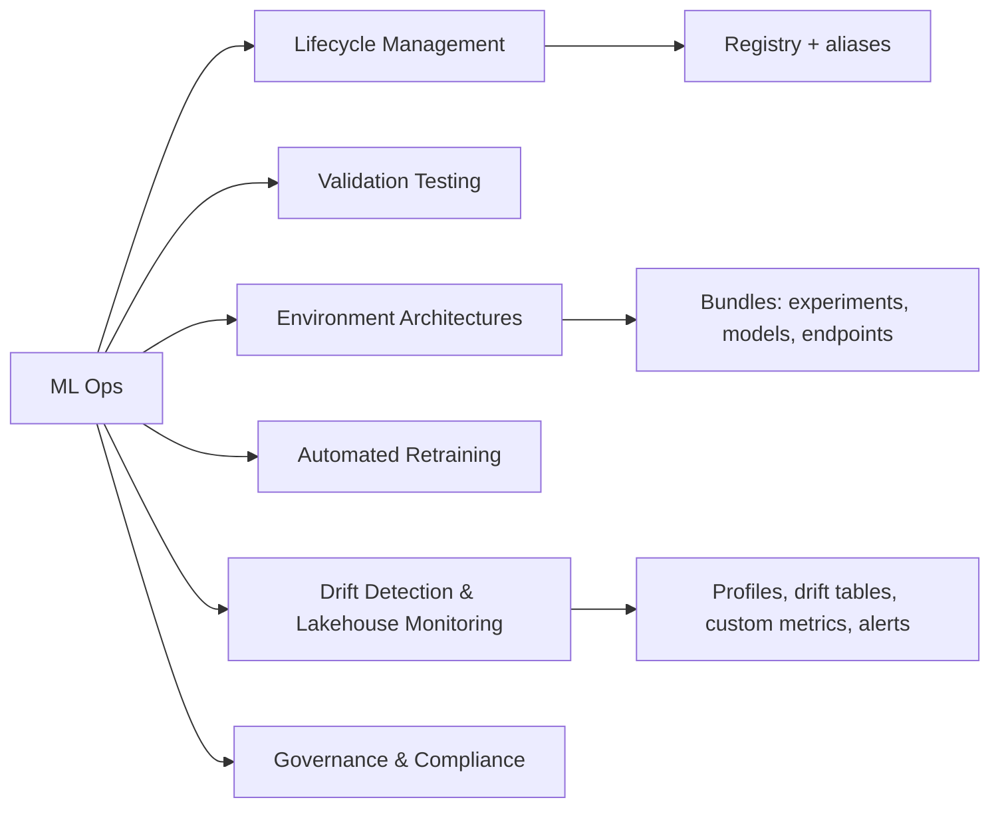

# ML Ops (44 % of Exam)

The equal-largest domain. The exam guide splits it into **Model Lifecycle Management** (deploy-code architecture, mapping Databricks features to lifecycle activities), **Validation Testing** (unit and integration tests), **Environment Architectures** (scalable environments, ML assets defined with bundles), **Automated Retraining**, and **Drift Detection and Lakehouse Monitoring**. Governance and compliance files round out production practice.

## Topics Overview

## Section Contents

| File | Topic | Exam guide section | Priority |
| :--- | :--- | :--- | :--- |
| [01-model-versioning-registry.md](./01-model-versioning-registry.md) | UC Model Registry, aliases, version promotion | Model Lifecycle Management | High |
| [02-model-lifecycle-orchestration.md](./02-model-lifecycle-orchestration.md) | Lakeflow Jobs DAGs, evaluation gates, **selecting the top-performing model**, **drift- and performance-triggered retraining** | Automated Retraining | High |
| [03-model-monitoring-observability.md](./03-model-monitoring-observability.md) | Inference tables, **Lakehouse Monitoring / data profiling** profiles, granularities, slices, **custom metrics**, **endpoint health**, alerts | Drift Detection and Lakehouse Monitoring | High |
| [04-drift-detection-remediation.md](./04-drift-detection-remediation.md) | **Drift metrics table** tests (KS, chi-square, PSI, JS / TV / L-inf, Wasserstein), baseline vs consecutive drift, remediation | Drift Detection and Lakehouse Monitoring | High |
| [05-governance-frameworks.md](./05-governance-frameworks.md) | Unity Catalog for AI assets, lineage, model audit | Supporting (production practice) | Medium |
| [06-compliance-audit-logging.md](./06-compliance-audit-logging.md) | `system.access.audit`, retention, regulated-workloads patterns | Supporting (production practice) | Medium |
| [07-validation-testing.md](./07-validation-testing.md) | **Unit tests** in notebooks (`pytest`), test types by environment, **integration test design**, organizing functions and tests | Validation Testing | High |
| [08-environments-and-bundles.md](./08-environments-and-bundles.md) | **Deploy code** architecture, feature-to-lifecycle map, dev / staging / prod catalogs, **bundles for experiments, UC models, serving endpoints** | Model Lifecycle Management, Environment Architectures | High |

## Key Concepts

| Concept | Why it matters |
| :--- | :--- |
| **Deploy code** | Code moves dev → staging → prod; the production model trains on production data |
| **Model aliases** | `set_registered_model_alias(name, alias, version)`; stable references (`@Champion`) instead of "latest" |
| **Unit vs integration tests** | Unit tests per function on every PR; integration tests across all pipelines in staging |
| **Bundles** (DABs → Declarative Automation Bundles) | `experiments`, `registered_models`, `model_serving_endpoints`, `jobs` in `databricks.yml`, deployed per target |
| **Lakehouse Monitoring (now "data profiling")** | InferenceLog / TimeSeries / Snapshot profiles; profile and drift metric tables |
| **Drift tests** | Numeric: KS, Wasserstein, PSI. Categorical: chi-square, TV, L-infinity, JS |
| **Retraining trigger** | Monitor metric breach → alert / check task → retraining job → evaluation gate → alias promotion |
| **Endpoint health** | Latency, request rate, error rate, CPU, memory from Model Serving metrics |

## Related Resources

- [MLflow cheat sheet (shared)](../../../shared/cheat-sheets/mlflow-quick-ref.md)
- [Data quality monitoring documentation](https://docs.databricks.com/aws/en/data-governance/unity-catalog/data-quality-monitoring/)
- [MLOps workflows documentation](https://docs.databricks.com/aws/en/machine-learning/mlops/mlops-workflow)
- [Hands-on Lab 04 — MLflow tracking and Model Registry in UC](../../../labs/04-mlflow-tracking.md)

---

**[← Previous: Model Development](../01-model-development/README.md) | [↑ Back to ML Professional](../README.md) | [Next: Model Deployment →](../03-model-deployment/README.md)**
