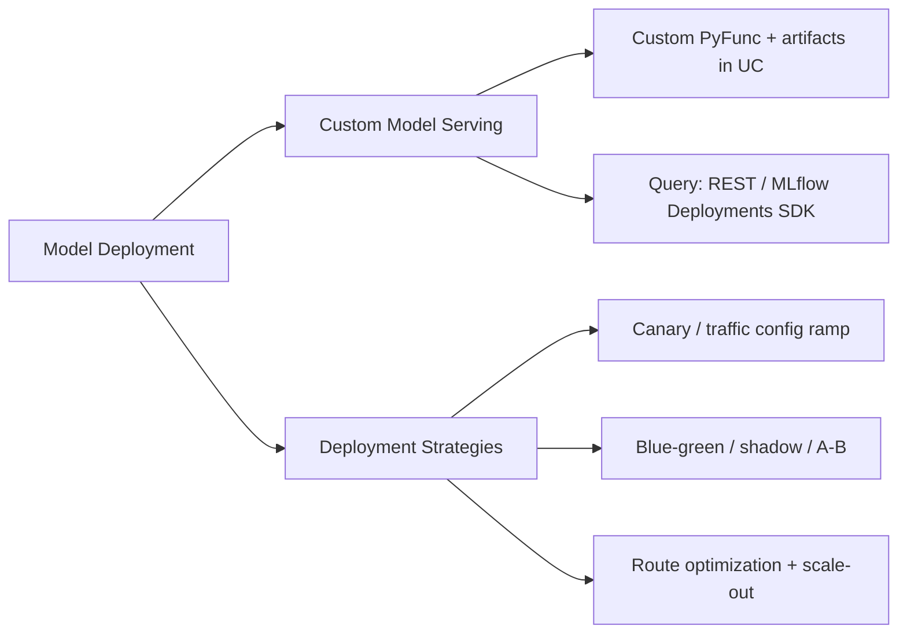

# Model Deployment (12 % of Exam)

How models actually serve in production. The exam guide has two sections: **Deployment Strategies** (compare blue-green, canary, and others for high-traffic applications; implement a rollout strategy with Model Serving) and **Custom Model Serving** (register a custom PyFunc with custom artifacts in Unity Catalog, query it through the REST API or the MLflow Deployments SDK, and deploy it through the SDK, REST API, or UI).

## Topics Overview

## Section Contents

| File | Topic | Exam guide section | Priority |
| :--- | :--- | :--- | :--- |
| [01-model-serving-deployment.md](./01-model-serving-deployment.md) | Endpoint creation (UI / REST / Databricks SDK / MLflow Deployments), workload size, querying with **MLflow Deployments `predict`** and REST, custom PyFunc + artifacts in UC, batch / streaming | Custom Model Serving | High |
| [02-ab-testing-canary.md](./02-ab-testing-canary.md) | **Blue-green vs canary vs shadow vs A/B**, **rollout strategy with served entities + traffic config**, **route optimization**, statistical significance | Deployment Strategies | High |

## Key Concepts

| Concept | Why it matters |
| :--- | :--- |
| **`served_entities`** | List of UC-registered model versions hosted on one endpoint (older examples: `served_models`) |
| **`traffic_config`** | Weighted routes summing to 100 % across `served_model_name`s; the canary / A-B mechanism |
| **Canary rollout** | Second served entity at a small share, monitored, then ramped; rollback = route 100 % back |
| **Blue-green** | Atomic switch between two complete versions with instant switch-back |
| **Route optimization** | Higher QPS, lower overhead latency; set at endpoint creation; OAuth + dedicated URL |
| **Workload size** | Concurrency per served entity (Small 0–4, Medium 8–16, Large 16–64) |
| **Scale to zero** | Saves cost; cold start on first request; not recommended for production |
| **MLflow Deployments SDK** | `get_deploy_client("databricks").predict(endpoint=..., inputs=...)`, plus `create_endpoint` / `update_endpoint_config` |

## Related Resources

- [Model Serving documentation](https://docs.databricks.com/aws/en/machine-learning/model-serving/)
- [Custom models on Model Serving](https://docs.databricks.com/aws/en/machine-learning/model-serving/custom-models)
- [Hands-on Lab 04 — MLflow tracking and Model Registry in UC](../../../labs/04-mlflow-tracking.md)

---

**[← Previous: ML Ops](../02-ml-ops/README.md) | [↑ Back to ML Professional](../README.md)**
