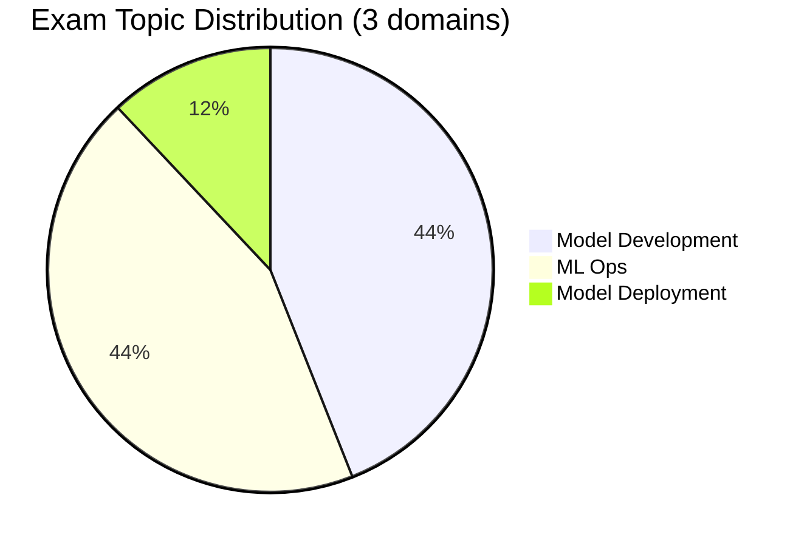

# Databricks Machine Learning Professional

> [!important]
> **What changed in the September 2025 exam guide**
>
> - Consolidated to **3 domains** (was 4): Model Development 44 %, ML Ops 44 %, Model Deployment 12 %
> - "Solution & Data Monitoring" responsibilities now sit inside **ML Ops** (44 %)
> - **Model Development** is weighted equally at 44 %: Spark ML pipelines, distributed training and tuning (**Optuna**, **Ray**, pandas Function API), advanced MLflow, and advanced Feature Store concepts (point-in-time lookups, online tables, feature serving)
> - **ML Ops** adds explicit **testing** (unit and integration), **environment architectures with Databricks Asset Bundles**, automated retraining, and Lakehouse Monitoring
> - Pass / fail — **the September 2025 exam guide does not publish a numeric passing score**
>
> **Exam-guide re-issue (Oct 2026).** Databricks re-published the PDF under a file name ending in "august" ([exam guide PDF](https://www.databricks.com/sites/default/files/2026-10/databricks-certified-machine-learning-professional-exam-guide-august.pdf)). Its update table still reads *Exam Published / Exam Guide Updated: September 30, 2025*, so **this is the same exam**: same outline, same 59 questions, same weights. The re-issued PDF includes an **AI Prep Guide** section, points hands-on practice at **Databricks Free Edition**, and gives an answer key with an explanation for each of its 10 sample questions. The [certification page](https://www.databricks.com/learn/certification/machine-learning-professional) now calls bundles **Declarative Automation Bundles**; the PDF still says "DABs (Databricks Asset Bundles)".
>
> The folder structure in this guide matches the official 3-domain blueprint 1 : 1. The October 2026 refresh adds topic files for every exam-guide bullet that wasn't covered yet (see the [coverage map](#exam-guide-coverage-map)).

## Exam Overview

| Detail              | Information                                        |
| ------------------- | -------------------------------------------------- |
| **Certification**   | Databricks Certified Machine Learning Professional |
| **Exam guide**      | [September 30, 2025 (PDF re-issued Oct 2026)](https://www.databricks.com/sites/default/files/2026-10/databricks-certified-machine-learning-professional-exam-guide-august.pdf) |
| **Scored questions**| 59 multiple-choice                                 |
| **Unscored items**  | Up to 10 (not identified; extra time already included) |
| **Duration**        | 120 minutes                                        |
| **Result**          | Pass / fail (no numeric threshold in the September 2025 exam guide) |
| **Languages**       | English                                            |
| **Code in stems**   | Python                                             |
| **Prerequisite**    | None required; related training highly recommended |
| **Experience**      | One year of hands-on experience on the Databricks platform with the exam-outline tasks (recommended) |
| **Recertification** | Every 2 years — see [Renewal Guide](../../shared/appendix/renewal-guide.md) |
| **Cost**            | USD 200, plus applicable taxes                     |
| **Delivery**        | Online proctored or test center                    |
| **Test aides**      | None allowed                                       |

Recommended training (from the exam guide): *Machine Learning at Scale* and *Advanced Machine Learning Operations*, instructor-led or self-paced in Databricks Academy.

## Exam Domain Weights (official — September 2025)

## Study Topics

| Section | Weight | Focus |
| :--- | :---: | :--- |
| [01 — Model Development](./01-model-development/README.md) | 44 % | Spark ML pipelines, scaling (pandas Function API, Ray vs Spark, parallelism), Optuna / Ray Tune, advanced MLflow, Feature Engineering in UC (point-in-time, online tables, feature serving) |
| [02 — ML Ops](./02-ml-ops/README.md) | 44 % | Deploy-code lifecycle, unit and integration testing, environments and bundles, automated retraining, Lakehouse Monitoring and drift, governance |
| [03 — Model Deployment](./03-model-deployment/README.md) | 12 % | Blue-green vs canary, rollout with Model Serving, route optimization, custom PyFunc serving and querying |

## Exam Guide Coverage Map

Every section of the September 2025 exam outline maps to at least one topic file:

| Exam guide section | Topic files |
| :--- | :--- |
| **Using Spark ML** | [08 Spark ML Pipelines](./01-model-development/08-spark-ml-pipelines.md), [05 Tuning Fundamentals](./01-model-development/05-tuning-fundamentals.md), [Model Serving (batch / streaming)](./03-model-deployment/01-model-serving-deployment.md) |
| **Scaling and Tuning** | [07 Distributed Tuning (Optuna, Ray Tune)](./01-model-development/07-distributed-tuning.md), [09 Scaling ML Workloads (pandas Function API, Ray vs Spark, parallelism)](./01-model-development/09-scaling-ml-workloads.md) |
| **Advanced MLflow Usage** | [10 Advanced MLflow Tracking](./01-model-development/10-advanced-mlflow-tracking.md) |
| **Advanced Feature Store Concepts** | [11 Feature Engineering Client and Online Serving](./01-model-development/11-feature-engineering-client-online-serving.md), [01](./01-model-development/01-feature-store-fundamentals.md) – [04](./01-model-development/04-feature-store-production.md) feature-store background |
| **Model Lifecycle Management** | [08 Environments and Bundles](./02-ml-ops/08-environments-and-bundles.md), [01 Model Versioning and Registry](./02-ml-ops/01-model-versioning-registry.md) |
| **Validation Testing** | [07 Validation Testing](./02-ml-ops/07-validation-testing.md) |
| **Environment Architectures** | [08 Environments and Bundles](./02-ml-ops/08-environments-and-bundles.md) |
| **Automated Retraining** | [02 Model Lifecycle Orchestration](./02-ml-ops/02-model-lifecycle-orchestration.md) |
| **Drift Detection and Lakehouse Monitoring** | [03 Model Monitoring and Observability](./02-ml-ops/03-model-monitoring-observability.md), [04 Drift Detection and Remediation](./02-ml-ops/04-drift-detection-remediation.md) |
| **Deployment Strategies** | [02 A/B Testing and Canary Deployments](./03-model-deployment/02-ab-testing-canary.md) |
| **Custom Model Serving** | [01 Model Serving and Deployment](./03-model-deployment/01-model-serving-deployment.md), [10 Advanced MLflow Tracking (custom pyfunc)](./01-model-development/10-advanced-mlflow-tracking.md) |

## Platform Updates Since the Exam Guide (Oct 2026)

The exam guide's wording is canonical for the exam. These platform changes landed after it was written. Each topic file carries a `Platform update (Oct 2026)` note where it matters.

| Exam-guide term | Current platform status | Source |
| :--- | :--- | :--- |
| DABs (Databricks Asset Bundles) | Renamed **Declarative Automation Bundles** (Mar 16, 2026); `databricks bundle` CLI unchanged | [Bundles release notes](https://docs.databricks.com/aws/en/release-notes/dev-tools/bundles) |
| Lakehouse Monitoring | Now **data profiling** under data quality monitoring; `quality_monitors` API deprecated in favour of `w.data_quality` | [Data quality monitoring](https://docs.databricks.com/aws/en/data-governance/unity-catalog/data-quality-monitoring/) |
| Online tables | Legacy online tables inaccessible after Jan 15, 2026; use **Online Feature Stores** (Lakebase) or Lakebase synced tables | [Online Feature Stores](https://docs.databricks.com/aws/en/machine-learning/feature-store/online-feature-store) |
| Hyperopt / `SparkTrials` (older material) | Not in Databricks Runtime ML after 16.4 LTS ML; Optuna or Ray Tune recommended | [Hyperparameter tuning](https://docs.databricks.com/aws/en/machine-learning/automl-hyperparam-tuning/) |
| Lakeflow Declarative Pipelines (DLT) | Renamed **Lakeflow Spark Declarative Pipelines** (Nov 12, 2025) | [November 2025 release notes](https://docs.databricks.com/aws/en/release-notes/product/2025/november) |
| Inference tables (`auto_capture_config`) | Legacy docs retired; AI Gateway-enabled inference tables recommended | [Inference tables](https://docs.databricks.com/aws/en/machine-learning/model-serving/inference-tables) |
| Community Edition (hands-on practice) | Retired Jan 1, 2026; use **Databricks Free Edition**, which has no GPU serving, no provisioned throughput, and no online tables | [Free Edition limitations](https://docs.databricks.com/aws/en/getting-started/free-edition-limitations) |

> [!note]
> Agents deployed to Model Serving and the MLflow `AgentServer` moved to a **Legacy** docs section on Oct 5, 2026 ([October 2026 release notes](https://docs.databricks.com/aws/en/release-notes/product/2026/october)). That's GenAI agent serving. **Custom model serving**, which this exam tests, isn't affected.

### Practice & Resources

| Resource                                                        | Description                              |
| --------------------------------------------------------------- | ---------------------------------------- |
| [Practice Questions](./resources/practice-questions/README.md)  | Topic-specific practice questions        |
| [Mock Exam 1](./resources/mock-exam/README.md)                  | 45-question timed practice exam          |
| [Mock Exam 2](./resources/mock-exam-2/README.md)                | Alternative 45-question practice exam    |
| [Exam Tips](./resources/exam-tips.md)                           | Exam strategies and tips                 |
| [Final Review](./resources/final-review.md)                     | 20-minute exam-morning cram scan         |
| [Official Links](./resources/official-links.md)                 | Documentation and resources              |

## Interview Preparation

After completing this certification, explore:

- [Interview Prep Resource](../../shared/interview-prep/README.md) - Advanced ML systems design, governance, and production architecture

## Prerequisites

- Complete [ML Associate](../ml-associate/README.md) certification first
- Review shared fundamentals:
  - [Spark Fundamentals](../../shared/fundamentals/spark-fundamentals.md)
  - [MLflow Basics](../../shared/fundamentals/mlflow-basics.md)
  - [Feature Engineering Basics](../../shared/fundamentals/feature-engineering-basics.md)

## Study Progress Tracker

- [ ] Domain 01 — Spark ML pipelines (estimators, transformers, tuning, batch / streaming scoring)
- [ ] Domain 01 — Scaling and tuning (pandas Function API, Optuna `MlflowSparkStudy`, Ray Tune, parallelism)
- [ ] Domain 01 — Advanced MLflow (nested runs, custom logging, custom pyfunc)
- [ ] Domain 01 — Feature Engineering in UC (point-in-time, online tables, streaming + on-demand features)
- [ ] Domain 02 — Lifecycle, testing, environments and bundles
- [ ] Domain 02 — Automated retraining, Lakehouse Monitoring, drift
- [ ] Domain 03 — Deployment strategies, rollout, route optimization, custom model serving
- [ ] Run Hands-on Lab 04 (MLflow + Model Registry in UC)
- [ ] Practise the hands-on tasks in [Databricks Free Edition](https://docs.databricks.com/aws/en/getting-started/free-edition) (no GPU serving, provisioned throughput, or online tables there)

## Official Resources

- [Databricks Certification Page](https://www.databricks.com/learn/certification/machine-learning-professional)
- [Exam guide PDF (September 30, 2025; re-issued Oct 2026)](https://www.databricks.com/sites/default/files/2026-10/databricks-certified-machine-learning-professional-exam-guide-august.pdf)
- [AI Prep Guide — any Databricks certification (PDF)](https://www.databricks.com/sites/default/files/2026-06/ai-prep-guide-any-databricks-certification.pdf)
- [Databricks ML Documentation](https://docs.databricks.com/aws/en/machine-learning/)
- [Databricks Free Edition](https://docs.databricks.com/aws/en/getting-started/free-edition)
