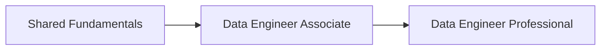

---
tags:
  - databricks
  - learning-path
  - data-engineer
aliases:
  - DE Learning Path
---

# Data Engineer Learning Path

A recommended progression from Data Engineer Associate to Data Engineer Professional.

## Path Overview

## Prerequisites

Before starting, you should have:

- Basic SQL knowledge (SELECT, JOIN, GROUP BY, subqueries)
- Familiarity with Python or Scala
- Understanding of cloud storage concepts (S3, ADLS, GCS)
- Basic data pipeline concepts (ETL vs ELT)

## Phase 1: Shared Fundamentals

Start with the core concepts that apply across both certifications.

| Topic | Priority | Link |
| ----- | -------- | ---- |
| Platform Architecture | High | [Platform Architecture](../shared/fundamentals/platform-architecture.md) |
| Databricks Workspace | High | [Databricks Workspace](../shared/fundamentals/databricks-workspace.md) |
| Delta Lake Basics | High | [Delta Lake Basics](../shared/fundamentals/delta-lake-basics.md) |
| Spark Fundamentals | High | [Spark Fundamentals](../shared/fundamentals/spark-fundamentals.md) |
| Medallion Architecture | High | [Medallion Architecture](../shared/fundamentals/medallion-architecture.md) |
| Unity Catalog Basics | Medium | [Unity Catalog Basics](../shared/fundamentals/unity-catalog-basics.md) |
| SQL Essentials | Medium | [SQL Essentials](../shared/fundamentals/sql-essentials.md) |

## Phase 2: Data Engineer Associate

Focus areas based on exam weight (exam published May 4, 2026; guide updated Aug 6, 2026 — 7 domains, 45 questions):

| Domain | Weight | Key Topics |
| ------ | ------ | ---------- |
| Data Transformation and Modeling | 22 % | PySpark/SQL cleaning, joins, dedup, streaming tables vs materialized views, data quality checks |
| Data Ingestion and Loading | 21 % | COPY INTO, Auto Loader, Lakeflow Connect connectors |
| Working with Lakeflow Jobs | 16 % | Lakeflow Jobs (formerly Workflows): task types, control flow, triggers |
| Governance and Security | 15 % | Unity Catalog, GRANT/REVOKE/DENY, row filters, column masks, ABAC |
| Implementing CI/CD | 10 % | Git folders, Declarative Automation Bundles (formerly Databricks Asset Bundles), Databricks CLI |
| Troubleshooting, Monitoring, and Optimization | 10 % | Job run history, Spark UI, Liquid Clustering, predictive optimization |
| Databricks Intelligence Platform | 6 % | Architecture, compute options (including serverless) |

See the full study guide: [Data Engineer Associate](../certifications/data-engineer-associate/README.md)

### Recommended Cheat Sheets

- [Delta Lake Commands](../shared/cheat-sheets/delta-lake-commands.md)
- [SQL Functions](../shared/cheat-sheets/sql-functions.md)
- [Unity Catalog Quick Reference](../shared/cheat-sheets/unity-catalog-quick-ref.md)
- [Lakeflow Spark Declarative Pipelines Quick Reference (formerly DLT)](../shared/cheat-sheets/lakeflow-declarative-pipelines-quick-ref.md)

## Phase 3: Data Engineer Professional

After passing the Associate exam, advance to Professional topics (new exam Oct 9, 2026 — 9 domains, 60 questions):

| Domain | Weight | Key Topics |
| ------ | ------ | ---------- |
| Developing Code for Data Processing using Python and SQL | 23 % | Lakeflow Pipelines, AUTO CDC (formerly APPLY CHANGES), Lakeflow Jobs, UDFs, testing, Structured Streaming |
| Cost & Performance Optimization | 15 % | Predictive Optimization, Liquid Clustering, deletion vectors, CDF, query profile |
| Data Ingestion & Acquisition | 12 % | Kafka/Kinesis/cloud files, Lakeflow Connect CDC, OpenSharing (formerly Delta Sharing), Clean Rooms, Lakehouse Federation |
| Data Manipulation | 12 % | Window functions, VARIANT, `ai_query`, pipeline expectations |
| Monitoring and Alerting | 10 % | System tables, pipeline event logs, alerts, Jobs API |
| Debugging and Deploying | 10 % | Spark UI, job repair, Declarative Automation Bundles, Git folders |
| Ensuring Data Security and Compliance | 8 % | ACLs, ABAC, masking, PII, GDPR deletion |
| Data Governance | 5 % | UC tags/comments, permission inheritance |
| Data Modeling | 5 % | Table layout, dimensional models, materialized views, metric views |

See the full study guide: [Data Engineer Professional](../certifications/data-engineer-professional/README.md)

### Additional Resources

- [Practice Questions](../certifications/data-engineer-professional/resources/practice-questions/README.md)
- [Mock Exam](../certifications/data-engineer-professional/resources/mock-exam/README.md)
- [Exam Tips](../certifications/data-engineer-professional/resources/exam-tips.md)
- [Official Links](../certifications/data-engineer-professional/resources/official-links.md)

## Study Tips

1. **Hands-on practice** - Use [Databricks Free Edition](https://docs.databricks.com/aws/en/getting-started/free-edition) (Community Edition was retired on Jan 1, 2026); it is serverless-only with [usage limits](https://docs.databricks.com/aws/en/getting-started/free-edition-limitations)
2. **Focus on Delta Lake** - It appears heavily in both exams
3. **Understand "why"** - The Professional exam tests decision-making, not just syntax
4. **Review error messages** - See [Common Errors](../shared/appendix/error-messages.md)
5. **Use cheat sheets** for final review before exam day

## Official Resources

- [Databricks Certifications](https://www.databricks.com/learn/certification)
- [Databricks Academy](https://www.databricks.com/learn/training)
- [Exam Registration](https://www.databricks.com/learn/certification)
