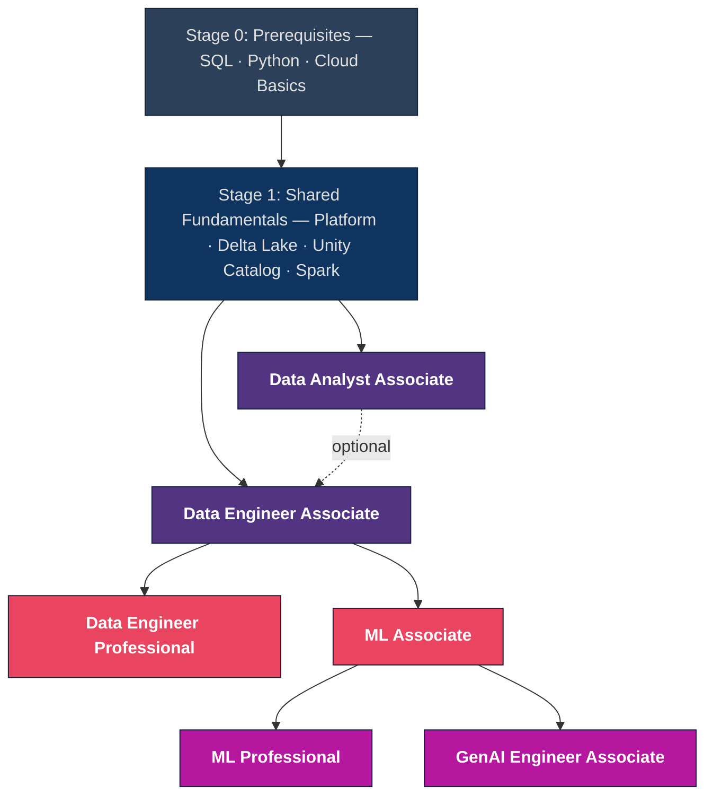

# Master Certification Roadmap

A step-by-step visual guide through all 6 Databricks certifications — from prerequisites to advanced specializations.

## How to Use This Roadmap

- **Follow top-to-bottom** — each stage builds on the previous one
- **Pick your track** — you don't need all 6 certs; use the decision table below to choose your path
- **Check the boxes** — each topic links to study materials; work through them in order

## Certification Progression

## Certification Quick Reference

Scored-question counts and durations from the current exam guides (Oct 2026). Databricks no longer publishes a numeric passing score — treat each exam as pass/fail. Exam-guide versions: [Version History](../shared/appendix/version-history.md).

| Certification | Level | Scored Questions | Duration | Exam version | Language | Prerequisites |
|:---|:---|:---:|:---:|:---|:---|:---|
| Data Analyst Associate | Associate | 45 | 90 min | Oct 30, 2025 | SQL | SQL basics |
| Data Engineer Associate | Associate | 45 | 90 min | May 4, 2026 (guide Aug 6, 2026) | Python, SQL | SQL + Python basics |
| Data Engineer Professional | Professional | 60 | 120 min | Oct 9, 2026 (new) | Python, SQL | DE Associate recommended |
| ML Associate | Associate | 48 | 90 min | Mar 1, 2025 | Python | Python + stats basics |
| ML Professional | Professional | 59 | 120 min | Sep 30, 2025 | Python | ML Associate recommended |
| GenAI Engineer Associate | Associate | 45 | 90 min | Mar 18, 2026 | Python | Python + ML basics |

## Which Path Should I Choose?

| If you are... | Start with | Then |
|:---|:---|:---|
| A SQL analyst / BI user | Data Analyst Associate | Optionally Data Engineer Associate |
| A data engineer (most common) | Data Engineer Associate | Data Engineer Professional |
| An ML engineer | Data Engineer Associate or ML Associate | ML Professional |
| Building LLM / RAG apps | ML Associate (recommended) | GenAI Engineer Associate |
| New to Databricks entirely | Data Engineer Associate | Choose your specialization |

---

## Stage 0: Prerequisites

Skills you need before starting any Databricks certification path.

| Skill | Needed For | You're Ready When... | Learn Here |
|:---|:---|:---|:---|
| SQL (SELECT, JOIN, GROUP BY, subqueries, window functions) | All certs | You can write a multi-table JOIN with GROUP BY from memory | [SQL Essentials](../shared/fundamentals/sql-essentials.md) · [SQLBolt](https://sqlbolt.com/) · [Mode SQL Tutorial](https://mode.com/sql-tutorial) |
| Python (functions, classes, list comprehensions, error handling) | DE, ML, GenAI | You can write a decorator or context manager | [Python Essentials](../shared/fundamentals/python-essentials.md) · [Python Essentials 2](../shared/fundamentals/python-essentials-2.md) · [Real Python](https://realpython.com/) |
| Cloud storage concepts (S3, ADLS, GCS) | DE certs | You understand object storage vs. block storage | [Platform Architecture](../shared/fundamentals/platform-architecture.md) · [AWS S3 Docs](https://docs.aws.amazon.com/s3/) |
| Statistics basics (mean, variance, distributions) | ML, GenAI | You can explain the bias-variance tradeoff | [Khan Academy Statistics](https://www.khanacademy.org/math/statistics-probability) · [StatQuest YouTube](https://www.youtube.com/@statquest) |
| ETL vs. ELT concepts | DE certs | You know when to transform before vs. after loading | [Medallion Architecture](../shared/fundamentals/medallion-architecture.md) · [Delta Lake Basics](../shared/fundamentals/delta-lake-basics.md) |

---

## Stage 1: Shared Fundamentals

Review these before starting any certification. Check off topics as you complete them.

### Universal (All Certifications)

| # | Topic | Link | Used By |
|:---:|:---|:---|:---|
| 1 | Platform Architecture | [platform-architecture.md](../shared/fundamentals/platform-architecture.md) | All |
| 2 | Databricks Workspace | [databricks-workspace.md](../shared/fundamentals/databricks-workspace.md) | All |
| 3 | Unity Catalog Basics | [unity-catalog-basics.md](../shared/fundamentals/unity-catalog-basics.md) | All |

### DE / DA Track Fundamentals

| # | Topic | Link | Used By |
|:---:|:---|:---|:---|
| 4 | Delta Lake Basics | [delta-lake-basics.md](../shared/fundamentals/delta-lake-basics.md) | DEA, DEP, DAA |
| 5 | Spark Fundamentals | [spark-fundamentals.md](../shared/fundamentals/spark-fundamentals.md) | DEA, DEP, MLA |
| 6 | SQL Essentials | [sql-essentials.md](../shared/fundamentals/sql-essentials.md) | DAA, DEA |
| 7 | Medallion Architecture | [medallion-architecture.md](../shared/fundamentals/medallion-architecture.md) | DEA, DEP |
| 8 | Streaming Fundamentals | [streaming-fundamentals.md](../shared/fundamentals/streaming-fundamentals.md) | DEA, DEP |
| 9 | Open Table Formats | [open-table-formats.md](../shared/fundamentals/open-table-formats.md) | DEA, DEP |
| 10 | Python Essentials (Part 1) | [python-essentials.md](../shared/fundamentals/python-essentials.md) | DEA, DEP, MLA, GenAI |
| 11 | Python Essentials (Part 2) | [python-essentials-2.md](../shared/fundamentals/python-essentials-2.md) | DEA, DEP, MLA, GenAI |

### ML / GenAI Track Fundamentals

| # | Topic | Link | Used By |
|:---:|:---|:---|:---|
| 12 | MLflow Basics | [mlflow-basics.md](../shared/fundamentals/mlflow-basics.md) | MLA, MLP, GenAI |
| 13 | Feature Engineering Basics | [feature-engineering-basics.md](../shared/fundamentals/feature-engineering-basics.md) | MLA, MLP |
| 14 | RAG & Vector Search (AI Search) Basics | [rag-vector-search-basics.md](../shared/fundamentals/rag-vector-search-basics.md) | GenAI |

---

## Stage 2: Entry Certifications

Choose one (or both) based on your path.

### Data Engineer Associate

[Full Study Guide](../certifications/data-engineer-associate/README.md) | [Exam Tips](../certifications/data-engineer-associate/resources/exam-tips.md)

**Study order (highest exam weight first):**

| Order | Domain (Weight) | Study Materials |
|:---:|:---|:---|
| 1 | Data Transformation and Modeling (22 %) | [03-data-transformation-and-modeling](../certifications/data-engineer-associate/03-data-transformation-and-modeling/README.md) |
| 2 | Data Ingestion and Loading (21 %) | [02-data-ingestion-and-loading](../certifications/data-engineer-associate/02-data-ingestion-and-loading/README.md) |
| 3 | Working with Lakeflow Jobs (16 %) | [04-working-with-lakeflow-jobs](../certifications/data-engineer-associate/04-working-with-lakeflow-jobs/README.md) |
| 4 | Governance and Security (15 %) | [07-governance-and-security](../certifications/data-engineer-associate/07-governance-and-security/README.md) |
| 5 | Implementing CI/CD (10 %) | [05-implementing-cicd](../certifications/data-engineer-associate/05-implementing-cicd/README.md) |
| 6 | Troubleshooting, Monitoring, and Optimization (10 %) | [06-troubleshooting-monitoring-and-optimization](../certifications/data-engineer-associate/06-troubleshooting-monitoring-and-optimization/README.md) |
| 7 | Databricks Intelligence Platform (6 %) | [01-databricks-intelligence-platform](../certifications/data-engineer-associate/01-databricks-intelligence-platform/README.md) |

**Practice & Review:**

- [Practice Questions](../certifications/data-engineer-associate/resources/practice-questions/README.md)
- [Mock Exam 1](../certifications/data-engineer-associate/resources/mock-exam/README.md) | [Mock Exam 2](../certifications/data-engineer-associate/resources/mock-exam-2/README.md)

### Data Analyst Associate

[Full Study Guide](../certifications/data-analyst-associate/README.md) | [Exam Tips](../certifications/data-analyst-associate/resources/exam-tips.md)

**Study order (highest exam weight first):**

| Order | Domain (Weight) | Study Materials |
|:---:|:---|:---|
| 1 | Executing Queries Using Databricks SQL and Warehouses (20 %) | [01-executing-queries-databricks-sql-warehouses](../certifications/data-analyst-associate/01-executing-queries-databricks-sql-warehouses/README.md) |
| 2 | Creating Dashboards and Visualizations (16 %) | [02-creating-dashboards-and-visualizations](../certifications/data-analyst-associate/02-creating-dashboards-and-visualizations/README.md) |
| 3 | Analyzing Queries (15 %) | [03-analyzing-queries](../certifications/data-analyst-associate/03-analyzing-queries/README.md) |
| 4 | Developing, Sharing, and Maintaining AI/BI Genie spaces — now Genie Agents (12 %) | [04-developing-sharing-maintaining-genie-spaces](../certifications/data-analyst-associate/04-developing-sharing-maintaining-genie-spaces/README.md) |
| 5 | Understanding the Databricks Data + AI Platform (11 %) | [05-understanding-databricks-platform](../certifications/data-analyst-associate/05-understanding-databricks-platform/README.md) |
| 6 | Managing Data (8 %) | [06-managing-data](../certifications/data-analyst-associate/06-managing-data/README.md) |
| 7 | Securing Data (8 %) | [07-securing-data](../certifications/data-analyst-associate/07-securing-data/README.md) |
| 8 | Importing Data (5 %) | [08-importing-data](../certifications/data-analyst-associate/08-importing-data/README.md) |
| 9 | Data Modeling with Databricks SQL (5 %) | [09-data-modeling-with-databricks-sql](../certifications/data-analyst-associate/09-data-modeling-with-databricks-sql/README.md) |

**Practice & Review:**

- [Practice Questions](../certifications/data-analyst-associate/resources/practice-questions/README.md)
- [Mock Exam 1](../certifications/data-analyst-associate/resources/mock-exam/README.md) | [Mock Exam 2](../certifications/data-analyst-associate/resources/mock-exam-2/README.md)

---

## Stage 3: Specialization

After completing an entry certification, choose your specialization.

### Data Engineer Professional

[Full Study Guide](../certifications/data-engineer-professional/README.md) | [Exam Tips](../certifications/data-engineer-professional/resources/exam-tips.md) | Prereq: DE Associate

**Study order (highest exam weight first).** Domains from the new **Oct 9, 2026** exam guide (9 domains, 60 questions):

| Order | Domain (Weight) | Study Materials |
|:---:|:---|:---|
| 1 | Developing Code for Data Processing using Python and SQL (23 %) | [01-developing-code-for-data-processing](../certifications/data-engineer-professional/01-developing-code-for-data-processing/README.md) |
| 2 | Cost & Performance Optimization (15 %) | [05-cost-and-performance-optimization](../certifications/data-engineer-professional/05-cost-and-performance-optimization/README.md) |
| 3 | Data Ingestion & Acquisition (12 %) | [02-data-ingestion-and-acquisition](../certifications/data-engineer-professional/02-data-ingestion-and-acquisition/README.md) |
| 4 | Data Manipulation (12 %) | [03-data-manipulation](../certifications/data-engineer-professional/03-data-manipulation/README.md) |
| 5 | Monitoring and Alerting (10 %) | [04-monitoring-and-alerting](../certifications/data-engineer-professional/04-monitoring-and-alerting/README.md) |
| 6 | Debugging and Deploying (10 %) | [08-debugging-and-deploying](../certifications/data-engineer-professional/08-debugging-and-deploying/README.md) |
| 7 | Ensuring Data Security and Compliance (8 %) | [06-ensuring-data-security-and-compliance](../certifications/data-engineer-professional/06-ensuring-data-security-and-compliance/README.md) |
| 8 | Data Governance (5 %) | [07-data-governance](../certifications/data-engineer-professional/07-data-governance/README.md) |
| 9 | Data Modeling (5 %) | [09-data-modeling](../certifications/data-engineer-professional/09-data-modeling/README.md) |

**Practice & Review:**

- [Practice Questions](../certifications/data-engineer-professional/resources/practice-questions/README.md)
- [Mock Exam 1](../certifications/data-engineer-professional/resources/mock-exam/README.md) | [Mock Exam 2](../certifications/data-engineer-professional/resources/mock-exam-2/README.md)
- [Cheat Sheets](../certifications/data-engineer-professional/resources/cheat-sheets/README.md)

### ML Associate

[Full Study Guide](../certifications/ml-associate/README.md) | [Exam Tips](../certifications/ml-associate/resources/exam-tips.md) | Prereq: Python + stats

**Study order (highest exam weight first):**

| Order | Domain (Weight) | Study Materials |
|:---:|:---|:---|
| 1 | Databricks Machine Learning (38 %) | [01-databricks-machine-learning](../certifications/ml-associate/01-databricks-machine-learning/README.md) |
| 2 | Model Development (31 %) | [03-model-development](../certifications/ml-associate/03-model-development/README.md) |
| 3 | Data Processing — "ML Workflows" on the cert page (19 %) | [02-data-processing](../certifications/ml-associate/02-data-processing/README.md) |
| 4 | Model Deployment (12 %) | [04-model-deployment](../certifications/ml-associate/04-model-deployment/README.md) |

**Practice & Review:**

- [Practice Questions](../certifications/ml-associate/resources/practice-questions/README.md)
- [Mock Exam 1](../certifications/ml-associate/resources/mock-exam/README.md) | [Mock Exam 2](../certifications/ml-associate/resources/mock-exam-2/README.md)

---

## Stage 4: Advanced Certifications

Choose based on your career direction after Stage 3.

### ML Professional

[Full Study Guide](../certifications/ml-professional/README.md) | [Exam Tips](../certifications/ml-professional/resources/exam-tips.md) | Prereq: ML Associate

**Study order (highest exam weight first):**

| Order | Domain (Weight) | Study Materials |
|:---:|:---|:---|
| 1 | Model Development (44 %) | [01-model-development](../certifications/ml-professional/01-model-development/README.md) |
| 2 | ML Ops (44 %) | [02-ml-ops](../certifications/ml-professional/02-ml-ops/README.md) |
| 3 | Model Deployment (12 %) | [03-model-deployment](../certifications/ml-professional/03-model-deployment/README.md) |

**Practice & Review:**

- [Practice Questions](../certifications/ml-professional/resources/practice-questions/README.md)
- [Mock Exam 1](../certifications/ml-professional/resources/mock-exam/README.md) | [Mock Exam 2](../certifications/ml-professional/resources/mock-exam-2/README.md)

### GenAI Engineer Associate

[Full Study Guide](../certifications/genai-engineer-associate/README.md) | [Exam Tips](../certifications/genai-engineer-associate/resources/exam-tips.md) | Prereq: Python + ML basics

**Study order (highest exam weight first):**

| Order | Domain (Weight) | Study Materials |
|:---:|:---|:---|
| 1 | Application Development (30 %) | [01-application-development](../certifications/genai-engineer-associate/01-application-development/README.md) |
| 2 | Assembling and Deploying Applications (22 %) | [02-assembling-and-deploying-apps](../certifications/genai-engineer-associate/02-assembling-and-deploying-apps/README.md) |
| 3 | Design Applications (14 %) | [03-design-applications](../certifications/genai-engineer-associate/03-design-applications/README.md) |
| 4 | Data Preparation (14 %) | [04-data-preparation](../certifications/genai-engineer-associate/04-data-preparation/README.md) |
| 5 | Evaluation and Monitoring (12 %) | [05-evaluation-and-monitoring](../certifications/genai-engineer-associate/05-evaluation-and-monitoring/README.md) |
| 6 | Governance (8 %) | [06-governance](../certifications/genai-engineer-associate/06-governance/README.md) |

**Practice & Review:**

- [Practice Questions](../certifications/genai-engineer-associate/resources/practice-questions/README.md)
- [Mock Exam 1](../certifications/genai-engineer-associate/resources/mock-exam/README.md) | [Mock Exam 2](../certifications/genai-engineer-associate/resources/mock-exam-2/README.md)

---

## Quick Reference & Review Materials

### Cheat Sheets

| Cheat Sheet | Best For |
|:---|:---|
| [Delta Lake Commands](../shared/cheat-sheets/delta-lake-commands.md) | DEA, DEP |
| [SQL Functions](../shared/cheat-sheets/sql-functions.md) | DAA, DEA |
| [Unity Catalog Quick Ref](../shared/cheat-sheets/unity-catalog-quick-ref.md) | All |
| [PySpark API Quick Ref](../shared/cheat-sheets/pyspark-api-quick-ref.md) | DEA, DEP, MLA |
| [Spark Configurations](../shared/cheat-sheets/spark-configurations.md) | DEP |
| [Lakeflow Spark Declarative Pipelines Quick Ref (formerly DLT)](../shared/cheat-sheets/lakeflow-declarative-pipelines-quick-ref.md) | DEA, DEP |
| [Auto Loader Quick Ref](../shared/cheat-sheets/auto-loader-quick-ref.md) | DEA, DEP |
| [Streaming Quick Ref](../shared/cheat-sheets/streaming-quick-ref.md) | DEP |
| [MLflow Quick Ref](../shared/cheat-sheets/mlflow-quick-ref.md) | MLA, MLP, GenAI |
| [Performance Optimization](../shared/cheat-sheets/performance-optimization.md) | DEP |
| [DESCRIBE & SHOW Commands](../shared/cheat-sheets/describe-show-commands.md) | DEA, DEP |

### Code Examples

| Example Set | Link |
|:---|:---|
| Python: Delta Lake Operations | [delta_lake_operations.md](../shared/code-examples/python/delta_lake_operations.md) |
| Python: Streaming | [streaming_examples.md](../shared/code-examples/python/streaming_examples.md) |
| Python: CDC & Deduplication | [cdc_and_deduplication.md](../shared/code-examples/python/cdc_and_deduplication.md) |
| Python: Feature Store & Vector Search (AI Search) | [feature_store_and_vector_search.md](../shared/code-examples/python/feature_store_and_vector_search.md) |
| Python: Patterns | [python_patterns.md](../shared/code-examples/python/python_patterns.md) |
| Python: Unity Catalog Setup | [unity_catalog_setup.md](../shared/code-examples/python/unity_catalog_setup.md) |
| SQL: Delta Lake Operations | [delta_lake_operations.md](../shared/code-examples/sql/delta_lake_operations.md) |
| SQL: Window Functions | [window_functions.md](../shared/code-examples/sql/window_functions.md) |
| SQL: CTE Patterns | [cte_patterns.md](../shared/code-examples/sql/cte_patterns.md) |
| SQL: CDC Merge Patterns | [cdc_merge_patterns.md](../shared/code-examples/sql/cdc_merge_patterns.md) |

### Deep Review

| Resource | Link |
|:---|:---|
| Interview Prep | [interview-prep](../shared/interview-prep/README.md) |
| Glossary | [glossary.md](../shared/appendix/glossary.md) |
| Comparison Tables | [comparison-tables.md](../shared/appendix/comparison-tables.md) |
| Error Messages | [error-messages.md](../shared/appendix/error-messages.md) |
| Performance Troubleshooting | [performance-troubleshooting.md](../shared/appendix/performance-troubleshooting.md) |

---

**[← Back to Learning Paths](./README.md) | [↑ Repository Home](../README.md)**
