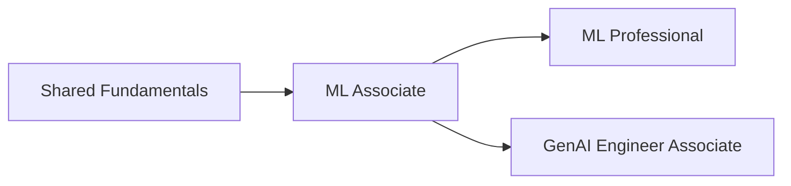

---
tags:
  - databricks
  - learning-path
  - machine-learning
aliases:
  - ML Learning Path
---

# ML Engineer Learning Path

A recommended progression from ML Associate through ML Professional, with an optional GenAI Engineer branch.

## Path Overview

## Prerequisites

Before starting, you should have:

- Python proficiency (functions, classes, libraries)
- Statistics and linear algebra basics
- Understanding of supervised and unsupervised learning concepts
- Familiarity with pandas and scikit-learn
- Basic SQL knowledge

## Phase 1: Shared Fundamentals

Start with the core platform concepts relevant to ML workloads.

| Topic | Priority | Link |
| ----- | -------- | ---- |
| Platform Architecture | High | [Platform Architecture](../shared/fundamentals/platform-architecture.md) |
| Databricks Workspace | High | [Databricks Workspace](../shared/fundamentals/databricks-workspace.md) |
| Spark Fundamentals | High | [Spark Fundamentals](../shared/fundamentals/spark-fundamentals.md) |
| Delta Lake Basics | Medium | [Delta Lake Basics](../shared/fundamentals/delta-lake-basics.md) |
| Unity Catalog Basics | Medium | [Unity Catalog Basics](../shared/fundamentals/unity-catalog-basics.md) |

## Phase 2: ML Associate

Focus areas based on exam weight:

Exam version Mar 1, 2025 (guide PDF re-issued Aug 2026) — 4 domains, 48 questions:

| Domain | Weight | Key Topics |
| ------ | ------ | ---------- |
| Databricks Machine Learning | 38 % | ML Runtime, AutoML, feature tables in Unity Catalog, MLflow |
| Model Development | 31 % | Spark ML, hyperparameter tuning, evaluation |
| Data Processing ("ML Workflows" on the cert page) | 19 % | Data prep, feature engineering |
| Model Deployment | 12 % | Batch, streaming, and real-time (Model Serving) inference |

See the full study guide: [ML Associate](../certifications/ml-associate/README.md)

### Key Concepts

- MLflow experiment tracking and model logging
- Feature Store for feature management and reuse
- Hyperparameter tuning with Hyperopt
- Spark ML pipelines (Transformers, Estimators)
- AutoML for baseline model creation

## Phase 3: Choose Your Path

After ML Associate, you can pursue either or both certifications:

### Option A: ML Professional

For deeper MLOps and production ML expertise.

Exam version Sep 30, 2025 (guide PDF re-issued Aug 2026) — 3 domains, 59 questions:

| Domain | Weight | Key Topics |
| ------ | ------ | ---------- |
| Model Development | 44 % | Advanced experimentation, Spark ML at scale, Feature Store concepts |
| ML Ops | 44 % | Model lifecycle, testing, monitoring and drift |
| Model Deployment | 12 % | Model Serving, batch and streaming inference |

See the full study guide: [ML Professional](../certifications/ml-professional/README.md)

### Option B: GenAI Engineer Associate

For LLM application development and RAG architectures.

Exam version Mar 18, 2026 — 6 domains, 45 questions:

| Domain | Weight | Key Topics |
| ------ | ------ | ---------- |
| Application Development | 30 % | Agents, tools, MCP, prompt engineering |
| Assembling and Deploying Applications | 22 % | Agent Framework, Model Serving deployment |
| Design Applications | 14 % | RAG and agent design |
| Data Preparation | 14 % | Chunking, embeddings, Vector Search (now AI Search) |
| Evaluation and Monitoring | 12 % | MLflow evaluation, inference tables |
| Governance | 8 % | Guardrails, AI Gateway, Unity Catalog |

See the full study guide: [GenAI Engineer Associate](../certifications/genai-engineer-associate/README.md)

### Key Technologies

- Databricks Vector Search (now called AI Search in the docs)
- Foundation Model APIs
- LangChain integration
- Model Serving endpoints (for new code agents, Databricks now recommends the Agent Bricks CLI on Agent Runtime)

## Study Tips

1. **Use notebooks** - Databricks notebooks are ideal for ML experimentation
2. **Learn MLflow thoroughly** - It is central to both ML certifications
3. **Practice with real data** - Use Databricks sample datasets
4. **Understand trade-offs** - Professional exams test architecture decisions
5. **Review glossary** - See [Glossary](../shared/appendix/glossary.md)

## Related Paths

- [Data Engineer Path](data-engineer-path.md) - Recommended if you need stronger data engineering fundamentals

## Official Resources

- [Databricks Certifications](https://www.databricks.com/learn/certification)
- [Databricks Academy](https://www.databricks.com/learn/training)
- [MLflow Documentation](https://mlflow.org/docs/latest/index.html)
